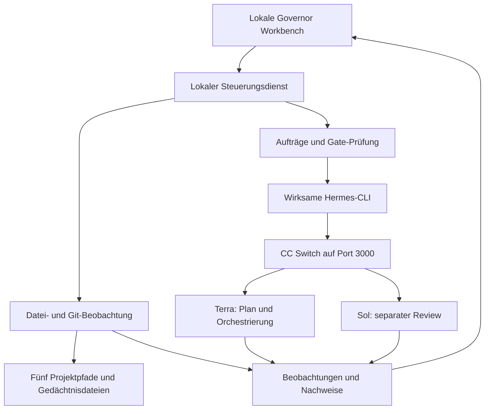

# Governor Workbench: konkreter Oberflächen- und Betriebsentwurf

Stand: 11.09.2026. Vom Benutzer zur Umsetzung bestätigt, einschließlich optionalem Astra-Supervisor und Windows-Dauerbetrieb. Historischer Entwurf; der implementierte Stand ist in README.md, DEVELOPER_GUIDE.md und VERIFICATION.md dokumentiert. Ausgangspunkt sind die zwei bereitgestellten Bilder und die Bestandsprüfung in `GOVERNOR_BESTANDSPRUEFUNG_2026-09-11.md`.

## Ziel

Die fünf Projekte aus einer lokalen Browseroberfläche beobachten, priorisierte Schritte prüfen und per Klick über Hermes ausführen; Gedächtnisdateien ohne Copy/Paste bearbeiten. Die vorhandene Terra/Sol-/CC-Switch-Konfiguration bleibt die Modellbasis. Bestehende Produktfreigaben werden nicht durch eine UI-Installation aufgehoben.

## Empfohlener Ansatz und Alternativen

Empfohlen ist eine eigenständige lokale Governor Workbench mit Python-Dienst und Browseroberfläche. Sie lässt sich unabhängig von Aurelias eingefrorenem Produktstand entwickeln und passt zur vorhandenen Python-/Hermes-Installation. Der Dienst bedient ausschließlich Loopback und kommuniziert mit dem Browser über HTTP und Server-Sent Events für Live-Daten.

Eine Erweiterung der bestehenden Hermes-Weboberfläche wäre möglich, würde aber die Lösung an deren interne Version und Updatezyklen koppeln. Eine primäre Browserfernsteuerung über CDP wäre ebenfalls möglich, bringt für eine eigene Dashboard-Seite jedoch eine zusätzliche Browser-Prozessabhängigkeit. CDP bleibt deshalb ein optionaler Diagnose-/Browserprüfpfad. Die gewünschte Bedienung ohne Copy/Paste benötigt keinen fernsteuerbaren Chrome-Prozess.

## Bildschirmaufbau

Deutsche Oberfläche, ruhige dunkle Farbgebung, gut lesbare Tabellen, klare Statusfarben mit ausgeschriebenen Bezeichnungen. Desktop: zentrale Matrix mit rechter Detail-/Aktionsspalte; darunter Live-Protokoll. Kleine Bildschirme: dieselben Bereiche untereinander. Keine erfundenen Prozentwerte für Projektreife.

1. **Kopfzeile:** Governor-Beobachtung läuft/pausiert, letzte erfolgreiche Aktualisierung, CC Switch erreichbar, Hermes-Ausführung aktiv/inaktiv, Terra-/Sol-Prüfstatus.
2. **Projektmatrix:** Aurelia, RadiWorks, Modul_Templates, Radi144, morphic_v1. Pro Zeile dokumentierter Gate-Status, aktuelle Git-/Gedächtnisbeobachtung, letzte nachgewiesene Prüfung, nächster Schritt und offene Abhängigkeiten.
3. **Projektdetails:** Aufgelöster Pfad, Worktree, HEAD, Quellen mit SHA-256 und Zeitstempel, vorhandene Änderungen, widersprüchliche Statusquellen. Ein Klick auf eine Quelle öffnet deren Text lesbar innerhalb der Oberfläche.
4. **Nächster Schritt:** Ziel, Begründung, betroffene Projekte/Dateien, Voraussetzungen, konkrete Aktion, erwartetes Ergebnis. „Prüfen“ bzw. „Ausführen“ startet exakt diese Aktion. Bei gesperrten Gates bleibt die Ausführung gesperrt und der Grund sichtbar.
5. **Live-Protokoll:** Zeit, Projekt, Phase, Quelle und Ausgabe; Filter für Governor/Hermes/Terra/Sol/Tests. Fehler sind auch nach einem Neuladen sichtbar. Unterbrochene Läufe erscheinen nicht als erfolgreich.
6. **Gedächtnis:** Auswahl vorhandener `project_memories/*.md`, Texteditor, Änderungsvergleich, explizites Speichern mit Sicherungskopie. Ungespeicherte Änderungen bleiben bei Projektwechsel erkennbar. Keine automatische Überschreibung bei externen Änderungen.
7. **Prüfverlauf:** Nachweise, Rückgabecodes, Prüfbasis, Modellidentitäten und Supervisor-Voten je Lauf. Ein grüner Testlauf bedeutet nicht automatisch eine Integrationsfreigabe.

## Datenfluss

Die Beobachtung verarbeitet Dateiänderungen automatisch. Eine Dateiänderung löst nicht automatisch einen kostenpflichtigen Modelllauf oder eine Produktänderung aus. Beobachtungsbetrieb und Ausführungsbetrieb sind getrennte, sichtbare Zustände.

## Wahrheitsmodell

Jede Aussage trägt eine Quelle, einen Prüfzeitpunkt und einen Typ:

- **Dokumentiert:** bestehende Strategie, Gate oder Snapshot-Aussage.
- **Lokal beobachtet:** Pfad, Git-Status, Dateihash, Port oder Prozess.
- **Ausgeführt:** konkrete Prüfung mit Rückgabecode und gebundener Eingabe.
- **Reviewt:** dokumentiertes unabhängiges Votum für genau diesen Stand.
- **Freigegeben:** ausdrückliche Betreiberentscheidung für einen festgelegten Umfang.

Fehlende Quellen und Zugriffsfehler werden als „nicht geprüft“ oder „nicht lesbar“ angezeigt. Sie fallen nicht auf einen alten grünen Status zurück. Ändern sich Eingabedateien, wird ein daran gebundener Review als veraltet markiert. Bei widersprechenden Governance-Quellen entscheidet das System nicht anhand des Dateinamens oder anhand eines einzelnen grünen Tests.

## Reihenfolge bei der ersten Inbetriebnahme

1. Fünf Pfade, Manifest, Snapshot und Gedächtnisdateien erfassen; neue Bestandsaufnahme mit Hashes erstellen.
2. Die gefundenen Statuswidersprüche anzeigen. Radi144-Dateien im Index von tatsächlich committierten Dateien unterscheiden.
3. Die echte Hermes-CLI aus dem PATH beziehungsweise ihrem aufgelösten Launcher anbinden. Nicht stillschweigend die zweite Installation im Benutzerordner verwenden.
4. Routerprüfung und je einen begrenzten frischen Terra-/Sol-Aufruf getrennt prüfen. Bei Fehlern keine Hybrid-Funktionsbestätigung aussprechen.
5. Den ersten fachlichen Vorschlag aus der bestehenden priorisierten RadiWorks-Contract-Intake-Spur erzeugen. Aurelias Ground-Zero-Gate bleibt eine Voraussetzung für Adapter-/Registry-Arbeit. Morphic und Radi144 behalten ihre eigenen G0-/Review-Gates; Modul_Templates bleibt eine passive Vertragsautorität.

## Ausführung und hybrider Review

Terra erhält ein gezielt zusammengestelltes, quellengebundenes Kontextpaket. Dokumentinhalte gelten als Daten; sie dürfen weder Betriebsvorgaben noch Freigaben überschreiben. Der Plan muss Voraussetzungen und den vorgeschlagenen Umfang nennen.

Sol erhält in einem getrennten Lauf dieselbe eingefrorene Evidenz und das zu prüfende Ergebnis. Seine Antwort wird mit tatsächlichem Modell, Session, Zeitpunkt und Eingabehash protokolliert. Ein fehlender, fehlgeschlagener oder durch Fallback ersetzter Review wird entsprechend markiert. Die Oberfläche darf „unabhängig geprüft“ nicht allein aus der Delegationskonfiguration ableiten.

Ein Auftrag durchläuft `vorgeschlagen → bereit/gesperrt → läuft → Prüfung → erfolgreich/fehlgeschlagen/abgebrochen`. Doppelklicks erzeugen keine doppelten Aufträge. Laufzeitbegrenzung, Abbruch und Wiederanlauf nach einem Dienstabsturz gehören zum Lebenszyklus. Repositories werden pro mutierender Aufgabe gesperrt, damit nicht zwei Schritte denselben Arbeitsbaum gleichzeitig verändern.

Die erste Version bietet feste Aktionen für Aktualisierung, lesende Bestands-/Reviewaufträge und den überprüften RadiWorks-Testlauf. Fachliche Implementierungsaufträge benötigen einen konkret angezeigten Umfang und eine gültige Gatefreigabe; kein frei ausführbares Shellfeld. Ein Klick überträgt keine pauschale Freigabe für Commit, Migration oder Serveränderungen.

## Gedächtnis- und Vault-Schreiben

Editorziele stammen ausschließlich aus den konfigurierten Projektgedächtnisordnern. Pfadnavigation und symbolische Verweise dürfen diesen Bereich nicht verlassen. Vor dem Schreiben werden Inhaltshash und letzter gelesener Stand verglichen. Bei Drift wird der Unterschied angezeigt statt überschrieben.

Speichern erzeugt eine versionierte Sicherung und einen Audit-Eintrag. Ein erfolgreicher Speichervorgang wird erst nach dem tatsächlichen Schreiben und Rücklesen angezeigt. Entwürfe lassen sich zusätzlich im Workbench-Arbeitsordner speichern. Ein historischer Vault-Spiegel wird nicht unbemerkt zur Hauptquelle gemacht oder in beide Richtungen automatisch synchronisiert.

## Lokale Betriebsgrenze

Der Dienst bindet an `127.0.0.1` auf einem vorab geprüften freien Port, getrennt vom belegten CC-Switch-Port 3000. Browserzugriffe erhalten eine lokale Sitzung; mutierende Aufrufe benötigen gültige Sitzung und Origin-/CSRF-Prüfung. Prozesse werden mit Argumentlisten statt zusammengesetzten Shellstrings gestartet. Konfiguration und Zugangsdaten werden nicht an den Browser ausgegeben.

Start und Stop erfolgen über mitgelieferte lokale Launcher. Ein Windows-Autostart ist eine gesondert sichtbare Betriebsoption nach erfolgreicher Erprobung. Der bestehende Hermes-Gateway muss für diese lokale Oberfläche nicht automatisch aktiviert werden.

## Umsetzungspakete und Abnahme

### A. Beobachtung und Matrix

Implementierung: Quellenadapter, Hash-/Git-Erfassung, gespeicherte Beobachtungen, Matrix und Quelldetails. Tests: fehlende Pfade, fehlerhaftes JSON, staged/untracked/committed Gedächtnisdateien, externe Änderungen, widersprüchliche Gatequellen. Abnahme: fünf reale Pfade sichtbar, jede Statusbehauptung auf ihren Beleg zurückführbar.

### B. Aktionen und Live-Ausgaben

Implementierung: Auftragsqueue, feste Aktionen, Prozessausgabe, Abbruch, Zeitlimit, Ereignisstream und Wiederanlauf. Tests: doppelte Starts, Fehlerexit, Streamabriss, Neustart während eines Auftrags und Verweigerung ungültiger Aktionen. Abnahme: ein RadiWorks-Testlauf lässt sich per Klick starten und mit seinem tatsächlichen Ergebnis nachvollziehen.

### C. Hermes und zwei Modellrollen

Implementierung: CLI-Adapter, Kontextpaket, Terra-Plan, separater Sol-Review, Anzeige tatsächlicher Modell-/Routingergebnisse. Tests: fehlende CLI, nicht erreichbarer Router, Inferenzfehler, Fallback, fehlender Reviewer und veraltete Eingabehashes. Abnahme: zwei frische, zuordenbare Modellläufe; kein falsches GO bei einem negativen oder fehlenden Review.

### D. Gedächtnis und Betriebsübergabe

Implementierung: Editor, Konfliktanzeige, Sicherung, Audit, Launcher und Betriebsanleitung. Tests: Traversal, Verweis aus dem erlaubten Ordner, Schreibfehler, konkurrierendes Editieren, ungültige Sitzung/Origin. Browserprüfung auf Desktop und kleinem Bildschirm einschließlich Tastaturbedienung. Abnahme: Speichern/Rücklesen und Konfliktverhalten mit isolierten Testdateien nachgewiesen; keine bestehenden Projektgedächtnisse zum Test überschrieben.

## Status dieses Dokuments

Dieser Entwurf wurde vom Benutzer bestätigt. Die Workbench wurde anschließend implementiert; die konkrete Verifikation und verbleibende Grenzen stehen in VERIFICATION.md. Die Freigabe der Implementierung ersetzt keine Freigabe für die Übermittlung echter Projektinhalte oder spätere fachliche Produktänderungen.
