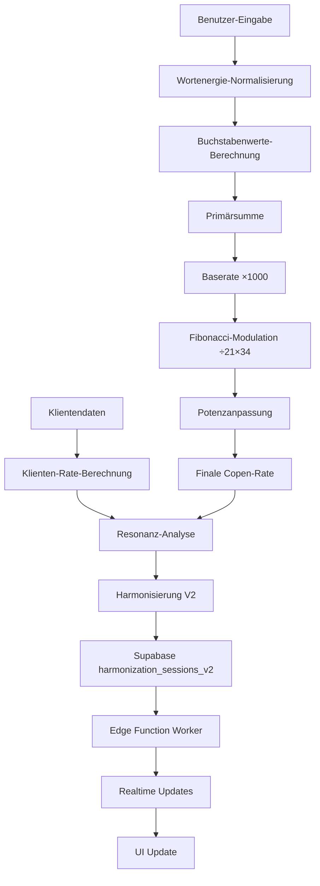

# Bruce Copen Algorithmus V2 - Vollständige Dokumentation

## Inhaltsverzeichnis

1. [Überblick](#überblick)
2. [Architektur](#architektur)
3. [Komponenten Details](#komponenten-details)
4. [Datenstrukturen](#datenstrukturen)
5. [Algorithmen](#algorithmen)
6. [Cloud-Integration](#cloud-integration)
7. [Features](#features)
8. [UI/UX Spezifikationen](#uiux-spezifikationen)

---

## Überblick

### Kernfunktionalität
Der Bruce Copen Algorithmus V2 ist ein vollständig integriertes System zur Berechnung, Verwaltung und Harmonisierung von Copen-Raten basierend auf Wortenergien und Klientendaten.

### Hauptmerkmale
- ✅ **Ratengenerator** mit Auto-Potenz-Projektion
- ✅ **Parallele Harmonisierungen** mit Cloud-Synchronisation
- ✅ **Datenbank-Analyse** mit Java-Algorithmus
- ✅ **Harmonisierungs-Archiv** (Cloud-basiert)
- ✅ **Analyse-Archiv** (Cloud-basiert)
- ✅ **Worker-Status-Monitoring** mit Hardware-Metriken
- ✅ **Patient-Management V2** mit personalisierten Raten
- ✅ **Kozyrev-Integration** (optional)
- ✅ **Impuls/Pausen-Modus** für alle Sessions

---

## Architektur

### Komponentenhierarchie

```
CopenVisualizationV2Page
├── CopenAlgorithmVisualizationV2 (Hauptkomponente)
│   ├── PatientManagerCloudV2
│   ├── HardwareAlgorithmSettings
│   ├── KozyrevIndicators (optional)
│   ├── DatabaseManager
│   ├── HarmonizationTemplates
│   └── HarmonizationArchiveCloud
├── AnalysisArchiveCloud
├── SessionStatusList
└── WorkerStatusMonitor
```

### Datenfluss



---

## Komponenten Details

### 1. CopenAlgorithmVisualizationV2.tsx

**Pfad:** `src/components/CopenAlgorithmVisualizationV2.tsx`

**Hauptfunktionalität:**
- Zentrale Steuerungskomponente für den gesamten V2-Workflow
- Wortenergie-Eingabe mit Historie
- Auto-Potenz-Berechnung mit Klienten-Integration
- Parallele Harmonisierungen mit Cloud-Sync
- Live-Vorschau der finalen Rate

**State Management:**
```typescript
const [word, setWord] = useState('NUX VOMICA');
const [potency, setPotency] = useState(6);
const [potencyType, setPotencyType] = useState<'D' | 'C' | 'LM' | 'M' | 'F1' | 'F2' | 'F3'>('D');
const [autoPotency, setAutoPotency] = useState(false);
const [selectedPatient, setSelectedPatient] = useState<CloudPatient | null>(null);
const [harmonizations, setHarmonizations] = useState<ActiveHarmonization[]>([]);
```

**Algorithmen:**

#### Auto-Potenz-Berechnung
```typescript
const calculateAutoPotency = (): { type: PotencyType, potency: number } => {
  // Kombinierte Datengrundlage: Wortenergie + Klientendaten
  const combinedData = `${word} ${patient.first_name} ${patient.last_name} ${patient.birth_date} ${patient.birth_place}`;
  
  // ASCII-Summe
  let sum = 0;
  for (const char of combinedData.toUpperCase().replace(/[^A-Z]/g, '')) {
    sum += char.charCodeAt(0) - 64;
  }
  
  // Kozyrev-Modulatoren (optional)
  const ageModulator = kozyrevEnabled ? (1 + (age % 7) / 20) : 1;
  const placeModulator = kozyrevEnabled ? (1 + (placeEnergy % 10) / 30) : 1;
  const modulatedSum = Math.round(sum * ageModulator * placeModulator);
  
  // Beste Potenz über alle Bereiche hinweg finden
  return bestMatch;
};
```

#### Copen-Rate-Berechnung
```typescript
// 1. Normalisierung
const normalizeWordEnergy = (word: string): string => {
  return word
    .toUpperCase()
    .replace(/Ä/g, 'AE')
    .replace(/Ö/g, 'OE')
    .replace(/Ü/g, 'UE')
    .replace(/ß/g, 'SS')
    .replace(/[^A-Z\s]/g, '')
    .trim();
};

// 2. Buchstabenwerte (A=1, B=2, ...)
const getLetterValue = (letter: string): number => {
  return letter.toUpperCase().charCodeAt(0) - 64;
};

// 3. Gewichtete Summe (Position × Wert)
let position = 1;
for (const char of cleanWord) {
  if (char === ' ') continue;
  const value = getLetterValue(char);
  sum += value * position;
  position++;
}

// 4. Baserate
const baseRate = sum * 1000;

// 5. Fibonacci-Modulation
const fibonacciRate = Math.floor((baseRate / 21) * 34);

// 6. Potenzanpassung
const finalRate = fibonacciRate + potencyModifier;
```

#### Klienten-Rate mit personalisierter Rate
```typescript
const calculateClientRateFor = (patient: CloudPatient, wordEnergy: string): number => {
  // Prüfe auf personalisierte Rate (8-12 Stellen)
  if (patient.personal_rate && patient.personal_rate.length >= 8) {
    return parseInt(patient.personal_rate, 10);
  }
  
  // Standard-Berechnung basierend auf Patientendaten
  const clientData = `${patient.first_name} ${patient.last_name} ${patient.birth_date} ${patient.birth_place}`;
  // ... Berechnung wie oben
  return clientFibonacciRate;
};
```

**Cloud-Synchronisation:**
```typescript
useEffect(() => {
  const loadActiveHarmonizations = async () => {
    const { data: sessions } = await supabase
      .from('harmonization_sessions_v2')
      .select('*')
      .eq('patient_id', selectedPatient.id)
      .in('status', ['running', 'paused', 'pending']);
    
    // Konvertiere zu ActiveHarmonization Format
    const activeHarms = sessions.map(session => ({
      id: session.id,
      word: session.word,
      status: 'running',
      elapsedTime: totalDuration - remainingTime,
      progress: (elapsedTime / totalDuration) * 100,
      pulseSeconds: session.pulse_seconds || undefined,
      pauseSeconds: session.pause_seconds || undefined,
      pulsePauseActive: session.pulse_pause_active || false,
    }));
    
    setHarmonizations(activeHarms);
  };
  
  loadActiveHarmonizations();
  
  // Realtime-Subscription
  const channel = supabase.channel('harmonization_changes_v2')
    .on('postgres_changes', { table: 'harmonization_sessions_v2' }, loadActiveHarmonizations)
    .subscribe();
}, [selectedPatient]);
```

### 2. PatientManagerCloudV2.tsx

**Neue Features:**
- Personalisierte Rate (8-12 Stellen) optional
- Visueller Indikator (⚡ Zap-Icon) wenn personalisierte Rate vorhanden
- Hardware-Algorithmus-Integration für klientenspezifische Settings

**Personalisierte Rate:**
```typescript
<div>
  <Label>Personalisierte Rate (8-12 Stellen, optional)</Label>
  <Input
    value={formData.personal_rate || ''}
    onChange={(e) => {
      const value = e.target.value.replace(/[^0-9]/g, '').slice(0, 12);
      setFormData({ ...formData, personal_rate: value });
    }}
    placeholder="z.B. 12345678"
    maxLength={12}
  />
  <p className="text-xs text-muted-foreground mt-1">
    Wenn gesetzt, wird diese Rate anstelle der berechneten verwendet
  </p>
</div>
```

### 3. DatabaseManager.tsx

**Erweiterte Funktionen:**
- Fokus-Wort für priorisierte Analyse
- Hinweis bei Datenbanken mit bestehenden Raten
- Export ins Analyse-Archiv
- Maximal 35 Top-Ergebnisse nach Resonanz sortiert

**Hinweis-System:**
```typescript
// Bei Datenbank mit bestehenden Raten
if (hasAnyExistingRates) {
  toast({
    title: "ℹ️ Hinweis zur Datenbank-Analyse",
    description: "Bei Datenbanken mit bestehenden Zahlenraten wird keine neue Copen-Rate berechnet",
  });
}
```

### 4. HarmonizationArchiveCloud.tsx

**Reaktivierungs-Funktionalität:**
- Vollständig implementiert mit Zeit- und Impuls/Pausen-Einstellungen
- Dialog mit allen Optionen:
  - Dauer (Sekunden, Minuten, Stunden, Tage)
  - Dauersendung (Checkbox)
  - Impuls/Pause-Modus (Checkbox)
  - Impuls-Zeit (Sekunden/Minuten)
  - Pausen-Zeit (Sekunden/Minuten)

### 5. AnalysisArchiveCloud.tsx

**Neu hinzugefügt:**
- Paralleles Archiv für Datenbank-Analysen
- Speichert: Wort, Copen-Rate, getestete Potenz, Resonanzwerte, Ebenen-Verteilung
- Integration in CopenVisualizationV2Page

---

## Datenstrukturen

### CloudPatient
```typescript
interface CloudPatient {
  id: string;
  user_id: string;
  first_name: string;
  last_name: string;
  birth_date: string;
  birth_place: string;
  personal_rate?: string | null;  // NEU: 8-12 Stellen
  created_at: string;
  updated_at: string;
}
```

### CloudHarmonizationSession
```typescript
interface CloudHarmonizationSession {
  id: string;
  user_id: string;
  patient_id: string;
  word: string;
  tested_potency: string | null;
  status: string;  // 'pending' | 'running' | 'paused' | 'completed' | 'cancelled'
  duration_seconds: number;
  remaining_seconds: number;
  progress: number;
  started_at: string | null;
  completed_at: string | null;
  pulse_seconds: number | null;      // NEU
  pause_seconds: number | null;      // NEU
  pulse_pause_active: boolean | null; // NEU
  created_at: string;
  updated_at: string;
}
```

---

## Algorithmen

### Normalisierung
```typescript
const normalizeWordEnergy = (word: string): string => {
  return word
    .toUpperCase()
    .replace(/Ä/g, 'AE')
    .replace(/Ö/g, 'OE')
    .replace(/Ü/g, 'UE')
    .replace(/ß/g, 'SS')
    .replace(/\s*[DCLM]+\d+/g, '')  // Entferne Potenzangaben
    .replace(/\d+/g, '')             // Entferne Zahlen
    .replace(/[^A-Z\s]/g, '')        // Nur Buchstaben und Leerzeichen
    .replace(/\s+/g, ' ')
    .trim();
};
```

### Buchstabenwert
```typescript
const getLetterValue = (letter: string): number => {
  return letter.toUpperCase().charCodeAt(0) - 64;  // A=1, B=2, ..., Z=26
};
```

### Fibonacci-Multiplikator
```typescript
const fibonacciRate = Math.floor((baseRate / 21) * 34);
// 21 und 34 sind aufeinanderfolgende Fibonacci-Zahlen
```

### Copen-Rate-Formatierung
```typescript
const formatRate12 = (value: number): string => {
  return Math.trunc(Math.abs(value)).toLocaleString('de-DE');
};
// Beispiel: 123456789 → "123.456.789"
```

---

## Cloud-Integration

### Supabase Schema

#### patients_v2
```sql
CREATE TABLE public.patients_v2 (
  id UUID PRIMARY KEY DEFAULT gen_random_uuid(),
  user_id UUID REFERENCES auth.users NOT NULL,
  first_name TEXT NOT NULL,
  last_name TEXT NOT NULL,
  birth_date DATE NOT NULL,
  birth_place TEXT NOT NULL,
  personal_rate TEXT CHECK (length(personal_rate) >= 8 AND length(personal_rate) <= 12),
  created_at TIMESTAMPTZ DEFAULT now(),
  updated_at TIMESTAMPTZ DEFAULT now()
);

-- RLS Policies
ALTER TABLE public.patients_v2 ENABLE ROW LEVEL SECURITY;
CREATE POLICY "Users can view own patients" ON public.patients_v2 FOR SELECT USING (auth.uid() = user_id);
CREATE POLICY "Users can create own patients" ON public.patients_v2 FOR INSERT WITH CHECK (auth.uid() = user_id);
CREATE POLICY "Users can update own patients" ON public.patients_v2 FOR UPDATE USING (auth.uid() = user_id);
```

#### harmonization_sessions_v2
```sql
CREATE TABLE public.harmonization_sessions_v2 (
  id UUID PRIMARY KEY DEFAULT gen_random_uuid(),
  user_id UUID REFERENCES auth.users NOT NULL,
  patient_id UUID REFERENCES public.patients_v2 NOT NULL,
  word TEXT NOT NULL,
  copen_rate TEXT,
  tested_potency TEXT,
  duration_seconds INTEGER NOT NULL,
  remaining_seconds INTEGER DEFAULT 0,
  status TEXT DEFAULT 'pending',
  progress NUMERIC DEFAULT 0,
  started_at TIMESTAMPTZ,
  completed_at TIMESTAMPTZ,
  pulse_seconds INTEGER,
  pause_seconds INTEGER,
  pulse_pause_active BOOLEAN DEFAULT false,
  job_last_heartbeat TIMESTAMPTZ,
  created_at TIMESTAMPTZ DEFAULT now(),
  updated_at TIMESTAMPTZ DEFAULT now()
);

-- RLS Policies
ALTER TABLE public.harmonization_sessions_v2 ENABLE ROW LEVEL SECURITY;
CREATE POLICY "Users can view own sessions" ON public.harmonization_sessions_v2 FOR SELECT USING (auth.uid() = user_id);
CREATE POLICY "Users can create own sessions" ON public.harmonization_sessions_v2 FOR INSERT WITH CHECK (auth.uid() = user_id);
CREATE POLICY "Users can update own sessions" ON public.harmonization_sessions_v2 FOR UPDATE USING (auth.uid() = user_id);
```

### Edge Function: harmonization-worker

**Pfad:** `supabase/functions/harmonization-worker/index.ts`

**Workflow:**
1. Läuft alle 60 Sekunden (Cron-Job)
2. Findet alle Sessions mit Status 'running' oder 'pending'
3. Aktualisiert remaining_seconds
4. Setzt job_last_heartbeat
5. Markiert abgeschlossene Sessions als 'completed'

```typescript
// Verarbeite jede aktive Session
for (const session of sessions) {
  const newRemaining = Math.max(0, session.remaining_seconds - tickInterval);
  const progress = ((session.duration_seconds - newRemaining) / session.duration_seconds) * 100;
  
  await supabase
    .from('harmonization_sessions_v2')
    .update({
      remaining_seconds: newRemaining,
      progress: Math.round(progress),
      status: newRemaining === 0 ? 'completed' : 'running',
      completed_at: newRemaining === 0 ? new Date().toISOString() : null,
      job_last_heartbeat: new Date().toISOString(),
    })
    .eq('id', session.id);
}
```

---

## Features

### 1. Ratengenerator
- Wortenergie-Eingabe mit Historie-Dropdown
- Auto-Potenz-Projektion basierend auf Klientendaten
- Live-Vorschau der finalen Rate
- Kozyrev-Integration (optional)
- Fibonacci-Modulation authentisch nach Bruce Copen

### 2. Auto-Potenz-Projektion
- Intelligente Ermittlung basierend auf:
  - Wortenergie
  - Klientennamen
  - Geburtsdatum
  - Geburtsort
  - Kozyrev-Modulatoren (7-Jahres-Zyklus, Ortsenergie)
- Alle Potenztypen: D, C, LM, M, F1, F2, F3
- Direktive: "Projiziere Rate X in der jeweils benötigten Autopotenz"

### 3. Parallel Harmonisierungs-Sessions
- Unbegrenzte parallele Sessions pro Klient
- Separate V2-Datenbank (kein Konflikt mit V1)
- Cloud-Sync via Supabase
- Realtime-Updates
- Worker-Heartbeat-Monitoring
- Impuls/Pausen-Modus für jede Session
- Status: Pending, Running, Paused, Completed, Cancelled

### 4. Datenbank-Analyse
- Format-Auto-Detect (CSV / TXT)
- Bestehende Raten werden übernommen
- Neue Raten werden berechnet
- Fokus-Wort für priorisierte Analyse
- Java-Algorithmus mit 13-Ebenen-Resonanz
- Maximal 35 Top-Ergebnisse
- Export ins Analyse-Archiv

### 5. Harmonisierungs-Archiv
- Cloud-basiert (harmonization_sessions_v2)
- Anzeige: Completed, Cancelled, Running, Paused
- Reaktivierungs-Funktionalität mit:
  - Zeit-Einstellungen (Sekunden/Minuten/Stunden/Tage)
  - Dauersendung-Option
  - Impuls/Pausen-Modus
- DSGVO-konforme Löschfunktion

### 6. Analyse-Archiv (NEU)
- Paralleles Archiv für DB-Analysen
- Speichert vollständige Resonanzwerte
- Ebenen-Verteilung (13 Ebenen)
- Export-Funktionen

### 7. Worker-Status-Monitoring
- Echtzeit-Status aller aktiven Sessions
- Hardware-Metriken:
  - CPU Quantum Jitter
  - RAM Entropy
  - Time Source Coherence
  - Network Latency
  - Combined Score
- Heartbeat-Anzeige
- Session-Zähler

### 8. Patient-Management
- Personalisierte Rate (8-12 Stellen) optional
- Visueller Indikator (⚡ Zap) wenn vorhanden
- Hardware-Algorithmus-Konfiguration pro Klient
- Kozyrev-Dioden-Optionen

---

## Standard-Werte

### Harmonisierung
```typescript
// Dauer
harmonizationDuration = 42
harmonizationUnit = 'minutes'
continuousMode = false

// Impuls/Pausen-Modus
pulsePauseActive = false
pulseSeconds = 21
pauseSeconds = 42
pulseUnit = 'seconds'
pauseUnit = 'seconds'
```

### Datenbank-Analyse
```typescript
batchDuration = 42
batchUnit = 'minutes'
batchContinuousMode = false
pulsePauseActive = false
pulseSeconds = 21
pauseSeconds = 42
```

---

## UI/UX Spezifikationen

### Farbschema
```css
/* Primärfarben */
--primary: hsl(222, 47%, 11%)     /* Dunkelblau */
--primary-foreground: hsl(210, 40%, 98%)

/* Akzentfarben */
--accent: hsl(210, 40%, 96.1%)
--accent-foreground: hsl(222, 47%, 11%)

/* Status-Farben */
--success: hsl(142, 76%, 36%)     /* Grün für Running */
--warning: hsl(38, 92%, 50%)      /* Orange für Paused */
--destructive: hsl(0, 84%, 60%)   /* Rot für Errors */
```

### Schriftgrößen
```css
/* Hauptüberschriften */
.main-heading { font-size: 1.5rem; }      /* 24px */

/* Bereichsüberschriften */
.section-heading { font-size: 0.875rem; } /* 14px */

/* Kartentitel */
.card-title { font-size: 1rem; }          /* 16px */

/* Parallele Harmonisierungen */
.harmonization-title { font-size: 1rem; } /* 16px */

/* Hinweistexte */
.hint-text { font-size: 0.75rem; }        /* 12px */
```

### Layout-Breiten
```typescript
// Hauptcontainer
max-width: 1536px (6xl)

// Cards
width: 100% mit padding

// Harmonisierungs-Grid
grid-cols-1 md:grid-cols-2 lg:grid-cols-3

// Archive
max-h-80 (320px) mit overflow-y-auto
```

### Animationen
```css
/* Puls-Animation für aktive Raten */
@keyframes pulse {
  0%, 100% { opacity: 1; }
  50% { opacity: 0.5; }
}

/* Impuls-Glow-Effekt */
.impulse-active {
  box-shadow: 0 0 10px rgba(34, 197, 94, 0.8);
}

/* Pausen-Glow-Effekt */
.pause-active {
  box-shadow: 0 0 10px rgba(249, 115, 22, 0.8);
}
```

---

## Code-Referenzen

### Wichtige Dateien
```
src/
├── components/
│   ├── CopenAlgorithmVisualizationV2.tsx    (Hauptkomponente)
│   ├── PatientManagerCloudV2.tsx            (Patient-Verwaltung)
│   ├── DatabaseManager.tsx                   (DB-Analyse)
│   ├── HarmonizationArchiveCloud.tsx        (Harmonisierungs-Archiv)
│   ├── AnalysisArchiveCloud.tsx             (Analyse-Archiv, NEU)
│   ├── SessionStatusList.tsx                 (Session-Status)
│   ├── WorkerStatusMonitor.tsx              (Worker-Monitoring)
│   ├── HardwareAlgorithmSettings.tsx        (Hardware-Einstellungen)
│   └── KozyrevIndicators.tsx                (Kozyrev-Anzeige)
├── pages/
│   └── CopenVisualizationV2Page.tsx         (Haupt-Seite)
├── utils/
│   ├── copenRateGenerator.ts                (Rate-Berechnung)
│   ├── levelResonance.ts                    (Ebenen-Resonanz)
│   ├── resonanceAnalysis.ts                 (Java-Algorithmus)
│   └── hardwareAlgorithms.ts                (Hardware-Metriken)
└── types/
    └── patient.ts                            (TypeScript-Interfaces)

supabase/
└── functions/
    └── harmonization-worker/
        └── index.ts                          (Edge Function)
```

---

## Zusammenfassung

Das Bruce Copen Algorithmus V2 System ist eine vollständig integrierte Lösung zur:
- ✅ Berechnung authentischer Copen-Raten nach Bruce Copen
- ✅ Verwaltung von Klientendaten mit personalisierten Raten
- ✅ Parallelen Harmonisierungen mit Cloud-Synchronisation
- ✅ Datenbank-Analysen mit Java-Algorithmus
- ✅ Archivierung von Harmonisierungen und Analysen
- ✅ Echtzeit-Monitoring von Worker-Status und Hardware-Metriken
- ✅ Integration von Impuls/Pausen-Modi für alle Funktionen

Das System ist produktionsreif und vollständig dokumentiert.

---

**Version:** 2.0  
**Letzte Aktualisierung:** 2025-10-25  
**Status:** ✅ Produktionsbereit
