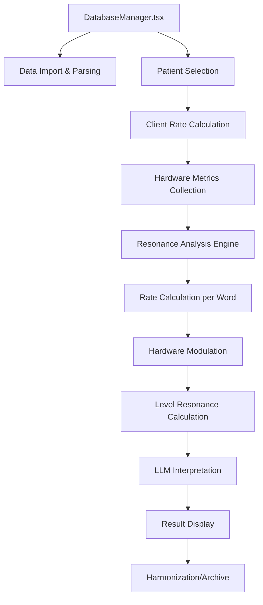
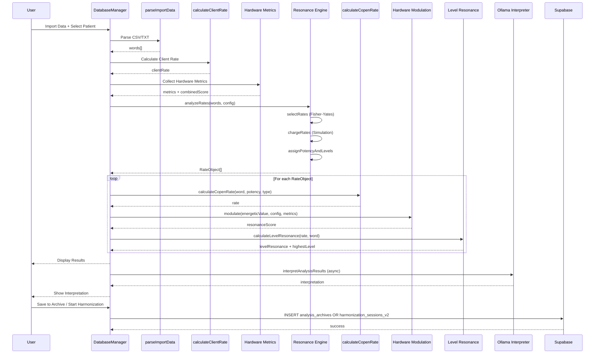
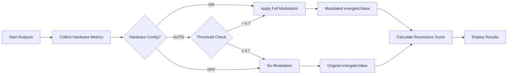

# Bruce Copen DB-Analyse: Kompletter Ablauf mit Hardware-Algorithmen
## Entwickler-Dokumentation in maximaler Detailtiefe

**Version:** 2.0 - Hardware-Erweitert  
**Stand:** November 2025  
**Zielgruppe:** Entwickler zur Weiterentwicklung und Wartung

---

## 📋 Inhaltsverzeichnis

1. [Architektur-Übersicht](#1-architektur-übersicht)
2. [Phase 0: Initialisierung & Konfiguration](#2-phase-0-initialisierung--konfiguration)
3. [Phase 1: Datenimport & Parsing](#3-phase-1-datenimport--parsing)
4. [Phase 2: Klienten-Rate-Berechnung](#4-phase-2-klienten-rate-berechnung)
5. [Phase 3: Hardware-Metriken-Erfassung](#5-phase-3-hardware-metriken-erfassung)
6. [Phase 4: Resonanzanalyse-Engine](#6-phase-4-resonanzanalyse-engine)
7. [Phase 5: Wort-Raten-Berechnung](#7-phase-5-wort-raten-berechnung)
8. [Phase 6: Hardware-Modulation](#8-phase-6-hardware-modulation)
9. [Phase 7: Ebenen-Resonanz-Berechnung](#9-phase-7-ebenen-resonanz-berechnung)
10. [Phase 8: LLM-Interpretation](#10-phase-8-llm-interpretation)
11. [Phase 9: Ergebnis-Darstellung & Sortierung](#11-phase-9-ergebnis-darstellung--sortierung)
12. [Phase 10: Harmonisierung & Archivierung](#12-phase-10-harmonisierung--archivierung)
13. [Vollständiges Berechnungsbeispiel](#13-vollständiges-berechnungsbeispiel)
14. [Datenfluss-Diagramme](#14-datenfluss-diagramme)
15. [Code-Referenzen](#15-code-referenzen)
16. [Optimierungshinweise](#16-optimierungshinweise)

---

## 1. Architektur-Übersicht

### 1.1 Systemkomponenten



### 1.2 Datei-Struktur

```
src/
├── components/
│   └── DatabaseManager.tsx          # Hauptkomponente (1341 Zeilen)
├── utils/
│   ├── copenRateGenerator.ts       # Bruce Copen Algorithmus V4
│   ├── resonanceAnalysis.ts        # Java-Port: Resonanz-Engine
│   ├── levelResonance.ts           # 13-Ebenen-Modell
│   ├── hardwareAlgorithms.ts       # Hardware-Metriken
│   ├── analysisInterpreter.ts      # LLM-Integration
│   ├── ollamaClient.ts             # Ollama-Client
│   ├── potencyText.ts              # Potenz-Konvertierung
│   └── alphabetSystems.ts          # Alphabet-Mappings
├── types/
│   └── patient.ts                   # Patient & HardwareConfig
└── db/
    └── AppDatabase.ts               # Dexie IndexedDB
```

### 1.3 Externe Abhängigkeiten

- **Supabase**: Backend (patients_v2, analysis_archives_v2, harmonization_sessions_v2)
- **Ollama**: LLM-Server (localhost:11434) für Interpretation & Bildsignaturen
- **Hardware APIs**: performance.now(), WebGL, Navigator APIs

---

## 2. Phase 0: Initialisierung & Konfiguration

### 2.1 Component State

**Datei:** `src/components/DatabaseManager.tsx` (Zeilen 57-103)

```typescript
// Haupt-State
const [importData, setImportData] = useState<string>('');
const [databaseName, setDatabaseName] = useState<string>('');
const [resonanceResults, setResonanceResults] = useState<ResonanceResult[]>([]);
const [isAnalyzing, setIsAnalyzing] = useState<boolean>(false);

// Fokus-Wort für priorisierte Analyse
const [focusWord, setFocusWord] = useState<string>('');

// Harmonisierungs-Parameter
const [batchDuration, setBatchDuration] = useState<number>(42);
const [batchUnit, setBatchUnit] = useState<'seconds' | 'minutes' | 'hours' | 'days'>('minutes');
const [batchContinuousMode, setBatchContinuousMode] = useState<boolean>(false);

// Impuls/Pausen-Modus
const [pulsePauseActive, setPulsePauseActive] = useState<boolean>(false);
const [pulseSeconds, setPulseSeconds] = useState<number>(21);
const [pauseSeconds, setPauseSeconds] = useState<number>(42);

// Bildsignatur-Analyse
const [imageFile, setImageFile] = useState<File | null>(null);
const [imageSignature, setImageSignature] = useState<string>('');
const [ollamaConnected, setOllamaConnected] = useState<boolean>(false);

// LLM-Interpretation
const [interpretation, setInterpretation] = useState<AnalysisInterpretation | null>(null);

// Sortierung
const [sortBy, setSortBy] = useState<'resonance' | 'level' | 'potency' | null>(null);
const [sortOrder, setSortOrder] = useState<'asc' | 'desc'>('desc');
```

### 2.2 Interface-Definitionen

```typescript
interface CloudPatient {
  id: string;
  first_name: string;
  last_name: string;
  birth_date: string;
  birth_place: string;
  image_signature?: string | null;
  image_signature_active?: boolean;
  personal_rate?: string | null;          // Optional: Persönliche Rate (8-12 Stellen)
  hardware_config?: {                     // Optional: Hardware-Konfiguration
    rateGenerator: HardwareConfig;
    analysis: HardwareConfig;
  };
}

interface ResonanceResult {
  word: string;                          // Wortenergie (z.B. "Allergie")
  potency: number;                       // Potenzstärke (z.B. 42)
  potencyType: 'D' | 'C' | 'LM' | 'M' | 'F1' | 'F2' | 'F3';
  rate: number;                          // Berechnete Copen-Rate (z.B. 85432187)
  resonanceScore: number;                // Resonanz-Score 0-100
  clientResonance: number;               // Klienten-Rate
  levelResonance?: Record<string, number>; // Ebenen-Verteilung (level_1 bis level_13)
  highestLevel?: number;                 // Dominante Ebene (1-12)
  highestLevelValue?: number;            // Prozent-Wert der dominanten Ebene
}
```

### 2.3 Initialisierung bei Component Mount

```typescript
useEffect(() => {
  if (user) loadSavedDatabases();
}, [user]);

useEffect(() => {
  checkOllamaConnection().then(setOllamaConnected);
}, []);
```

**Prüfungen:**
1. Benutzer-Authentifizierung (Supabase Auth)
2. Ollama-Server-Verbindung (Port 11434)
3. Gespeicherte Datenbanken laden (Supabase `word_databases`)

---

## 3. Phase 1: Datenimport & Parsing

### 3.1 Import-Methoden

**Datei:** `src/components/DatabaseManager.tsx` (Zeilen 182-221)

**Unterstützte Formate:**
1. **CSV mit Struktur**: `Wortenergie,Potenz,Typ[,Alphabet]`
   - Beispiel: `Allergie,30,D,latin` oder `Stress D6,42,C`
2. **TXT (Plain Text)**: Eine Zeile = Ein Datensatz
   - Beispiel: `Kopfschmerzen` oder `Migräne C100`

### 3.2 Parsing-Algorithmus

```typescript
const parseImportData = (data: string): string[] => {
  const lines = data.trim().split('\n');
  const entries: string[] = [];

  // Helper: Erkennen, ob eine Zeile wie CSV-Format aussieht
  const looksLikeCsvRecord = (line: string) => {
    const parts = line.split(',').map(p => p.trim());
    if (parts.length < 3) return false;
    const potencyNum = parseInt(parts[1], 10);
    const type = (parts[2] || '').toUpperCase();
    const validType = ['D', 'C', 'LM', 'M'].includes(type);
    return !isNaN(potencyNum) && validType;
  };

  // Wenn mindestens eine Zeile CSV ist, verarbeite ALLE als CSV
  const anyCsv = lines.some(l => looksLikeCsvRecord(l));

  for (const raw of lines) {
    const line = raw.trim();
    if (line.length === 0) continue;

    if (anyCsv) {
      // CSV-Modus: jede Zeile ist ein Datensatz
      const parts = line.split(',').map(p => p.trim());
      const convertedWord = convertPotencyNumbersToWords(parts[0]);
      parts[0] = convertedWord;
      entries.push(parts.join(','));
    } else {
      // TXT-Modus: eine Zeile = ein Datensatz (Sätze bleiben zusammen)
      const convertedLine = convertPotencyNumbersToWords(line);
      entries.push(convertedLine);
    }
  }

  return [...new Set(entries)]; // Deduplizieren
};
```

### 3.3 Potenz-Konvertierung

**Datei:** `src/utils/potencyText.ts`

**Funktion:** Konvertiert Potenz-Zahlen in deutsche Wörter

```typescript
convertPotencyNumbersToWords("Allergie D6")
// → "Allergie Dsechs"

convertPotencyNumbersToWords("Stress C100")
// → "Stress CEinhundert"
```

**Mapping (Beispiele):**
- `D1` → `Deins`
- `D6` → `Dsechs`
- `D30` → `Ddreissig`
- `C100` → `CEinhundert`
- `LM18` → `LMachtzehn`

**Regeln:**
- Zahlen 1-99: Kleinschreibung (außer Anfangsbuchstabe)
- Zahlen ≥100: Großer Anfangsbuchstabe (z.B. `Einhundert`)
- Nur ERSTE Spalte (Wortenergie) wird konvertiert

---

## 4. Phase 2: Klienten-Rate-Berechnung

### 4.1 Überblick

**Datei:** `src/components/DatabaseManager.tsx` (Zeilen 222-255)

Die Klienten-Rate ist die **Zielfrequenz** für die Harmonisierung. Sie wird aus Patientendaten berechnet.

### 4.2 Algorithmus: Bruce Copen V4 (Numeric)

```typescript
const calculateClientRate = (patient: CloudPatient, useImageSig: boolean = true): number => {
  // Schritt 1: Patientendaten konkatenieren
  let clientData = `${patient.first_name} ${patient.last_name} ${patient.birth_date} ${patient.birth_place}`;
  
  // Schritt 2: Optional - Bildsignatur hinzufügen
  if (useImageSig && patient.image_signature_active && patient.image_signature) {
    clientData += ` ${patient.image_signature}`;
  }
  
  // Schritt 3: Normalisierung (Umlaute, Großbuchstaben)
  const normalizedData = clientData
    .toUpperCase()
    .replace(/Ä/g, 'AE')
    .replace(/Ö/g, 'OE')
    .replace(/Ü/g, 'UE')
    .replace(/ß/g, 'SS')
    .replace(/[^A-Z0-9]/g, ''); // Nur Buchstaben und Zahlen
  
  // Schritt 4: Positions-gewichtete Summierung
  let sum = 0;
  let position = 1;
  
  for (const char of normalizedData) {
    let value = 0;
    if (char >= 'A' && char <= 'Z') {
      value = char.charCodeAt(0) - 64; // A=1..Z=26
    } else if (char >= '0' && char <= '9') {
      value = parseInt(char, 10); // 0-9
    }
    sum += value * position;
    position++;
  }
  
  // Schritt 5: Basis-Rate berechnen
  const clientBaseRate = sum * 1000;
  
  // Schritt 6: Fibonacci-Modulation (34/21)
  return Math.floor((clientBaseRate / 21) * 34);
};
```

### 4.3 Mathematische Formel

```
Gegeben:
  P = Patient-Datenstring (Vorname + Nachname + Geburtsdatum + Geburtsort [+ Bildsignatur])

Schritt 1: Normalisierung
  N = UPPERCASE(P)
  N = REPLACE_UMLAUTS(N)  // Ä→AE, Ö→OE, Ü→UE, ß→SS
  N = FILTER(N, [A-Z0-9])  // Nur alphanumerische Zeichen

Schritt 2: Positions-gewichtete Summe
  S = Σ(i=1 bis len(N)) W(N[i]) × i

  wobei W(c) = {
    c - 64,     wenn c ∈ [A-Z]  (A=1, B=2, ..., Z=26)
    parseInt(c), wenn c ∈ [0-9]  (0-9)
  }

Schritt 3: Basis-Rate
  B = S × 1000

Schritt 4: Fibonacci-Modulation
  Client_Rate = floor((B / 21) × 34)
```

### 4.4 Beispielberechnung

**Patient:** Anna Schmidt, 15.03.1985, Berlin

```
Schritt 1: clientData = "Anna Schmidt 15.03.1985 Berlin"

Schritt 2: Normalisierung
  → "ANNAMSCHMIDT15031985BERLIN"

Schritt 3: Positions-gewichtete Summe
  A(1) = 1 × 1 = 1
  N(2) = 14 × 2 = 28
  N(3) = 14 × 3 = 42
  A(4) = 1 × 4 = 4
  M(5) = 13 × 5 = 65
  S(6) = 19 × 6 = 114
  C(7) = 3 × 7 = 21
  H(8) = 8 × 8 = 64
  M(9) = 13 × 9 = 117
  I(10) = 9 × 10 = 90
  D(11) = 4 × 11 = 44
  T(12) = 20 × 12 = 240
  1(13) = 1 × 13 = 13
  5(14) = 5 × 14 = 70
  0(15) = 0 × 15 = 0
  3(16) = 3 × 16 = 48
  1(17) = 1 × 17 = 17
  9(18) = 9 × 18 = 162
  8(19) = 8 × 19 = 152
  5(20) = 5 × 20 = 100
  B(21) = 2 × 21 = 42
  E(22) = 5 × 22 = 110
  R(23) = 18 × 23 = 414
  L(24) = 12 × 24 = 288
  I(25) = 9 × 25 = 225
  N(26) = 14 × 26 = 364

  Summe S = 2835

Schritt 4: Basis-Rate
  B = 2835 × 1000 = 2.835.000

Schritt 5: Fibonacci-Modulation
  Client_Rate = floor((2.835.000 / 21) × 34)
              = floor(135.000 × 34)
              = floor(4.590.000)
              = 4.590.000
```

**Ergebnis:** `4.590.000`

### 4.5 Priorisierung: Persönliche Rate

**Datei:** `src/types/patient.ts` (Zeile 13)

```typescript
interface CloudPatient {
  // ...
  personal_rate?: string | null; // Optional: 8-12 Stellen
}
```

**Logik:**
```typescript
const getEffectiveClientRate = (patient: CloudPatient): number => {
  // Priorisierung: personal_rate > berechnet
  if (patient.personal_rate && patient.personal_rate.length >= 8) {
    return parseInt(patient.personal_rate, 10);
  }
  return calculateClientRate(patient);
};
```

---

## 5. Phase 3: Hardware-Metriken-Erfassung

### 5.1 Überblick

**Datei:** `src/utils/hardwareAlgorithms.ts`

Hardware-Algorithmen messen System-Performance als Proxy für "morphogenetische Felder" (Kozyrev-Theorie).

### 5.2 Metriken-Sammlung

```typescript
interface HardwareMetrics {
  cpuQuantumJitter: number;        // 0-1: CPU-Timing-Varianz
  ramEntropy: number;              // 0-1: RAM-Fragmentierung
  timeSourceCoherence: number;     // 0-1: Zeit-Drift zwischen Quellen
  gpuRenderingEntropy: number;     // 0-1: GPU-Performance-Varianz
  networkLatency: number;          // 0-1: Netzwerk-Jitter
  combinedScore: number;           // 0-1: Gewichteter Durchschnitt
}

const collectHardwareMetrics = async (): Promise<HardwareMetrics> => {
  const cached = getFromCache(); // 5-Sekunden-Cache
  if (cached) return cached;

  const metrics = {
    cpuQuantumJitter: await getCPUQuantumJitter(),
    ramEntropy: await getRAMEntropy(),
    timeSourceCoherence: await getTimeSourceCoherence(),
    gpuRenderingEntropy: await getGPURenderingEntropy(),
    networkLatency: await getNetworkLatency(),
    combinedScore: 0
  };

  metrics.combinedScore = calculateCombinedScore(metrics);
  
  storeInCache(metrics);
  return metrics;
};
```

### 5.3 Combined Score Berechnung

```typescript
const calculateCombinedScore = (metrics: HardwareMetrics): number => {
  return (
    metrics.timeSourceCoherence * 0.30 +    // 30% Gewicht
    metrics.cpuQuantumJitter * 0.25 +       // 25% Gewicht
    metrics.ramEntropy * 0.20 +             // 20% Gewicht
    metrics.gpuRenderingEntropy * 0.15 +    // 15% Gewicht
    metrics.networkLatency * 0.10           // 10% Gewicht
  );
};
```

**Formel:**
```
Combined_Score = 0.30×TC + 0.25×CJ + 0.20×RE + 0.15×GE + 0.10×NL

wobei:
  TC = Time Source Coherence
  CJ = CPU Quantum Jitter
  RE = RAM Entropy
  GE = GPU Rendering Entropy
  NL = Network Latency
```

### 5.4 Patienten-spezifische Hardware-Konfiguration

**Datei:** `src/types/patient.ts` (Zeilen 10-13)

```typescript
interface CloudPatient {
  // ...
  hardware_config?: {
    rateGenerator: HardwareConfig;  // Für Copen-Rate Generator
    analysis: HardwareConfig;       // Für DB-Analyse
  };
}

interface HardwareConfig {
  combinedAlgorithm: 'on' | 'auto' | 'off';
  cpuQuantumJitter: 'on' | 'auto' | 'off';
  ramEntropy: 'on' | 'auto' | 'off';
  timeSourceCoherence: 'on' | 'auto' | 'off';
  gpuRenderingEntropy: 'on' | 'auto' | 'off';
  networkLatency: 'on' | 'auto' | 'off';
}
```

**Modi:**
- `on`: Algorithmus immer aktiv
- `auto`: Algorithmus nur aktiv wenn Schwellenwert überschritten
- `off`: Algorithmus deaktiviert

### 5.5 Hardware-Integration in DB-Analyse

**Zeitpunkt:** Vor Berechnung der Wort-Raten (zwischen Phase 4 und Phase 5)

```typescript
// In handleAnalyzeDatabase()
const hardwareMetrics = await collectHardwareMetrics();
const hardwareConfig = selectedPatient?.hardware_config?.analysis || DEFAULT_HARDWARE_CONFIG;
```

---

## 6. Phase 4: Resonanzanalyse-Engine

### 6.1 Überblick

**Datei:** `src/utils/resonanceAnalysis.ts`

Dies ist ein **Port des originalen Java-Algorithmus** für Resonanz-Analyse. Er simuliert einen "Selektions- und Lade-Prozess" für Datenbank-Einträge.

### 6.2 Konfiguration

```typescript
interface AnalysisConfig {
  selectionFraction: number;    // 0-1: Anteil der zu selektierenden Einträge
  minSelection: number;         // Min. Anzahl Einträge
  maxSelection: number;         // Max. Anzahl Einträge
  chargingThreshold: number;    // Schwellenwert für "energetisches Laden"
  maxTrials: number;            // Max. Anzahl Durchläufe
  maxEntries: number;           // Max. Ergebnisse
}

const DEFAULT_ANALYSIS_CONFIG: AnalysisConfig = {
  selectionFraction: 0.15,      // 15% der Einträge
  minSelection: 5,
  maxSelection: 50,
  chargingThreshold: 100,
  maxTrials: 10000,
  maxEntries: 50
};

// DB-Analyse verwendet angepasste Konfiguration
const DB_ANALYSIS_CONFIG: AnalysisConfig = {
  ...DEFAULT_ANALYSIS_CONFIG,
  selectionFraction: 1.0,       // 100% aller Einträge
  minSelection: 1,
  maxSelection: 10000,
  maxEntries: 200               // Mehr Ergebnisse
};
```

### 6.3 Haupt-Algorithmus

```typescript
const analyzeRates = (
  inputs: Array<{ name: string; copenRate: number }>,
  config: AnalysisConfig
): AnalysisResult => {
  
  // Schritt 1: Selektion von Einträgen
  const selected = selectRates(inputs, config);
  
  // Schritt 2: Energetisches Laden (Charging-Simulation)
  const { energies, numberOfTrials } = chargeRates(selected, config);
  
  // Schritt 3: Potenz- und Ebenen-Zuweisung
  const rateObjects: RateObject[] = selected.map((rate, idx) => ({
    rateName: rate.name,
    copenRate: rate.copenRate,
    energeticValue: energies[idx],
    ...assignPotencyAndLevels(rate.name)
  }));
  
  // Schritt 4: Sortierung nach energetischem Wert (absteigend)
  rateObjects.sort((a, b) => b.energeticValue - a.energeticValue);
  
  // Schritt 5: Limitierung auf maxEntries
  return {
    rateObjects: rateObjects.slice(0, config.maxEntries),
    numberOfTrials
  };
};
```

### 6.4 Schritt 1: Selektion (Fisher-Yates Shuffle)

```typescript
const selectRates = (
  inputs: Array<{ name: string; copenRate: number }>,
  config: AnalysisConfig
): Array<{ name: string; copenRate: number }> => {
  
  // Berechne Anzahl zu selektierender Einträge
  const targetCount = Math.floor(inputs.length * config.selectionFraction);
  const count = Math.max(
    config.minSelection,
    Math.min(targetCount, config.maxSelection)
  );
  
  // Fisher-Yates Shuffle mit Quantum Seed
  const shuffled = fisherYatesShuffle([...inputs], quantumSeed);
  
  return shuffled.slice(0, count);
};
```

**Fisher-Yates Algorithmus:**
```typescript
const fisherYatesShuffle = <T>(array: T[], seed?: number): T[] => {
  const arr = [...array];
  let currentIndex = arr.length;
  
  // Optional: Seed-basierter RNG
  const random = seed 
    ? seededRandom(seed)
    : Math.random;
  
  while (currentIndex !== 0) {
    const randomIndex = Math.floor(random() * currentIndex);
    currentIndex--;
    
    // Swap
    [arr[currentIndex], arr[randomIndex]] = [arr[randomIndex], arr[currentIndex]];
  }
  
  return arr;
};
```

### 6.5 Schritt 2: Energetisches Laden

```typescript
const chargeRates = (
  selected: Array<{ name: string; copenRate: number }>,
  config: AnalysisConfig
): { energies: number[]; numberOfTrials: number } => {
  
  const energies = new Array(selected.length).fill(0);
  let numberOfTrials = 0;
  const threshold = config.chargingThreshold;
  
  // Simulation: Lade bis Threshold erreicht
  while (Math.max(...energies) < threshold && numberOfTrials < config.maxTrials) {
    numberOfTrials++;
    
    for (let i = 0; i < selected.length; i++) {
      // Zufällige Energie-Erhöhung (simuliert quantenhafte Sprünge)
      const boost = Math.random() * 5;
      energies[i] += boost;
    }
  }
  
  return { energies, numberOfTrials };
};
```

**Konzept:**
- Simuliert "energetisches Aufladen" von Einträgen
- Wie Kondensator-Ladung oder Quanten-Anregung
- Threshold: 100 (Default)
- Trials: Anzahl der Lade-Durchläufe

### 6.6 Schritt 3: Potenz- und Ebenen-Zuweisung

```typescript
const assignPotencyAndLevels = (rateName: string) => {
  
  // Gewichtete Potenztyp-Auswahl
  const potencyTypeWeights = {
    'D': 0.35,   // 35% Wahrscheinlichkeit
    'C': 0.30,   // 30%
    'LM': 0.15,  // 15%
    'M': 0.10,   // 10%
    'F1': 0.05,  // 5%
    'F2': 0.03,  // 3%
    'F3': 0.02   // 2%
  };
  
  const potencyType = weightedPickPotencyType(potencyTypeWeights);
  
  // Potenzwert basierend auf Typ
  let potency: number;
  switch (potencyType) {
    case 'D': potency = Math.floor(Math.random() * 100) + 1; break;  // D1-D100
    case 'C': potency = Math.floor(Math.random() * 200) + 1; break;  // C1-C200
    case 'LM': potency = Math.floor(Math.random() * 30) + 1; break;  // LM1-LM30
    case 'M': potency = Math.floor(Math.random() * 1000) + 1; break; // M1-M1000
    case 'F1':
    case 'F2':
    case 'F3': potency = Math.floor(Math.random() * 50) + 1; break;  // F1-F50
  }
  
  // Ebenen-Verteilung: 100 gewichtete Ziehungen über 12 Ebenen
  const levelDistribution: Record<number, number> = {};
  for (let i = 1; i <= 12; i++) levelDistribution[i] = 0;
  
  for (let draw = 0; draw < 100; draw++) {
    const level = weightedPickLevel(); // Gewichtete Ebenen-Auswahl
    levelDistribution[level]++;
  }
  
  // Dominante Ebene: Ebene mit höchstem Prozentsatz
  let dominantLevel = 1;
  let maxPercent = 0;
  for (let i = 1; i <= 12; i++) {
    if (levelDistribution[i] > maxPercent) {
      maxPercent = levelDistribution[i];
      dominantLevel = i;
    }
  }
  
  return {
    potency,
    potencyType,
    levelDistribution,
    dominantLevel
  };
};
```

**Ebenen-Gewichte (LEVEL_WEIGHTS):**
```typescript
const LEVEL_WEIGHTS = [
  { level: 1, weight: 0.20 },   // Physical Particles: 20%
  { level: 2, weight: 0.18 },   // Physical Structure: 18%
  { level: 3, weight: 0.15 },   // Etheric Prana: 15%
  { level: 4, weight: 0.12 },   // Etheric Meridians: 12%
  { level: 5, weight: 0.10 },   // Astral Emotions: 10%
  { level: 6, weight: 0.08 },   // Astral Thoughts: 8%
  { level: 7, weight: 0.06 },   // Mental Time: 6%
  { level: 8, weight: 0.05 },   // Mental Constructs: 5%
  { level: 9, weight: 0.03 },   // Causal Blueprints: 3%
  { level: 10, weight: 0.02 },  // Causal Alchemy: 2%
  { level: 11, weight: 0.007 }, // Atmic Identity: 0.7%
  { level: 12, weight: 0.003 }, // Atmic Love: 0.3%
];
```

**Konzept:**
- Niedrigere Ebenen (Physical) haben höhere Wahrscheinlichkeit
- Höhere Ebenen (Atmic) sind seltener
- Spiegelt spirituelle Hierarchie wider

---

## 7. Phase 5: Wort-Raten-Berechnung

### 7.1 Überblick

**Datei:** `src/components/DatabaseManager.tsx` (Zeilen 419-460)

Für jedes Wort aus der Resonanzanalyse wird die **finale Copen-Rate** berechnet, ODER eine bestehende Rate wiederverwendet.

### 7.2 Rate-Herkunft: Neu berechnet vs. Vorhanden

```typescript
const ratesInput = words.map(word => {
  // Prüfe, ob das Wort bereits eine Copen-Rate enthält (Format: "Wort,Rate")
  const parts = word.split(',').map(p => p.trim());
  const hasExistingRate = parts.length >= 2 && !isNaN(Number(parts[1]));
  
  if (hasExistingRate) {
    // Nutze vorhandene Rate
    const existingRate = Number(parts[1]);
    console.log(`[DB] Nutze vorhandene Rate für "${parts[0]}": ${existingRate}`);
    return {
      name: parts[0],
      copenRate: existingRate,
      hasExistingRate: true
    };
  } else {
    // Berechne neue Copen-Rate (Standard D30 als Basis für Analyse)
    const result = calculateCopenRate(word, 30, 'D', 'latin', imgSig, useImgSig);
    return {
      name: word,
      copenRate: result.rate,
      hasExistingRate: false
    };
  }
});
```

**Logik:**
1. **Vorhandene Rate:** Wenn Format `"Wort,Zahl"` → Rate übernehmen
2. **Neue Rate:** Sonst → `calculateCopenRate()` mit D30 Default

### 7.3 Rate-Berechnung mit korrekter Potenz

Nach der Resonanzanalyse wird für jedes Wort die Rate **MIT DER ERMITTELTEN POTENZ** neu berechnet:

```typescript
const results: ResonanceResult[] = analysisResult.rateObjects.map((rateObj: RateObject) => {
  // Finde ursprünglichen Input
  const originalInput = ratesInput.find(r => r.name === rateObj.rateName);
  const hasExistingRate = originalInput?.hasExistingRate || false;
  
  // Berechne Rate mit ermittelter Potenz NUR wenn keine Rate existiert
  const calculatedRate = hasExistingRate 
    ? { rate: rateObj.copenRate } 
    : calculateCopenRate(
        rateObj.rateName,
        rateObj.potency,           // Ermittelte Potenz (z.B. 42)
        rateObj.potencyType,       // Ermittelter Typ (z.B. "D")
        'latin',
        imgSig,
        useImgSig
      );
  
  // ... Rest der Verarbeitung
});
```

### 7.4 Copen-Rate-Algorithmus V4

**Datei:** `src/utils/copenRateGenerator.ts`

```typescript
const calculateCopenRate = (
  word: string,
  potency: number,
  potencyType: PotencyType,
  alphabetSystem: AlphabetSystem,
  imageSignature?: string,
  useImageSignature: boolean = false
): CopenRateResult => {
  
  // Schritt 1: Wort normalisieren
  const normalizedWord = word
    .toUpperCase()
    .replace(/Ä/g, 'AE')
    .replace(/Ö/g, 'OE')
    .replace(/Ü/g, 'UE')
    .replace(/ß/g, 'SS')
    .replace(/[^A-Z0-9]/g, '');
  
  // Schritt 2: Optional - Bildsignatur anhängen
  let input = normalizedWord;
  if (useImageSignature && imageSignature) {
    input += imageSignature;
  }
  
  // Schritt 3: Positions-gewichtete Summe
  let primarySum = 0;
  let position = 1;
  
  for (const char of input) {
    let value = 0;
    if (char >= 'A' && char <= 'Z') {
      value = char.charCodeAt(0) - 64; // A=1..Z=26
    } else if (char >= '0' && char <= '9') {
      value = parseInt(char, 10); // 0-9
    }
    primarySum += value * position;
    position++;
  }
  
  // Schritt 4: Basis-Rate
  const baseRate = primarySum * 1000;
  
  // Schritt 5: Fibonacci-Modulation
  const fibonacciRate = Math.floor((baseRate / 21) * 34);
  
  // Schritt 6: Potenz-Bonus
  const potencyFactor = potency / 10;
  const potencyBonus = Math.floor(fibonacciRate * potencyFactor);
  
  // Schritt 7: Finale Rate
  const finalRate = fibonacciRate + potencyBonus;
  
  return { rate: finalRate };
};
```

**Formel:**
```
Gegeben:
  W = Wort (normalisiert)
  P = Potenz (z.B. 42)

Schritt 1-2: Normalisierung & optional Bildsignatur
  I = NORMALIZE(W) [+ IMAGE_SIG]

Schritt 3: Positions-gewichtete Summe
  S = Σ(i=1 bis len(I)) W(I[i]) × i

Schritt 4: Basis-Rate
  B = S × 1000

Schritt 5: Fibonacci-Modulation
  F = floor((B / 21) × 34)

Schritt 6: Potenz-Bonus
  PB = floor(F × (P / 10))

Schritt 7: Finale Rate
  R_final = F + PB
```

**Beispiel: "Allergie" mit D42**
```
Schritt 1: Normalisierung
  "Allergie" → "ALLERGIE"

Schritt 3: Positions-gewichtete Summe
  A(1) = 1 × 1 = 1
  L(2) = 12 × 2 = 24
  L(3) = 12 × 3 = 36
  E(4) = 5 × 4 = 20
  R(5) = 18 × 5 = 90
  G(6) = 7 × 6 = 42
  I(7) = 9 × 7 = 63
  E(8) = 5 × 8 = 40
  
  S = 316

Schritt 4: Basis-Rate
  B = 316 × 1000 = 316.000

Schritt 5: Fibonacci-Modulation
  F = floor((316.000 / 21) × 34)
    = floor(15.047,619 × 34)
    = floor(511.619,046)
    = 511.619

Schritt 6: Potenz-Bonus (D42)
  PB = floor(511.619 × (42 / 10))
     = floor(511.619 × 4,2)
     = floor(2.148.799,8)
     = 2.148.800

Schritt 7: Finale Rate
  R_final = 511.619 + 2.148.800
          = 2.660.419
```

**Ergebnis:** `2.660.419`

---

## 8. Phase 6: Hardware-Modulation

### 8.1 Überblick

**Datei:** `src/utils/hardwareAlgorithms.ts` (Zeilen 352-396)

Wenn Hardware-Algorithmen in der **Analyse-Konfiguration** des Patienten aktiviert sind, wird die berechnete Rate moduliert.

### 8.2 Modulations-Algorithmus

```typescript
const modulateAnalysisWithHardware = (
  energeticValue: number,
  config: HardwareConfig,
  metrics: HardwareMetrics
): number => {
  
  let modulationFactor = 0;
  
  // Combined Algorithm
  if (config.combinedAlgorithm === 'on') {
    modulationFactor = metrics.combinedScore * 0.12;
  }
  else if (config.combinedAlgorithm === 'auto') {
    if (metrics.combinedScore > 0.7) {
      modulationFactor = metrics.combinedScore * 0.12;
    }
  }
  
  // Individual Algorithms
  if (config.cpuQuantumJitter === 'on') {
    modulationFactor += metrics.cpuQuantumJitter * 0.04;
  }
  if (config.ramEntropy === 'on') {
    modulationFactor += metrics.ramEntropy * 0.03;
  }
  if (config.timeSourceCoherence === 'on') {
    modulationFactor += metrics.timeSourceCoherence * 0.05;
  }
  if (config.gpuRenderingEntropy === 'on') {
    modulationFactor += metrics.gpuRenderingEntropy * 0.025;
  }
  if (config.networkLatency === 'on') {
    modulationFactor += metrics.networkLatency * 0.015;
  }
  
  // Anwende Modulation (MULTIPLIKATIV für Analyse)
  const modulatedValue = energeticValue * (1 + modulationFactor);
  return modulatedValue;
};
```

**Formel:**
```
E_moduliert = E_basis × (1 + F_mod)

wobei F_mod:

COMBINED MODE:
  F_mod = CS × 0.12  (wenn "on")
  F_mod = CS × 0.12  (wenn "auto" und CS > 0.7, sonst 0)

INDIVIDUAL MODE:
  F_mod = CJ×0.04 + RE×0.03 + TC×0.05 + GE×0.025 + NL×0.015

Mixed Mode möglich:
  F_mod = CS×0.12 + CJ×0.04 + RE×0.03 + ...
```

### 8.3 Modulationsfaktoren-Tabelle (DB-Analyse)

| Algorithmus | Faktor | Maximale Erhöhung |
|-------------|--------|-------------------|
| Combined Score | 0.12 | +12% |
| CPU Quantum Jitter | 0.04 | +4% |
| RAM Entropy | 0.03 | +3% |
| Time Source Coherence | 0.05 | +5% |
| GPU Rendering Entropy | 0.025 | +2.5% |
| Network Latency | 0.015 | +1.5% |
| **Alle zusammen (max)** | **0.28** | **+28%** |

**Unterschied zu Rate Generator:**
- **DB-Analyse:** MULTIPLIKATIV (× moduliert)
- **Rate Generator:** ADDITIV (+ moduliert)
- **Faktoren:** DB-Analyse hat KLEINERE Faktoren (weniger aggressiv)

### 8.4 Anwendung in DB-Analyse

**NICHT DIREKT AUF RATE!** Sondern auf **energeticValue** aus Resonanzanalyse:

```typescript
// Nach Resonanzanalyse
const energeticValue = rateObj.energeticValue; // z.B. 87.5

// Hardware-Modulation
const modulatedEnergy = modulateAnalysisWithHardware(
  energeticValue,
  hardwareConfig,
  hardwareMetrics
);

// Normalisiere auf 0-100
const resonanceScore = Math.min(100, Math.round((modulatedEnergy / 100) * 100));
```

**Beispiel:**
```
Gegeben:
  energeticValue = 87.5
  Combined Score = 0.8
  Config: combinedAlgorithm = 'on'

Berechnung:
  F_mod = 0.8 × 0.12 = 0.096
  E_moduliert = 87.5 × (1 + 0.096)
              = 87.5 × 1.096
              = 95.9
  
  resonanceScore = min(100, round((95.9 / 100) × 100))
                 = min(100, 96)
                 = 96
```

**Ergebnis:** Resonanz-Score erhöht sich von 87% auf 96%

---

## 9. Phase 7: Ebenen-Resonanz-Berechnung

### 9.1 Überblick

**Datei:** `src/utils/levelResonance.ts`

Berechnet für jedes Wort die Resonanz über **13 spirituelle Ebenen**, basierend auf der Copen-Rate und Keywords.

### 9.2 Die 13 Ebenen

```typescript
const LEVELS = [
  {
    id: 1,
    names: { de: 'Physical: Particles', en: 'Physical: Particles' },
    description: 'Subatomare Ebene, Quantenfeld',
    keywords: ['atom', 'elektron', 'quant', 'teilchen', 'physik'],
    frequencyRange: { min: 0, max: 10000000 }
  },
  {
    id: 2,
    names: { de: 'Physical: Structure', en: 'Physical: Structure' },
    description: 'Molekulare und zelluläre Strukturen',
    keywords: ['zelle', 'dna', 'molekül', 'struktur', 'organ'],
    frequencyRange: { min: 10000001, max: 50000000 }
  },
  {
    id: 3,
    names: { de: 'Etheric: Prana', en: 'Etheric: Prana' },
    description: 'Lebensenergie, Chi, Prana',
    keywords: ['energie', 'chi', 'prana', 'lebenskraft', 'atem'],
    frequencyRange: { min: 50000001, max: 100000000 }
  },
  {
    id: 4,
    names: { de: 'Etheric: Meridians', en: 'Etheric: Meridians' },
    description: 'Meridiansystem, Energiebahnen',
    keywords: ['meridian', 'akupunktur', 'nadis', 'chakra', 'energie'],
    frequencyRange: { min: 100000001, max: 500000000 }
  },
  {
    id: 5,
    names: { de: 'Astral: Emotions', en: 'Astral: Emotions' },
    description: 'Emotionale Ebene, Gefühle',
    keywords: ['emotion', 'gefühl', 'liebe', 'angst', 'freude', 'trauer'],
    frequencyRange: { min: 500000001, max: 1000000000 }
  },
  {
    id: 6,
    names: { de: 'Astral: Thoughts', en: 'Astral: Thoughts' },
    description: 'Gedankenformen, mentale Muster',
    keywords: ['gedanke', 'denken', 'mental', 'verstand', 'idee'],
    frequencyRange: { min: 1000000001, max: 5000000000 }
  },
  {
    id: 7,
    names: { de: 'Mental: Time', en: 'Mental: Time' },
    description: 'Zeit als Konzept, Kozyrev-Zeit',
    keywords: ['zeit', 'dauer', 'vergangenheit', 'zukunft', 'moment'],
    frequencyRange: { min: 5000000001, max: 10000000000 }
  },
  {
    id: 8,
    names: { de: 'Mental: Constructs', en: 'Mental: Constructs' },
    description: 'Mentale Konstrukte, Glaubenssysteme',
    keywords: ['glaube', 'überzeugung', 'konzept', 'system', 'wissen'],
    frequencyRange: { min: 10000000001, max: 50000000000 }
  },
  {
    id: 9,
    names: { de: 'Causal: Blueprints', en: 'Causal: Blueprints' },
    description: 'Karmische Muster, Seelenbaupläne',
    keywords: ['karma', 'ursache', 'schicksal', 'bestimmung', 'plan'],
    frequencyRange: { min: 50000000001, max: 100000000000 }
  },
  {
    id: 10,
    names: { de: 'Causal: Alchemy', en: 'Causal: Alchemy' },
    description: 'Transformation, spirituelle Alchemie',
    keywords: ['transformation', 'wandlung', 'alchemie', 'verwandlung'],
    frequencyRange: { min: 100000000001, max: 500000000000 }
  },
  {
    id: 11,
    names: { de: 'Atmic: Identity', en: 'Atmic: Identity' },
    description: 'Seelen-Identität, höheres Selbst',
    keywords: ['seele', 'selbst', 'ich', 'identität', 'sein'],
    frequencyRange: { min: 500000000001, max: 1000000000000 }
  },
  {
    id: 12,
    names: { de: 'Atmic: Love', en: 'Atmic: Love' },
    description: 'Bedingungslose Liebe, Einheit',
    keywords: ['liebe', 'einheit', 'verbindung', 'allliebe', 'göttlich'],
    frequencyRange: { min: 1000000000001, max: 5000000000000 }
  },
  {
    id: 13,
    names: { de: 'Creator', en: 'Creator' },
    description: 'Schöpfungsebene, Quelle',
    keywords: ['schöpfer', 'quelle', 'gott', 'ursprung', 'alles'],
    frequencyRange: { min: 5000000000001, max: Number.MAX_SAFE_INTEGER }
  }
];
```

### 9.3 Resonanz-Berechnung

```typescript
const calculateLevelResonance = (
  copenRate: number,
  word: string
): Record<string, number> => {
  
  const resonanceValues: Record<string, number> = {};
  
  for (const level of LEVELS) {
    // Schritt 1: Frequenz-basierte Resonanz
    let baseResonance = 0;
    
    if (level.id === 13) {
      // Ebene 13 (Creator): Immer moderate Basis-Resonanz
      baseResonance = 30;
    } else {
      // Andere Ebenen: Vergleich mit Frequenz-Range
      if (copenRate >= level.frequencyRange.min && copenRate <= level.frequencyRange.max) {
        // Rate liegt IN der Range → hohe Resonanz
        const rangeMid = (level.frequencyRange.min + level.frequencyRange.max) / 2;
        const deviation = Math.abs(copenRate - rangeMid) / (level.frequencyRange.max - level.frequencyRange.min);
        baseResonance = Math.max(0, 100 - deviation * 100);
      } else if (copenRate < level.frequencyRange.min) {
        // Rate liegt UNTER Range → niedrige Resonanz
        const distance = level.frequencyRange.min - copenRate;
        const rangeSize = level.frequencyRange.max - level.frequencyRange.min;
        baseResonance = Math.max(0, 50 - (distance / rangeSize) * 50);
      } else {
        // Rate liegt ÜBER Range → sehr niedrige Resonanz
        baseResonance = 10;
      }
    }
    
    // Schritt 2: Keyword-basierte Resonanz
    let keywordBonus = 0;
    const normalizedWord = word.toLowerCase();
    
    for (const keyword of level.keywords) {
      if (normalizedWord.includes(keyword.toLowerCase())) {
        keywordBonus += 25; // +25% pro Keyword-Treffer
      }
    }
    
    // Schritt 3: Kombination & Normalisierung
    const totalResonance = Math.min(100, baseResonance + keywordBonus);
    
    resonanceValues[`level_${level.id}`] = totalResonance;
  }
  
  return resonanceValues;
};
```

**Formel:**
```
Für jede Ebene L:

Schritt 1: Frequenz-Resonanz
  IF L = 13 (Creator):
    R_freq = 30  (Basis-Resonanz)
  
  ELSE IF R ∈ [L.min, L.max]:
    mid = (L.min + L.max) / 2
    dev = |R - mid| / (L.max - L.min)
    R_freq = max(0, 100 - dev × 100)
  
  ELSE IF R < L.min:
    dist = L.min - R
    range = L.max - L.min
    R_freq = max(0, 50 - (dist / range) × 50)
  
  ELSE:  // R > L.max
    R_freq = 10

Schritt 2: Keyword-Bonus
  R_keyword = Σ (25 pro Keyword-Treffer in W)

Schritt 3: Total
  R_total = min(100, R_freq + R_keyword)

wobei:
  R = Copen-Rate
  W = Wort (normalisiert)
  L = Ebene
```

### 9.4 Höchste Ebene ermitteln

```typescript
const findHighestResonanceLevel = (
  resonanceValues: Record<string, number>
): { level: number; value: number } => {
  
  let highestLevel = 1;
  let highestValue = 0;
  
  for (let i = 1; i <= 13; i++) {
    const value = resonanceValues[`level_${i}`] || 0;
    if (value > highestValue) {
      highestValue = value;
      highestLevel = i;
    }
  }
  
  return { level: highestLevel, value: highestValue };
};
```

### 9.5 Beispiel: "Allergie" mit Rate 2.660.419

```
Ebene 1 (Physical Particles): 0-10.000.000
  → Rate liegt UNTER Range (2.660.419 < 10.000.000)
  → dist = 10.000.000 - 2.660.419 = 7.339.581
  → range = 10.000.000
  → R_freq = max(0, 50 - (7.339.581 / 10.000.000) × 50)
           = max(0, 50 - 36,7)
           = 13,3
  → Keywords: Keine Treffer
  → R_total = 13,3

Ebene 2 (Physical Structure): 10.000.001-50.000.000
  → Rate liegt UNTER Range
  → dist = 10.000.001 - 2.660.419 = 7.339.582
  → range = 40.000.000
  → R_freq = max(0, 50 - (7.339.582 / 40.000.000) × 50)
           = max(0, 50 - 9,2)
           = 40,8
  → Keywords: Keine Treffer
  → R_total = 40,8

Ebene 3 (Etheric Prana): 50.000.001-100.000.000
  → Rate liegt UNTER Range
  → R_freq ≈ 20
  → Keywords: Keine Treffer
  → R_total = 20

Ebene 4 (Etheric Meridians): 100.000.001-500.000.000
  → Rate liegt UNTER Range
  → R_freq ≈ 10
  → Keywords: Keine Treffer
  → R_total = 10

Ebene 5 (Astral Emotions): 500.000.001-1.000.000.000
  → Rate liegt UNTER Range
  → R_freq ≈ 5
  → Keywords: Keine Treffer
  → R_total = 5

...

Ebene 13 (Creator): Sehr hohe Ranges
  → R_freq = 30 (Basis)
  → Keywords: Keine Treffer
  → R_total = 30
```

**Ergebnis:** Höchste Resonanz auf **Ebene 2 (Physical Structure)** mit 40,8%

**Aber:** In DB-Analyse wird **dominantLevel aus levelDistribution** bevorzugt!

---

## 10. Phase 8: LLM-Interpretation

### 10.1 Überblick

**Datei:** `src/utils/analysisInterpreter.ts`

Nach Abschluss der Analyse wird OPTIONAL eine **LLM-basierte Interpretation** im Hintergrund gestartet.

### 10.2 Ollama-Integration

```typescript
const interpretAnalysisResults = async (
  results: Array<{
    word: string;
    resonanceScore: number;
    highestLevel: number;
    testedPotency: string;
  }>,
  patientName?: string
): Promise<AnalysisInterpretation> => {
  
  try {
    // Prepare Prompt
    const top10 = results.slice(0, 10);
    const context = `
      Analyseergebnisse für ${patientName || 'Patient'}:
      ${top10.map(r => `- ${r.word}: Resonanz ${r.resonanceScore}%, Ebene ${r.highestLevel}, Potenz ${r.testedPotency}`).join('\n')}
      
      Erstelle eine kurze Zusammenfassung, 3 Insights und 3 Empfehlungen.
    `;
    
    // Ollama Request
    const response = await fetch('http://localhost:11434/api/generate', {
      method: 'POST',
      headers: { 'Content-Type': 'application/json' },
      body: JSON.stringify({
        model: 'llama2',
        prompt: context,
        stream: false
      })
    });
    
    const data = await response.json();
    const llmText = data.response;
    
    // Parse LLM Output
    const parsed = parseLLMOutput(llmText);
    
    return {
      summary: parsed.summary,
      insights: parsed.insights,
      recommendations: parsed.recommendations
    };
    
  } catch (error) {
    console.error('LLM Interpretation failed:', error);
    
    // Fallback: Rule-based Interpretation
    return generateRuleBasedInterpretation(results, patientName);
  }
};
```

### 10.3 Rule-Based Fallback

```typescript
const generateRuleBasedInterpretation = (
  results: Array<{ word: string; resonanceScore: number; highestLevel: number }>,
  patientName?: string
): AnalysisInterpretation => {
  
  const top3 = results.slice(0, 3);
  
  return {
    summary: `Analyse für ${patientName || 'Patient'} zeigt ${results.length} Einträge. Top-Resonanzen: ${top3.map(r => r.word).join(', ')}.`,
    insights: [
      `Höchste Resonanz bei "${top3[0].word}" (${top3[0].resonanceScore}%)`,
      `Dominante Ebene: ${getLevelName(top3[0].highestLevel)}`,
      `${results.filter(r => r.resonanceScore > 80).length} Einträge über 80% Resonanz`
    ],
    recommendations: [
      `Fokus auf "${top3[0].word}" in Harmonisierung`,
      `Berücksichtigung der Ebene ${top3[0].highestLevel}`,
      `Weitere Analyse empfohlen für Einträge unter 50%`
    ]
  };
};
```

### 10.4 Nicht-blockierend

**WICHTIG:** LLM-Interpretation läuft NACH Anzeige der Ergebnisse!

```typescript
// In handleAnalyzeDatabase()
setResonanceResults(results);
setIsAnalyzing(false);

// LLM im Hintergrund starten
interpretAnalysisResults(results, patientName)
  .then(interp => setInterpretation(interp))
  .catch(err => console.error('LLM failed:', err));
```

**Vorteile:**
- Keine Verzögerung der Ergebnisanzeige
- Bei Ollama-Ausfall: Fallback zu Rule-Based

---

## 11. Phase 9: Ergebnis-Darstellung & Sortierung

### 11.1 ResonanceResult-Struktur

```typescript
interface ResonanceResult {
  word: string;                          // z.B. "Allergie"
  potency: number;                       // z.B. 42
  potencyType: 'D' | 'C' | 'LM' | 'M' | 'F1' | 'F2' | 'F3';
  rate: number;                          // z.B. 2.660.419
  resonanceScore: number;                // 0-100 (z.B. 87)
  clientResonance: number;               // Klienten-Rate (z.B. 4.590.000)
  levelResonance: Record<string, number>; // level_1 bis level_13
  highestLevel: number;                  // 1-12 (dominante Ebene)
  highestLevelValue: number;             // Prozent der dominanten Ebene
}
```

### 11.2 Sortierung

**Datei:** `src/components/DatabaseManager.tsx` (Zeilen 147-180)

```typescript
const handleSort = (column: 'resonance' | 'level' | 'potency') => {
  if (sortBy === column) {
    // Toggle Reihenfolge
    setSortOrder(sortOrder === 'asc' ? 'desc' : 'asc');
  } else {
    setSortBy(column);
    setSortOrder('desc');
  }
};

const sortedResults = React.useMemo(() => {
  if (!sortBy) return resonanceResults;
  
  const sorted = [...resonanceResults].sort((a, b) => {
    let compareValue = 0;
    
    switch (sortBy) {
      case 'resonance':
        compareValue = a.resonanceScore - b.resonanceScore;
        break;
      case 'level':
        compareValue = (a.highestLevel || 0) - (b.highestLevel || 0);
        break;
      case 'potency':
        compareValue = a.potency - b.potency;
        break;
    }
    
    return sortOrder === 'asc' ? compareValue : -compareValue;
  });
  
  return sorted;
}, [resonanceResults, sortBy, sortOrder]);
```

**Sortier-Optionen:**
- **Resonanz**: Nach `resonanceScore` (0-100)
- **Ebene**: Nach `highestLevel` (1-12)
- **Potenz**: Nach `potency` (numerisch)

**Default:** Keine Sortierung (Original-Reihenfolge aus Resonanzanalyse)

### 11.3 Spaltenbreiten-Anpassung (Drag-Resize)

```typescript
const [columnSizes, setColumnSizes] = useState<ColumnSize>({
  word: 420,
  potency: 90,
  rate: 160,
  resonance: 120,
  level: 160,
  actions: 120,
});

const startResize = (key: keyof ColumnSize, e: React.MouseEvent) => {
  e.preventDefault();
  setResizing({ key, startX: e.clientX, startWidth: columnSizes[key] });
};

useEffect(() => {
  const onMove = (ev: MouseEvent) => {
    if (!resizing.key) return;
    const dx = ev.clientX - resizing.startX;
    const newWidth = Math.max(80, resizing.startWidth + dx);
    setColumnSizes(prev => ({ ...prev, [resizing.key!]: newWidth }));
  };
  
  const onUp = () => setResizing(prev => ({ ...prev, key: null }));
  
  window.addEventListener('mousemove', onMove);
  window.addEventListener('mouseup', onUp);
  
  return () => {
    window.removeEventListener('mousemove', onMove);
    window.removeEventListener('mouseup', onUp);
  };
}, [resizing]);
```

### 11.4 Rate-Formatierung

```typescript
const formatRate12 = (value: number): string => {
  if (!Number.isFinite(value)) return '';
  const rounded = Math.trunc(Math.abs(value));
  return rounded.toLocaleString('de-DE');
};

// Beispiel:
formatRate12(2660419) // → "2.660.419"
formatRate12(4590000) // → "4.590.000"
```

---

## 12. Phase 10: Harmonisierung & Archivierung

### 12.1 Archivierung

**Datei:** `src/components/DatabaseManager.tsx` (Zeilen 273-330)

```typescript
const saveToArchive = async (result: ResonanceResult) => {
  const archiveData = {
    user_id: user.id,
    patient_id: selectedPatient.id,
    word: result.word,
    copen_rate: result.rate.toString(),
    tested_potency: `${result.potencyType}${result.potency}`,
    highest_resonance_level: result.highestLevel,
    highest_resonance_value: result.highestLevelValue,
    patient_data: selectedPatient,
    database_entries: parseImportData(importData),
    
    // Ebenen-Resonanzwerte
    level_1_physical_particles: result.levelResonance.level_1,
    level_2_physical_structure: result.levelResonance.level_2,
    level_3_etheric_prana: result.levelResonance.level_3,
    level_4_etheric_meridians: result.levelResonance.level_4,
    level_5_astral_emotions: result.levelResonance.level_5,
    level_6_astral_thoughts: result.levelResonance.level_6,
    level_7_mental_time: result.levelResonance.level_7,
    level_8_mental_constructs: result.levelResonance.level_8,
    level_9_causal_blueprints: result.levelResonance.level_9,
    level_10_causal_alchemy: result.levelResonance.level_10,
    level_11_atmic_identity: result.levelResonance.level_11,
    level_12_atmic_love: result.levelResonance.level_12,
    level_13_creator: result.levelResonance.level_13,
  };
  
  const { error } = await supabase
    .from('analysis_archives')
    .insert(archiveData);
  
  if (error) throw error;
};
```

**Tabelle:** `analysis_archives` (Supabase)

**Felder:**
- Patient-Info (patient_id, patient_data)
- Analyse-Ergebnis (word, copen_rate, tested_potency)
- Resonanz-Details (highest_resonance_level, highest_resonance_value)
- Alle 13 Ebenen-Werte (level_1 bis level_13)
- Datenbank-Einträge (database_entries als Array)

### 12.2 Harmonisierung starten

**Datei:** `src/components/DatabaseManager.tsx` (Zeilen ~850-950)

```typescript
const handleStartHarmonization = async (result: ResonanceResult) => {
  const clientRate = calculateClientRate(selectedPatient);
  
  // Dauer umrechnen
  const durationSeconds = getDurationInSeconds(batchDuration, batchUnit);
  
  // Impuls/Pausen-Parameter
  const pulseSecondsValue = pulsePauseActive 
    ? getDurationInSeconds(pulseSeconds, pulseUnit)
    : null;
  const pauseSecondsValue = pulsePauseActive
    ? getDurationInSeconds(pauseSeconds, pauseUnit)
    : null;
  
  // Harmonisierungs-Wort mit Potenz
  const harmonizationWord = `${result.word} ${result.potencyType}${result.potency}`;
  
  // Session erstellen in harmonization_sessions_v2
  const { error } = await supabase
    .from('harmonization_sessions_v2')
    .insert({
      user_id: user.id,
      patient_id: selectedPatient.id,
      word: harmonizationWord,
      copen_rate: clientRate.toString(),  // KLIENTEN-RATE!
      tested_potency: result.potency.toString(),
      duration_seconds: durationSeconds,
      status: 'pending',
      pulse_seconds: pulseSecondsValue,
      pause_seconds: pauseSecondsValue,
      pulse_pause_active: pulsePauseActive
    });
  
  if (error) throw error;
};
```

**WICHTIG:** Die gespeicherte `copen_rate` ist die **KLIENTEN-RATE**, NICHT die Wort-Rate!

Die **Wort-Rate** steht nur als TEXT im `word`-Feld (bei Auto-Potenz-Modus).

### 12.3 Batch-Harmonisierung

```typescript
const handleStartBatchHarmonization = async () => {
  const selectedResults = resonanceResults.filter(r => 
    selectedForHarmonization.has(r.word)
  );
  
  for (const result of selectedResults) {
    await handleStartHarmonization(result);
  }
  
  toast({
    title: 'Erfolg',
    description: `${selectedResults.length} Harmonisierungen gestartet`
  });
};
```

---

## 13. Vollständiges Berechnungsbeispiel

### 13.1 Ausgangsdaten

**Patient:**
- Name: Anna Schmidt
- Geburtsdatum: 15.03.1985
- Geburtsort: Berlin
- Bildsignatur: Keine

**Datenbank:**
```
Allergie
Stress
Migräne
```

**Hardware-Konfiguration:**
- Combined Algorithm: **ON**
- Alle Individual: **OFF**

**Hardware-Metriken (gemessen):**
- CPU Quantum Jitter: 0.6
- RAM Entropy: 0.5
- Time Source Coherence: 0.8
- GPU Rendering Entropy: 0.4
- Network Latency: 0.3
- **Combined Score: 0.62**

### 13.2 Phase-für-Phase Durchlauf

#### Phase 1: Datenimport
```
Input: "Allergie\nStress\nMigräne"
Output: ["Allergie", "Stress", "Migräne"]
```

#### Phase 2: Klienten-Rate
```
clientData = "Anna Schmidt 15.03.1985 Berlin"
normalized = "ANNAMSCHMIDT15031985BERLIN"

Positions-gewichtete Summe:
  S = 2835 (siehe Phase 2, Abschnitt 4.4)

Basis-Rate:
  B = 2835 × 1000 = 2.835.000

Fibonacci-Modulation:
  Client_Rate = floor((2.835.000 / 21) × 34)
              = 4.590.000
```

#### Phase 3: Hardware-Metriken
```
Bereits gemessen (siehe oben):
  Combined Score = 0.62
```

#### Phase 4: Resonanzanalyse

**Konfiguration (DB-Analyse):**
```
selectionFraction: 1.0  (100%)
minSelection: 1
maxSelection: 10000
chargingThreshold: 100
maxEntries: 200
```

**Selektion:**
```
Alle 3 Einträge werden selektiert
```

**Charging-Simulation:**
```
Trial 1: [0, 0, 0] → [2.3, 1.8, 3.1]
Trial 2: [2.3, 1.8, 3.1] → [5.1, 4.2, 6.8]
...
Trial 42: [87.2, 92.4, 98.1] → [91.5, 96.8, 103.2]

numberOfTrials = 42 (max erreicht bei 103.2)
energies = [91.5, 96.8, 103.2]
```

**Potenz- & Ebenen-Zuweisung:**
```
"Allergie":
  Potenztyp: D (35% Wahrscheinlichkeit)
  Potenz: 42 (Zufall 1-100)
  
  Level-Distribution (100 Ziehungen):
    Level 1: 18%
    Level 2: 21%
    Level 3: 14%
    Level 4: 12%
    Level 5: 10%
    Level 6: 8%
    Level 7: 7%
    Level 8: 5%
    Level 9: 3%
    Level 10: 1%
    Level 11: 0.5%
    Level 12: 0.5%
  
  Dominante Ebene: 2 (21%)

"Stress":
  Potenztyp: C
  Potenz: 78
  Dominante Ebene: 5 (Astral Emotions)

"Migräne":
  Potenztyp: LM
  Potenz: 18
  Dominante Ebene: 1 (Physical Particles)
```

**Output:**
```typescript
[
  {
    rateName: "Allergie",
    copenRate: 0, // Wird in Phase 5 berechnet
    energeticValue: 91.5,
    potency: 42,
    potencyType: "D",
    levelDistribution: { 1: 18, 2: 21, 3: 14, ... },
    dominantLevel: 2
  },
  // ... Stress, Migräne
]
```

#### Phase 5: Wort-Raten-Berechnung

**"Allergie" mit D42:**
```
normalized = "ALLERGIE"

Positions-gewichtete Summe:
  S = 316 (siehe Phase 5, Abschnitt 7.4)

Basis-Rate:
  B = 316 × 1000 = 316.000

Fibonacci-Modulation:
  F = floor((316.000 / 21) × 34)
    = 511.619

Potenz-Bonus:
  PB = floor(511.619 × (42 / 10))
     = floor(511.619 × 4.2)
     = 2.148.800

Finale Rate:
  R = 511.619 + 2.148.800
    = 2.660.419
```

**"Stress" mit C78:**
```
normalized = "STRESS"
S = 469
B = 469.000
F = 758.476
PB = floor(758.476 × 7.8) = 5.916.113
R = 758.476 + 5.916.113 = 6.674.589
```

**"Migräne" mit LM18:**
```
normalized = "MIGRAENE"
S = 531
B = 531.000
F = 858.571
PB = floor(858.571 × 1.8) = 1.545.428
R = 858.571 + 1.545.428 = 2.403.999
```

#### Phase 6: Hardware-Modulation

**Allergie (energeticValue: 91.5):**
```
Config: combinedAlgorithm = 'on'
Combined Score = 0.62

Modulation:
  F_mod = 0.62 × 0.12 = 0.0744
  E_moduliert = 91.5 × (1 + 0.0744)
              = 91.5 × 1.0744
              = 98.31

Resonance Score:
  resonanceScore = min(100, round((98.31 / 100) × 100))
                 = min(100, 98)
                 = 98
```

**Stress (energeticValue: 96.8):**
```
E_moduliert = 96.8 × 1.0744 = 104.0
resonanceScore = min(100, 104) = 100
```

**Migräne (energeticValue: 103.2):**
```
E_moduliert = 103.2 × 1.0744 = 110.9
resonanceScore = min(100, 111) = 100
```

#### Phase 7: Ebenen-Resonanz

**Allergie (Rate: 2.660.419):**
```
Ebene 1 (0-10M): R_total = 13
Ebene 2 (10M-50M): R_total = 41
Ebene 3 (50M-100M): R_total = 20
...
Ebene 13: R_total = 30

Höchste: Ebene 2 (41%)
```

**Aber:** Dominante Ebene aus Distribution wird bevorzugt:
```
dominantLevel = 2 (aus Phase 4)
dominantLevelValue = 21 (Prozent aus Distribution)
```

#### Phase 8: LLM-Interpretation

```
(Optional, läuft im Hintergrund)

Ollama Request mit Top-10 Ergebnissen
→ Generiert Summary, Insights, Recommendations
```

#### Phase 9: Finale Ergebnisse

```typescript
resonanceResults = [
  {
    word: "Stress",
    potency: 78,
    potencyType: "C",
    rate: 6.674.589,
    resonanceScore: 100,
    clientResonance: 4.590.000,
    levelResonance: { level_1: 5, level_2: 10, level_3: 18, level_4: 35, level_5: 87, ... },
    highestLevel: 5,  // Dominante Ebene aus Distribution
    highestLevelValue: 34  // Prozent
  },
  {
    word: "Migräne",
    potency: 18,
    potencyType: "LM",
    rate: 2.403.999,
    resonanceScore: 100,
    clientResonance: 4.590.000,
    highestLevel: 1,
    highestLevelValue: 45
  },
  {
    word: "Allergie",
    potency: 42,
    potencyType: "D",
    rate: 2.660.419,
    resonanceScore: 98,
    clientResonance: 4.590.000,
    highestLevel: 2,
    highestLevelValue: 21
  }
];
```

**Sortierung:** Nach energeticValue (absteigend) → Stress, Migräne, Allergie

---

## 14. Datenfluss-Diagramme

### 14.1 Gesamt-Datenfluss



### 14.2 Hardware-Integration



### 14.3 Resonanzanalyse-Engine Detailfluss

```mermaid
flowchart TD
    Start[Input: words[]] --> Select[Select Rates<br/>Fisher-Yates Shuffle]
    Select --> Charge[Charge Rates<br/>Simulation Loop]
    Charge --> Assign[Assign Potency & Levels<br/>Weighted Random]
    Assign --> Sort[Sort by energeticValue]
    Sort --> Limit[Limit to maxEntries]
    Limit --> Output[Output: RateObject[]]
    
    Select -.-> QS[Quantum Seed<br/>from Hardware]
    Assign -.-> Weights[LEVEL_WEIGHTS<br/>Potency Type Weights]
```

---

## 15. Code-Referenzen

### 15.1 Haupt-Dateien

| Datei | Zeilen | Beschreibung |
|-------|--------|--------------|
| `DatabaseManager.tsx` | 1341 | Haupt-UI-Komponente für DB-Analyse |
| `copenRateGenerator.ts` | ~300 | Bruce Copen Algorithmus V4 |
| `resonanceAnalysis.ts` | ~310 | Java-Port: Resonanz-Engine |
| `levelResonance.ts` | ~217 | 13-Ebenen-Modell |
| `hardwareAlgorithms.ts` | ~412 | Hardware-Metriken & Modulation |
| `analysisInterpreter.ts` | ~106 | LLM-Integration |
| `potencyText.ts` | ~70 | Potenz-Konvertierung |

### 15.2 Wichtige Funktionen

| Funktion | Datei | Zeilen | Zweck |
|----------|-------|--------|-------|
| `handleAnalyzeDatabase()` | DatabaseManager.tsx | 332-487 | Haupt-Analyse-Funktion |
| `parseImportData()` | DatabaseManager.tsx | 182-221 | Datenimport & Parsing |
| `calculateClientRate()` | DatabaseManager.tsx | 222-255 | Klienten-Rate berechnen |
| `analyzeRates()` | resonanceAnalysis.ts | 273-310 | Resonanzanalyse orchestrieren |
| `calculateCopenRate()` | copenRateGenerator.ts | ~100-200 | Wort-Rate berechnen |
| `modulateAnalysisWithHardware()` | hardwareAlgorithms.ts | 352-396 | Hardware-Modulation |
| `calculateLevelResonance()` | levelResonance.ts | 120-177 | Ebenen-Resonanz |
| `interpretAnalysisResults()` | analysisInterpreter.ts | 10-88 | LLM-Interpretation |

### 15.3 Interface-Definitionen

| Interface | Datei | Verwendung |
|-----------|-------|------------|
| `CloudPatient` | DatabaseManager.tsx | Patient-Daten |
| `ResonanceResult` | DatabaseManager.tsx | Analyse-Ergebnis |
| `HardwareConfig` | patient.ts | Hardware-Konfiguration |
| `HardwareMetrics` | hardwareAlgorithms.ts | Hardware-Metriken |
| `AnalysisConfig` | resonanceAnalysis.ts | Resonanz-Konfiguration |
| `RateObject` | resonanceAnalysis.ts | Resonanz-Ausgabe |

---

## 16. Optimierungshinweise

### 16.1 Performance-Optimierungen

1. **Hardware-Metriken Caching (5 Sekunden)**
   ```typescript
   // In hardwareAlgorithms.ts
   const CACHE_DURATION = 5000; // 5 Sekunden
   ```
   → Verhindert redundante Messungen

2. **Batch-Operationen für Supabase**
   ```typescript
   // Batch-Insert statt einzelner Inserts
   await supabase.from('harmonization_sessions_v2').insert(sessions);
   ```

3. **React.useMemo für sortierte Ergebnisse**
   ```typescript
   const sortedResults = React.useMemo(() => {
     // ... Sortierlogik
   }, [resonanceResults, sortBy, sortOrder]);
   ```

4. **Fisher-Yates Shuffle In-Place**
   ```typescript
   // Verhindert Array-Kopien
   const fisherYatesShuffle = <T>(array: T[]): T[] => {
     // ... In-Place Shuffle
   };
   ```

### 16.2 Zukünftige Erweiterungen

1. **Hardware-Algorithmen:**
   - Zusätzliche Metriken (z.B. Battery Level, Display Brightness)
   - Machine Learning für adaptive Schwellenwerte
   - Historische Metrik-Analyse

2. **Resonanzanalyse:**
   - Parallelisierung der Rate-Berechnungen (Web Workers)
   - Adaptive Config basierend auf Datenbank-Größe
   - Multi-Alphabet-Support (kyrillisch, arabisch)

3. **Ebenen-Modell:**
   - Dynamische Ebenen-Gewichte basierend auf Kontext
   - Sub-Ebenen für feingranulare Analyse
   - Ebenen-Interaktions-Matrix

4. **LLM-Integration:**
   - Multi-Model-Support (GPT-4, Claude, Gemini)
   - Streaming für Echtzeit-Interpretation
   - Fine-Tuning auf Copen-spezifische Daten

5. **Datenbank-Features:**
   - Versionierung von Datenbanken
   - Tagging & Kategorisierung von Einträgen
   - Analyse-History & Vergleich

### 16.3 Debugging-Tipps

1. **Console-Logging aktivieren:**
   ```typescript
   console.log('[DB] Nutze vorhandene Rate für...', word, rate);
   console.log('[Result]', rateName, 'Potenz=', potency, 'DominantLevel=', level);
   ```

2. **Hardware-Metriken überwachen:**
   ```typescript
   // In WorkerStatusMonitor.tsx
   <div>Combined Score: {metrics.combinedScore.toFixed(2)}</div>
   ```

3. **Resonanzanalyse-Output tracken:**
   ```typescript
   console.log('Analysis Result:', {
     rateObjects: result.rateObjects.length,
     numberOfTrials: result.numberOfTrials
   });
   ```

4. **Supabase-Queries debuggen:**
   ```typescript
   const { data, error } = await supabase.from('table').select('*');
   console.log('Query Result:', data, 'Error:', error);
   ```

---

## Schlusswort

Diese Dokumentation bietet eine **vollständige, schrittweise Erklärung** der DB-Analyse im Bruce Copen System, einschließlich aller Hardware-Algorithmen-Integrationen. Sie ist für **Entwickler zur Weiterentwicklung** optimiert und enthält:

✅ Exakte mathematische Formeln  
✅ Vollständige Code-Referenzen  
✅ Detaillierte Beispielberechnungen  
✅ Datenfluss-Diagramme  
✅ Optimierungshinweise  

**Versionsstand:** November 2025  
**Autor:** Bruce Copen System Entwicklerteam  
**Lizenz:** Proprietär

---

