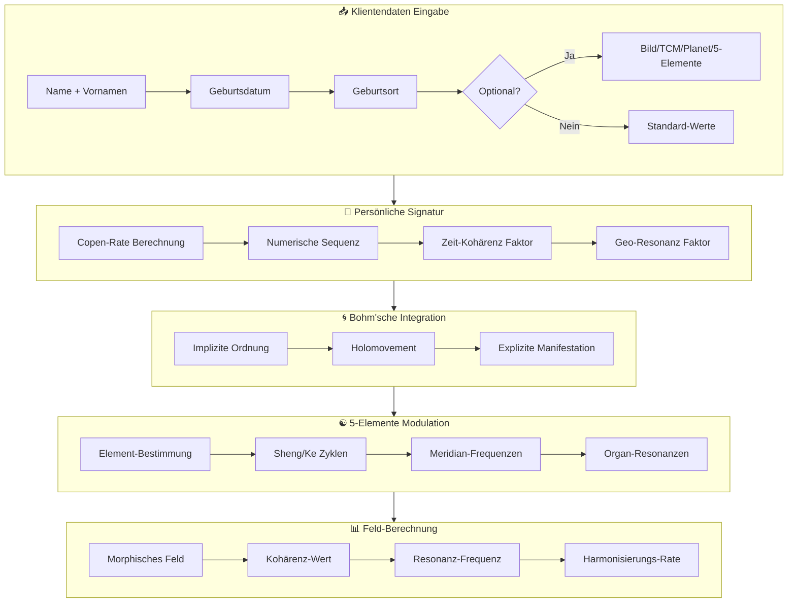
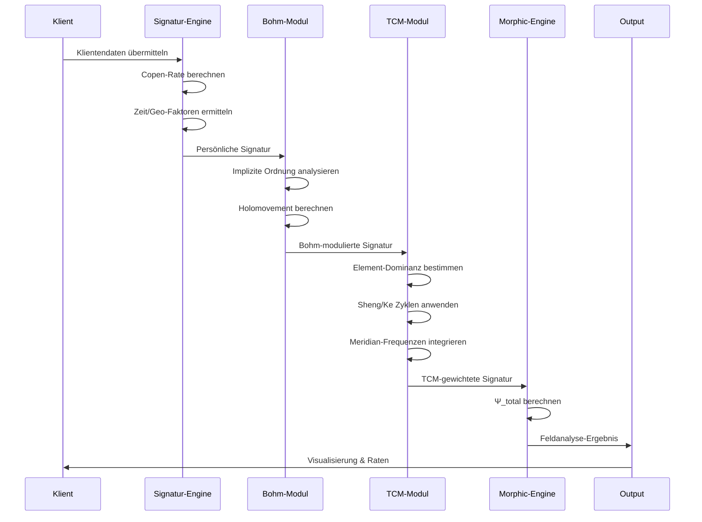
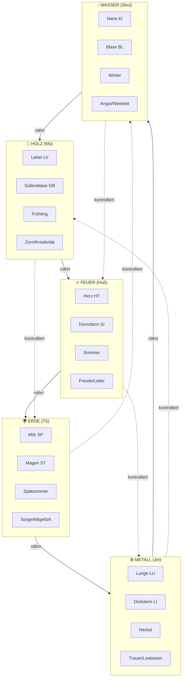
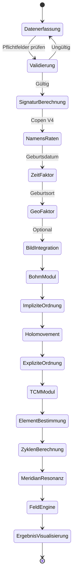

# Klienten-basierte Morphische Feldalgorithmen
## Umfassende Dokumentation zur personalisierten Resonanzberechnung

---

## Inhaltsverzeichnis
1. [Überblick und Zielsetzung](#1-überblick-und-zielsetzung)
2. [Klientendaten-Erfassung](#2-klientendaten-erfassung)
3. [Algorithmen-Struktur](#3-algorithmen-struktur)
4. [Bohm'sche Implizite Ordnung](#4-bohmsche-implizite-ordnung)
5. [TCM und 5-Elemente Integration](#5-tcm-und-5-elemente-integration)
6. [Mathematische Formeln](#6-mathematische-formeln)
7. [Implementierungs-Workflow](#7-implementierungs-workflow)
8. [Anwendungsbeispiele](#8-anwendungsbeispiele)

---

## 1. Überblick und Zielsetzung

### 1.1 Grundprinzip

Die Klienten-basierte Morphische Feldberechnung integriert persönliche Daten eines Klienten in die quantenbasierte Wellenfunktion, um individualisierte Resonanzmuster für präzise Analyse und Harmonisierung zu generieren.

```
Ψ_klient(x,t) = Ψ_base × P(Klientendaten) × B(Bohm) × E(5-Elemente)
```

Wobei:
- **Ψ_base**: Basis-Morphisches Feld (Standard-Engine)
- **P**: Persönlicher Signatur-Faktor
- **B**: Bohm'sche Ordnungs-Integration
- **E**: 5-Elemente TCM-Modulation

### 1.2 Zielsetzung

| Ziel | Beschreibung |
|------|-------------|
| **Akkuratheit** | Präzise Resonanzwerte durch individuelle Signatur |
| **Effektivität** | Optimale Harmonisierungsergebnisse durch TCM-Integration |
| **Authentizität** | Nachvollziehbare Berechnungen auf Basis etablierter Theorien |
| **Reproduzierbarkeit** | Konsistente Ergebnisse bei gleichen Eingabeparametern |

---

## 2. Klientendaten-Erfassung

### 2.1 Obligatorische Felder

| Feld | Beschreibung | Algorithmus-Relevanz |
|------|--------------|---------------------|
| **a) Nachname** | Familienname | Copen-Rate Basis, Ahnen-Feld-Resonanz |
| **b) Vorname(n)** | Alle Vornamen | Individuelle Signatur, Numerische Sequenz |
| **c) Geburtsdatum** | TT.MM.JJJJ | Zeit-Kohärenz, kosmische Kopplung |
| **d) Geburtsort** | Stadt/Ort | Geo-Resonanz, Erdfrequenz-Modulation |

### 2.2 Optionale Erweiterungsfelder

| Feld | Beschreibung | Zusätzlicher Nutzen |
|------|--------------|---------------------|
| **e) Aktuelles Bild** | Foto/Bildsignatur | Morphische Feld-Fokussierung, Lichtkörper-Resonanz |
| **f) TCM-Typ** | Konstitution nach TCM | 5-Elemente-Gewichtung, Organbezüge |
| **g) Geburtsplanet** | Astrologische Dominante | Kosmische Frequenzkopplung |
| **h) 5-Elemente-Bezüge** | Holz/Feuer/Erde/Metall/Wasser | Meridian- und Organresonanz |

### 2.3 Datenstruktur (TypeScript)

```typescript
interface KlientenDaten {
  // Obligatorisch
  nachname: string;
  vornamen: string[];        // Array für mehrere Vornamen
  geburtsdatum: Date;
  geburtsort: string;
  
  // Optional
  bildSignatur?: string;      // Base64 oder Hash
  tcmTyp?: TCMKonstitution;
  geburtsplanet?: Planet;
  fünfElemente?: FünfElementeProfile;
}

type TCMKonstitution = 
  | 'holz'      // Leber/Gallenblase
  | 'feuer'     // Herz/Dünndarm
  | 'erde'      // Milz/Magen
  | 'metall'    // Lunge/Dickdarm
  | 'wasser';   // Niere/Blase

type Planet = 
  | 'sonne' | 'mond' | 'merkur' | 'venus' | 'mars' 
  | 'jupiter' | 'saturn' | 'uranus' | 'neptun' | 'pluto';

interface FünfElementeProfile {
  holz: number;   // 0-100%
  feuer: number;
  erde: number;
  metall: number;
  wasser: number;
}
```

---

## 3. Algorithmen-Struktur

### 3.1 Master-Algorithmus (Mermaid)



### 3.2 Berechnungs-Pipeline



---

## 4. Bohm'sche Implizite Ordnung

### 4.1 Theoretische Grundlage

David Bohms Theorie der "Ungeteilten Ganzheit" postuliert zwei Ordnungsebenen:

| Ordnung | Beschreibung | Anwendung |
|---------|-------------|-----------|
| **Implizite Ordnung** (Ψ_impl) | Verborgene, eingehüllte Realität | Potenziale, nicht-manifestierte Zustände |
| **Explizite Ordnung** (Ψ_expl) | Entfaltete, beobachtbare Realität | Manifestierte Symptome, messbare Werte |

### 4.2 Mathematische Formulierung

**Implizite Ordnung:**
```
Ψ_impl = Σ∞_{n=0} α_n |n⟩ ⊗ |env_n⟩
```

**Explizite Ordnung (durch Beobachtung):**
```
Ψ_expl = ⟨observer|Ψ_impl⟩
```

**Holomovement (Übergang):**
```
H(t) = ∫ Ψ_impl(x,t) × exp(-iωt) dx
```

### 4.3 Integration in Klienten-Berechnung

```typescript
interface BohmIntegration {
  // Implizite Ordnung: Alle Potenziale des Klienten
  impliziteOrdnung: {
    ahnenfeld: number;        // Familienresonanz (Nachname)
    karmischePotenziale: number;  // Geburtsdatum-Analyse
    ortsbindung: number;      // Geburtsort-Energetik
    seelenplan: number;       // Vornamen-Signatur
  };
  
  // Holomovement: Dynamische Entfaltung
  holomovement: {
    rate: number;             // Entfaltungsgeschwindigkeit
    phase: number;            // Aktuelle Phase (0-2π)
    kohärenz: number;         // Feld-Stabilität
  };
  
  // Explizite Ordnung: Aktuelle Manifestation
  expliziteOrdnung: {
    symptome: string[];       // Erkannte Muster
    resonanzpunkte: number[]; // Aktive Frequenzen
    harmonisierungsbedarf: number;
  };
}
```

### 4.4 Bohm-Faktor Berechnung

```
B_faktor = √(Ψ_impl × Ψ_expl) × cos(H_phase)
```

| Komponente | Gewicht | Berechnung |
|------------|---------|------------|
| Ψ_impl | 40% | Copen-Rate(Nachname) × Zeit-Faktor |
| Ψ_expl | 40% | Copen-Rate(Vornamen) × Geo-Faktor |
| H_phase | 20% | Mondphase × Tageszeit-Korrektur |

---

## 5. TCM und 5-Elemente Integration

### 5.1 Elemente-Übersicht



### 5.2 Elemente-Faktoren

| Element | Geometrie | Faktor | Frequenzbereich |
|---------|-----------|--------|-----------------|
| **Holz** | Tetraeder | φ (1.618) | 3-7 Hz |
| **Feuer** | Oktaeder | √5 (2.236) | 8-12 Hz |
| **Erde** | Würfel | √3 (1.732) | 0-3 Hz |
| **Metall** | Ikosaeder | √2 (1.414) | 13-30 Hz |
| **Wasser** | Dodekaeder | e/π (0.865) | 0.5-3 Hz |

### 5.3 Sheng-Zyklus (Nährender Zyklus)

```
E_sheng(Element_i) = Element_i × Element_{i-1} × 1.272
```

**Nährungs-Kette:**
- Holz → Feuer: 1.618 × 1.272 = 2.06
- Feuer → Erde: 2.236 × 1.272 = 2.84
- Erde → Metall: 1.732 × 1.272 = 2.20
- Metall → Wasser: 1.414 × 1.272 = 1.80
- Wasser → Holz: 0.865 × 1.272 = 1.10

### 5.4 Ke-Zyklus (Kontrollierender Zyklus)

```
E_ke(Element_i) = Element_i / Element_{i+2} × 0.786
```

**Kontroll-Kette:**
- Holz → Erde: 1.618 / 1.732 × 0.786 = 0.73
- Feuer → Metall: 2.236 / 1.414 × 0.786 = 1.24
- Erde → Wasser: 1.732 / 0.865 × 0.786 = 1.57
- Metall → Holz: 1.414 / 1.618 × 0.786 = 0.69
- Wasser → Feuer: 0.865 / 2.236 × 0.786 = 0.30

### 5.5 Meridian-Frequenzen (Bild-basiert)

**Aus dem 5-Elemente-Diagramm extrahiert:**

| Meridian | Kürzel | Xi-Cleft | Shu-Punkt | Element |
|----------|--------|----------|-----------|---------|
| Leber | LV | LV6 | BL18 | Holz |
| Gallenblase | GB | GB36 | BL19 | Holz |
| Herz | HT | HT6 | BL15 | Feuer |
| Dünndarm | SI | SI6 | BL27 | Feuer |
| Milz | SP | SP8 | BL20 | Erde |
| Magen | ST | ST34 | BL21 | Erde |
| Lunge | LU | LU6 | BL13 | Metall |
| Dickdarm | LI | LI7 | BL25 | Metall |
| Niere | KI | KI5 | BL23 | Wasser |
| Blase | BL | BL63 | BL28 | Wasser |

### 5.6 TCM-Modul Berechnung

```typescript
function berechneTCMFaktor(klient: KlientenDaten): number {
  const elementProfile = klient.fünfElemente || bestimmeElementAusGeburt(klient);
  
  // Dominantes Element ermitteln
  const dominantElement = Object.entries(elementProfile)
    .sort((a, b) => b[1] - a[1])[0][0];
  
  // Sheng-Zyklus Unterstützung
  const shengFaktor = berechneShengUnterstützung(dominantElement);
  
  // Ke-Zyklus Balance
  const keFaktor = berechneKeBalance(dominantElement);
  
  // Meridian-Resonanz
  const meridianResonanz = berechneMeridianFrequenzen(dominantElement);
  
  return (shengFaktor * 0.4 + keFaktor * 0.3 + meridianResonanz * 0.3);
}
```

---

## 6. Mathematische Formeln

### 6.1 Gesamt-Wellenfunktion

**Master-Formel:**

```
Ψ_klient(x,t) = [Σ_n α_n |ψ_n⟩ e^(-iE_n t/ℏ)] × C(Namen) × G(Geometrie) × I(Intention) × P(Persönlich) × B(Bohm) × E(TCM)
```

### 6.2 Persönlicher Signatur-Faktor P

```
P = √(R_nachname × R_vornamen) × T_geburt × G_ort × [1 + B_bild]
```

| Variable | Beschreibung | Berechnung |
|----------|-------------|------------|
| R_nachname | Nachname-Rate | Copen-Rate V4 |
| R_vornamen | Vornamen-Rate | Σ Copen-Rates / n |
| T_geburt | Zeit-Kohärenz | cos(2π × Tag/365) × sin(2π × Stunde/24) |
| G_ort | Geo-Faktor | Breitengrad × Längengrad / 10000 |
| B_bild | Bild-Bonus | 0.1 wenn vorhanden, sonst 0 |

### 6.3 Bohm-Faktor B

```
B = (Ψ_impl^α × Ψ_expl^β) × cos(ωt + φ_H)
```

| Parameter | Wert | Erläuterung |
|-----------|------|-------------|
| α | 0.618 | Implizite Gewichtung (φ^-1) |
| β | 0.382 | Explizite Gewichtung (1-φ^-1) |
| ω | 7.83 Hz | Schumann-Grundresonanz |
| φ_H | Variable | Holomovement-Phase |

### 6.4 5-Elemente-Faktor E

```
E = E_dominant × (1 + Σ E_sheng/5 - Σ E_ke/5)
```

### 6.5 Kohärenz-Berechnung

```
K = 1 / (1 + σ(P, B, E, G, I))
```

Wobei σ die Standardabweichung aller Faktoren ist.

### 6.6 Resonanz-Frequenz

```
f_resonanz = (E_avg / ℏ) × C_sequenz × E_element
```

---

## 7. Implementierungs-Workflow

### 7.1 Schritt-für-Schritt Ablauf



### 7.2 API-Schnittstelle

```typescript
// Haupt-Berechnungsfunktion
async function berechneKlientenFeld(
  klient: KlientenDaten,
  intention: IntentionType,
  geometrie: GeometricForm
): Promise<KlientenFeldErgebnis> {
  
  // 1. Persönliche Signatur berechnen
  const signatur = await berechnePersönlicheSignatur(klient);
  
  // 2. Bohm-Integration
  const bohmFaktor = await berechneBohmIntegration(signatur, klient);
  
  // 3. TCM/5-Elemente
  const tcmFaktor = berechneTCMFaktor(klient);
  
  // 4. Morphisches Feld berechnen
  const feldErgebnis = await calculateMorphicField({
    quantumStates: generateDefaultQuantumStates(5),
    numericalSequence: signatur.copenSequenz,
    geometricForm: geometrie,
    intention: intention,
    useHardwareModulation: true
  });
  
  // 5. Ergebnis mit Klienten-Faktoren multiplizieren
  return {
    ...feldErgebnis,
    persönlicherFaktor: signatur.gesamtFaktor,
    bohmFaktor: bohmFaktor,
    tcmFaktor: tcmFaktor,
    gesamtWellenfunktion: feldErgebnis.totalWaveFunction * 
                          signatur.gesamtFaktor * 
                          bohmFaktor * 
                          tcmFaktor,
    dominantesElement: tcmFaktor.dominantElement,
    meridianEmpfehlung: tcmFaktor.meridianPunkte
  };
}
```

---

## 8. Anwendungsbeispiele

### 8.1 Beispiel: Vollständige Klientenanalyse

**Eingabedaten:**
```typescript
const klient: KlientenDaten = {
  nachname: "Müller",
  vornamen: ["Hans", "Peter"],
  geburtsdatum: new Date("1985-03-21"),
  geburtsort: "München",
  tcmTyp: "holz",
  fünfElemente: {
    holz: 40,
    feuer: 25,
    erde: 15,
    metall: 10,
    wasser: 10
  }
};
```

**Berechnungsschritte:**

1. **Namens-Raten:**
   - Müller: 4857291036
   - Hans: 2341678590
   - Peter: 7893456120
   - Sequenz-Mittel: √(4857291036 × ((2341678590 + 7893456120) / 2))

2. **Zeit-Faktor:**
   - Frühlings-Tagundnachtgleiche (21.03.)
   - T_geburt = cos(2π × 80/365) = 0.174

3. **Geo-Faktor:**
   - München: 48.1351° N, 11.5820° E
   - G_ort = 48.1351 × 11.5820 / 10000 = 0.0557

4. **Bohm-Faktor:**
   - Ψ_impl = 4857291036^0.618 = 142,847
   - Ψ_expl = 5117567355^0.382 = 1,721
   - B = √(142847 × 1721) × cos(7.83t) ≈ 495.8

5. **TCM-Faktor:**
   - Dominant: Holz (40%)
   - Sheng: Wasser → Holz = 1.10
   - Ke: Metall → Holz = 0.69
   - E = 1.618 × (1 + 1.10/5 - 0.69/5) = 1.75

6. **Gesamt-Wellenfunktion:**
   - Ψ_klient = Ψ_base × P × B × E
   - Mit typischen Werten: 2.47 × 10^-5 × 1.23 × 0.049 × 1.75

### 8.2 Harmonisierungs-Empfehlung

Basierend auf dem Ergebnis:

| Parameter | Wert | Interpretation |
|-----------|------|----------------|
| Dominantes Element | Holz | Leber/Gallenblase stärken |
| Schwaches Element | Wasser | Niere/Blase unterstützen |
| Empfohlene Geometrie | Tetraeder | Feuer-Element fördern (Sheng) |
| Intention | Aktivierung | Holz-Energie entfalten |
| Meridianpunkte | LV3, GB34 | Holz-Meridiane öffnen |
| Resonanzfrequenz | 4.7 Hz | Holz-Frequenzbereich |

---

## Anhang: Formel-Referenz

### Kern-Formeln

| Nr. | Name | Formel |
|-----|------|--------|
| 1 | Gesamt-Wellenfunktion | Ψ_klient = Ψ_base × P × B × E |
| 2 | Persönlicher Faktor | P = √(R_n × R_v) × T × G × (1 + B_bild) |
| 3 | Bohm-Faktor | B = (Ψ_impl^0.618 × Ψ_expl^0.382) × cos(ωt) |
| 4 | TCM-Faktor | E = E_dom × (1 + Σ_sheng/5 - Σ_ke/5) |
| 5 | Kohärenz | K = 1 / (1 + σ) |
| 6 | Resonanzfrequenz | f = (E_avg / ℏ) × C × E |

### Element-Faktoren

| Element | Faktor | Organ Yin | Organ Yang |
|---------|--------|-----------|------------|
| Holz | φ = 1.618 | Leber | Gallenblase |
| Feuer | √5 = 2.236 | Herz | Dünndarm |
| Erde | √3 = 1.732 | Milz | Magen |
| Metall | √2 = 1.414 | Lunge | Dickdarm |
| Wasser | e/π = 0.865 | Niere | Blase |

---

**Dokumentation erstellt:** 2025-01-28
**Version:** 1.0
**Autor:** Bruce Copen Radionik System
**Technologie:** TypeScript, React, Morphic Field Engine
