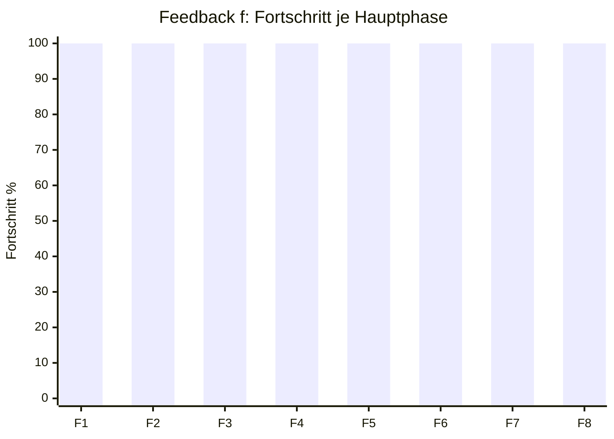

# Aktueller Umsetzungsplan: Phasen, Schritte und Fortschritt

Stand: 2026-07-18
Arbeitsort: `C:\morphic_v1\.worktrees\operator-workbench-phase1`
Branch: `operator-workbench-phase1`
HEAD: `619a1f5485a151816e32732929a6a823839ccb57`
Basisquellen: aktueller Worktree, `.hermes/plans/2026-07-13-feedback-f-admin-catalog-repositories.md`, `docs/status/2026-07-17-feedback-f-F5-B-technical-freeze-v12.md`, `docs/status/2026-07-17-feedback-f-F5-B-v12-GO.md`, `docs/status/2026-07-17-feedback-f-F5-C-source-documentation-contract.md`, `docs/status/2026-07-17-feedback-f-F6-1-admin-security.md`, `docs/status/2026-07-17-feedback-f-F6-2-admin-catalog-api.md`, `docs/status/2026-07-17-feedback-f-F6-3-source-display-safe-view.md`, `docs/status/2026-07-17-feedback-f-F6-4-admin-ui.md`, `docs/status/2026-07-17-feedback-f-F7-1-adapter-network-policy.md`, `docs/status/2026-07-17-feedback-f-F7-2-ncbi-taxonomy-adapter.md`, `docs/status/2026-07-17-feedback-f-F7-3-live-network-acceptance.md`, `docs/status/2026-07-18-feedback-f-F8-1-shadow-comparison.md`, `docs/status/2026-07-18-feedback-f-F8-2-runtime-consumption.md`, `docs/status/2026-07-18-feedback-f-F8-3-runtime-kill-switch.md`, `docs/status/2026-07-18-feedback-f-F8-4-runtime-acceptance.md`, `docs/status/2026-07-18-feedback-f-option-b-live-runtime-acceptance.md`, `docs/status/2026-07-18-feedback-f-option-b-browser-smoke.md`, `docs/status/2026-07-17-umsetzungsplan-status-tiefenanalyse.md`.

## 1. Kurzstatus

Der aktive Umsetzungsplan ist weiterhin **Feedback f: Admin Catalog und sichere Repositories**. Die früheren UI-/Radi144-Arbeiten sind abgeschlossen. Innerhalb von Feedback f sind **F1 bis F4 vollständig GO**, **F5-A abgeschlossen**, **F5-B/v12 formal GO**, **F5-C/F5.6 technisch geschlossen**, **F6.1 technisch geschlossen**, **F6.2 technisch geschlossen**, **F6.3 technisch geschlossen**, **F6.4 technisch geschlossen**, **F7.1-F7.3 technisch geschlossen**, **F8.1-F8.4 Option A technisch geschlossen**, **Option B API/ASGI-Transport technisch geschlossen** und **Option B Browser-Smoke technisch geschlossen**.

Der nächste konkrete Schritt ist:

> **Abschlussentscheidung fuer Review/Commit oder naechsten Nutzerfeedbackpunkt.**

## 2. Prozentmodell

Die Prozentwerte sind konservative Arbeitsstandsprozentwerte, keine Aufwandsschätzung in Stunden.

| Modell | Berechnung | Ergebnis |
|---|---|---:|
| Nutzerfeedback gesamt `a-f` | b/c/d/e fertig, f technisch geschlossen, a offen: `(4 + 1 + 0) / 6` | **83 %** |
| Feedback f nach Hauptphasen F1-F8 | F1-F8 je 100 % fuer Option A: `(100+100+100+100+100+100+100+100)/8` | **100 % Option A** |
| Feedback f nach gezählten Arbeitseinheiten | F1-F4 = 14/14, F5 = 14/14, F6 = 4/4, F7 = 3/3, F8 = 4/4: `39/39` | **100 % Option A** |
| Abgeschlossener Block F5-B/v12 | A0/M1/M2/M3/B1/P1/C1/REG/R1/R2/FRZ/REV, Dokumentfreeze v3, 2x Dokumentreview-APPROVE und Post-State-ShadowCopy: `GO` | **100 % formal GO** |
| Abgeschlossener Block F5-C/F5.6 | Quellen-Dokumentation auf reale Semantik korrigiert und testbelegt | **100 % technisch** |
| Abgeschlossener Block F6.1 | Fail-closed Adminauthentisierung testbelegt | **100 % technisch** |
| Abgeschlossener Block F6.2 | Admin-Catalog-API hinter Adminauth testbelegt | **100 % technisch** |
| Abgeschlossener Block F6.3 | Quellenanzeige auf Workbench-Safe-View korrigiert | **100 % technisch** |
| Abgeschlossener Block F6.4 | getrennte Admin-UI bootstrapgeschuetzt und no-store testbelegt | **100 % technisch** |
| Abgeschlossener Block F7.1 | Adaptervertrag und Netzwerkpolicy fail-closed testbelegt | **100 % technisch** |
| Abgeschlossener Block F7.2 | NCBI-Taxonomy-Adapter mit Mocktransport und quarantinisiertem Snapshot testbelegt | **100 % technisch** |
| Abgeschlossener Block F7.3 | Reale Netzwerkabnahme mit immutable Evidence testbelegt | **100 % technisch** |
| Abgeschlossener Block F8.1 | Schattenvergleich gegen Legacy read-only, deterministisch klassifiziert und ohne Runtimewirkung testbelegt | **100 % technisch** |
| Abgeschlossener Block F8.2 | Vollstaendige Runtime-Consumption aus einer aktiven Revision fail-closed testbelegt | **100 % technisch** |
| Abgeschlossener Block F8.3 | Expliziter Kill-Switch fail-closed testbelegt | **100 % technisch** |
| Abgeschlossener Block F8.4 Option A | Isolierte synthetische Admin-/Runtime-Abnahme mit Reload, Rollback, Kontextisolation, Kill-Switch und Audit-Evidence testbelegt | **100 % technisch** |
| Abgeschlossener Block Option B API/ASGI | Geschuetzter Admin-Webtransport bis Runtime-Read-Model mit Reload, Rollback, Kontextisolation, Kill-Switch und Redaction testbelegt | **100 % technisch** |
| Abgeschlossener Block Option B Browser-Smoke | UI-Abnahme ueber `admin.html` mit Headless-Playwright und isoliertem Testserver | **100 % technisch** |
| Aktiver naechster Schritt | Abschlussentscheidung fuer Review/Commit oder naechsten Nutzerfeedbackpunkt | **offen** |

Leitwert für die aktuelle Planung: **Feedback f ist fuer Option A und Option B technisch geschlossen**. Es gibt weiterhin keine implizite Produktivfreigabe und keinen Commit.

Klaerung zur F5-Zaehlung: Die 14. gezaehlte F5-Arbeitseinheit ist **F5-C/F5.6**. Die F5-B-Abschlusskette aus Dokumentreviews, Post-State-ShadowCopy und F5-B-GO ist ein formales Pflichtgate vor F5-C, aber kein zusaetzlicher gezaehlter F5-Implementierungsschritt.

## 3. Mermaid-Uebersicht

```mermaid
flowchart TD
    F1["F1 Contracts & Store<br/>100% GO"] --> F2["F2 Offline Service / Backup / Audit<br/>100% GO"]
    F2 --> F3["F3 Profile & Shadow Runtime<br/>100% GO"]
    F3 --> F4["F4 Remedies / Multiplexe / Launcher<br/>100% GO"]
    F4 --> F5A["F5-A Source Policy / Registry / Batchhash<br/>100% abgeschlossen"]
    F5A --> F5B["F5-B/v12 Source Normalisierung & Draft-Import<br/>100% technisch / formal GO"]
    F5B --> B1["B1 Durable Backup-/Restore-Publikation<br/>technisch geschlossen"]
    B1 --> P1["P1 POSIX Platform Contract<br/>technisch geschlossen"]
    P1 --> C1["C1 Validation-Key Composition<br/>technisch geschlossen"]
    C1 --> REG["REG Regression<br/>technisch geschlossen"]
    REG --> R1["R1 POSIX source-inode-bound Fail-Closed<br/>technisch geschlossen"]
    R1 --> R2["R2 Backup byte-bound Publish<br/>technisch geschlossen"]
    R2 --> FRZ["FRZ Freeze v12 / SHA-256<br/>technisch geschlossen"]
    FRZ --> REV["REV v12<br/>2x APPROVE technisch geschlossen"]
    REV --> DOC2["Dokumentfreeze v2<br/>REQUEST CHANGES"]
    DOC2 --> DOC3["Dokumentfreeze v3<br/>Reviewanker erzeugt"]
    DOC3 --> DREV["Dokumentreviews v3<br/>2x APPROVE"]
    DREV --> POST["Post-State-ShadowCopy<br/>151/151 OK"]
    POST --> F5BGO["F5-B GO-Entscheidung<br/>GO"]
    F5BGO --> F5C["F5-C/F5.6 Dokumentsemantik<br/>technisch geschlossen"]
    F5C --> F61["F6.1 Fail-closed Adminauth<br/>technisch geschlossen"]
    F61 --> F62["F6.2 Admin-Catalog-API<br/>technisch geschlossen"]
    F62 --> F63["F6.3 Quellenanzeige<br/>technisch geschlossen"]
    F63 --> F64["F6.4 Admin-UI<br/>technisch geschlossen"]
    F64 --> F71["F7.1 Adaptervertrag / Netzwerkpolicy<br/>technisch geschlossen"]
    F71 --> F72["F7.2 NCBI-Taxonomy-Adapter<br/>technisch geschlossen"]
    F72 --> F73["F7.3 reale Netzwerkabnahme<br/>technisch geschlossen"]
    F73 --> F81["F8.1 Schattenvergleich<br/>technisch geschlossen"]
    F81 --> F82["F8.2 Runtime-Consumption<br/>technisch geschlossen"]
    F82 --> F83["F8.3 Kill-Switch<br/>technisch geschlossen"]
    F83 --> F84["F8.4 Option A Runtime-Abnahme<br/>technisch geschlossen"]
    F84 --> F8["F8 Runtime-Umschaltung & Release<br/>100% Option A"]
    F8 --> OPTBAPI["Option B API/ASGI Transport<br/>technisch geschlossen"]
    OPTBAPI --> OPTBBROWSER["Option B Browser-Smoke<br/>technisch geschlossen"]
    OPTBBROWSER --> CHECKPOINT["Lokaler Checkpoint-Commit<br/>730da8e"]
    CHECKPOINT --> REPORTA["Feedback a<br/>Reportdesign technisch umgesetzt"]
```

## 4. Gesamtstatus Nutzerfeedback

| Punkt | Thema | Status | Fortschritt | Kommentar |
|---|---|---|---:|---|
| a | Einheitliches Design aller Berichte im Workflow-Look | technisch umgesetzt | 100 % technisch | Gemeinsames Workbench-Report-Theme fuer Legacy-, Multiplex- und PDF-Berichte; Status `docs/status/2026-07-18-feedback-a-workbench-report-design.md` |
| b | Scores maximal 5 Nachkommastellen | erledigt | 100 % | Commit `abe8739`; Anzeige-/Reportebene begrenzt |
| c | PDF-Berichte mit Layout statt Rohtext | erledigt | 100 % | Commit `d4701e7`; regulärer Workflow nutzt `html_to_pdf()` |
| d | tenantbasierte Export-Pfad-Isolation | erledigt | 100 % | Commit `713b66a`; Folgebruch Web-Exportroot vs. Reportkatalog bleibt separates Integrationsgate |
| e | Klienten-/Gruppenkontext nach Radi144-Vektoren | umgesetzt | 100 % | Produktiver Gruppenpfad default-off und consentgebunden; Geo bleibt NO-GO |
| f | Admin-Verwaltung Profile/Remedies/Multiplexe + Online-Repositories | technisch geschlossen fuer Option A und Option B | 100 % technisch | F1-F4 GO, F5-A abgeschlossen, F5-B/v12 GO, F5-C technisch geschlossen, F6.1-F6.4 technisch geschlossen, F7.1-F7.3 technisch geschlossen, F8.1-F8.4 Option A, Option B API/ASGI und Option B Browser-Smoke technisch geschlossen |

## 5. Feedback f: Hauptphasen F1-F8

| Phase | Ziel | Schritte | Status | Fortschritt | Naechster offener Punkt |
|---|---|---:|---|---:|---|
| F1 | Contracts und isolierter Catalog Store | 3/3 | GO | 100 % | keiner |
| F2 | Offline Draft, Diff, Publish, Activate, Rollback | 4/4 | GO | 100 % | keiner |
| F3 | Profilverwaltung ohne stille Runtimewirkung | 3/3 | GO | 100 % | keiner |
| F4 | Remedies und Multiplexe vereinheitlichen | 4/4 | GO | 100 % | keiner |
| F5 | Source-Pipeline-Hardening | 14/14 | technisch geschlossen | 100 % | keiner |
| F6 | Geschuetzte Admin-API und UI | 4/4 | technisch geschlossen | 100 % | keiner |
| F7 | Erster Onlineadapter, kein Auto-Publish | 3/3 | technisch geschlossen | 100 % | keiner |
| F8 | Runtime-Umschaltung und Release | 4/4 | technisch geschlossen fuer Option A und Option B | 100 % technisch | keiner; Review/Commit-Entscheidung offen |

## 6. Detailstatus F1-F4

| Phase | Schritt | Inhalt | Status | Fortschritt |
|---|---|---|---|---:|
| F1 | F1.1 | Typisierte Catalog-Vertraege definieren | erledigt / GO | 100 % |
| F1 | F1.2 | SQLite-Schema und Transaktionsgrenzen | erledigt / GO | 100 % |
| F1 | F1.3 | Typenspezifische Cross-Reference-Validierung | erledigt / GO | 100 % |
| F2 | F2.1 | Admin-Service-Fassade | erledigt / GO | 100 % |
| F2 | F2.2 | Sicherer Runtime-Pfad / Pfadpolicy | erledigt / GO | 100 % |
| F2 | F2.3 | Backup-/Recovery-Vertrag | erledigt / GO | 100 % |
| F2 | F2.4 | Audit-Integritaetsstufen explizit machen | erledigt / GO | 100 % |
| F3 | F3.1 | Bestehende Profile read-only normalisieren | erledigt / GO | 100 % |
| F3 | F3.2 | Profil-Draft-CRUD | erledigt / GO | 100 % |
| F3 | F3.3 | Read-only Runtime-Adapter im Schattenmodus | erledigt / GO | 100 % |
| F4 | F4.1 | Legacy-Remedy-Import read-only | erledigt / GO | 100 % |
| F4 | F4.2 | Drei Multiplexmodelle explizit migrieren | erledigt / GO | 100 % |
| F4 | F4.3 | Remedy-/Multiplex-Draft-CRUD und Cross-Refs | erledigt / GO | 100 % |
| F4 | F4.4 | Legacy-Remedy-Launcher entscheiden/fixen | erledigt / GO | 100 % |

## 7. Detailstatus F5

| Block | Schritt | Inhalt | Status | Fortschritt |
|---|---|---|---|---:|
| F5-A | F5.1 | Vollstaendiger Batch-Hashvertrag | abgeschlossen | 100 % |
| F5-B | F5.2 | Typenspezifische Source-Normalizer | formal GO im F5-B/v12-Scope | 100 % |
| F5-B | F5.3 | Kontrollierte Uebernahme in Catalog-Draft | formal GO im F5-B/v12-Scope | 100 % |
| F5-A | F5.4 | Atomare Registry-/Audit-Schreibpfade | abgeschlossen | 100 % |
| F5-A | F5.5 | Source-Policy, lokale Importgrenzen, Rollback | abgeschlossen | 100 % |
| F5-C | F5.6 | Quellen-Dokumentation auf reale Semantik korrigieren | technisch geschlossen; 14. gezaehlte F5-Einheit | 100 % |

### F5-B/v12 Mikro-Gates

| Reihenfolge | Gate | Inhalt | Status | Fortschritt |
|---:|---|---|---|---:|
| 1 | A0 | Parentbindung aller F5-B-Dateiauthorities | technisch geschlossen | 100 % |
| 2 | M1 | Historische v7-Known-Answer-Fixtures | technisch geschlossen | 100 % |
| 3 | M2 | Atomare v7->v8-Migration | technisch geschlossen | 100 % |
| 4 | M3 | v7-Backupmigration zu neuem v8-Bundle | technisch geschlossen | 100 % |
| 5 | B1 | Gemeinsame durable Backup-/Restore-Publikation | technisch geschlossen | 100 % |
| 6 | P1 | POSIX-Entscheidung oder fail-closed Plattformvertrag | technisch geschlossen | 100 % |
| 7 | C1 | Produktive Validation-Key-Composition | technisch geschlossen | 100 % |
| 8 | REG | Fokus-, Admin-, Source-, Web-, Vollsuite- und Top-5-Regression | technisch geschlossen | 100 % |
| 9 | FRZ | Freeze v12 mit SHA-256 und Rueckverifikation nach R2 | technisch geschlossen | 100 % |
| 10 | REV | Zwei technische Reviews auf Freeze v12 | technisch geschlossen, 2x APPROVE | 100 % |

## 8. Detailstatus F6-F8

| Phase | Schritt | Inhalt | Status | Fortschritt |
|---|---|---|---|---:|
| F6 | F6.1 | Fail-closed Adminauthentisierung | technisch geschlossen | 100 % |
| F6 | F6.2 | Admin-Catalog-API | technisch geschlossen | 100 % |
| F6 | F6.3 | Quellenanzeigefehler separat korrigieren | technisch geschlossen | 100 % |
| F6 | F6.4 | Admin-UI als getrennte Oberflaeche | technisch geschlossen | 100 % |
| F7 | F7.1 | Adaptervertrag und Netzwerkpolicy | technisch geschlossen | 100 % |
| F7 | F7.2 | Ersten offiziellen Adapter implementieren | technisch geschlossen | 100 % |
| F7 | F7.3 | Reale Netzwerkabnahme als eigenes Gate | technisch geschlossen | 100 % |
| F8 | F8.1 | Schattenvergleich gegen Legacy | technisch geschlossen | 100 % |
| F8 | F8.2 | Vollstaendige Runtime-Consumption aus einer Revision | technisch geschlossen | 100 % |
| F8 | F8.3 | Expliziter Kill-Switch | technisch geschlossen | 100 % |
| F8 | F8.4 | Reale Admin-/Runtime-Abnahme | technisch geschlossen fuer Option A | 100 % Option A |

## 9. Aktueller naechster Schritt: Abschlussentscheidung

### Ziel

F5 ist inhaltlich geschlossen. F5-B/v12 ist formal GO, F5-C/F5.6 ist mit einem Dokumentations-Contract-Test technisch geschlossen, F6.1 ist als Adminauth-Gate technisch geschlossen, F6.2 stellt die geschuetzte Admin-Catalog-API bereit, F6.3 korrigiert die normale Quellenanzeige auf eine Workbench-Safe-View, F6.4 stellt die getrennte Admin-UI bereit, F7.1 hat den fail-closed Adapter-/Netzwerkvertrag geschlossen, F7.2 stellt den ersten offiziellen NCBI-Taxonomy-Adapter mit injiziertem Mocktransport und quarantinisiertem Snapshot bereit, F7.3 hat die reale Netzwerkabnahme mit immutable Evidence geschlossen, F8.1 hat den read-only Schattenvergleich gegen Legacy technisch geschlossen, F8.2 stellt die explizite fail-closed Runtime-Consumption aus einer aktiven Revision bereit, F8.3 hat den expliziten Kill-Switch technisch geschlossen, F8.4 Option A belegt den isolierten Admin-/Runtime-Lifecycle mit Reload, Rollback, Kontextisolation, Kill-Switch und Audit-Evidence, Option B API/ASGI belegt denselben Lifecycle ueber geschuetzten Webtransport bis zum Runtime-Read-Model, und Option B Browser-Smoke belegt die Admin-UI ueber Headless-Playwright. Exakt weiter geht es mit der Abschlussentscheidung fuer Review/Commit oder den naechsten Nutzerfeedbackpunkt.

Freeze-Artefakte:

| Artefakt | Wert |
|---|---|
| Freeze-Dokument | `docs/status/2026-07-17-feedback-f-F5-B-technical-freeze-v12.md` |
| Freeze-Dokument SHA-256 | `64bc565b5e69b9703bef1a425a7d621f21ced6564e457457068b71538e238840` |
| Scope-Datei | `docs/status/2026-07-17-feedback-f-F5-B-technical-freeze-v12.scope.txt` |
| Scope-Datei SHA-256 | `807c9893364b24e857e184990904b948dcacdbbe3f923f93b56ccdf617471fd0` |
| Hash-Manifest | `docs/status/2026-07-17-feedback-f-F5-B-technical-freeze-v12.sha256` |
| Hash-Manifest SHA-256 | `21df34a8e95c9f5ea4d09fc8733de02b98efa282ac8e7b5e343a4fc04a068559` |
| Rueckverifikation | `125/125 OK` |
| Review 1 | `APPROVE`, `P0=0, P1=0, P2=0, P3=0`, keine Drift |
| Review 2 | `APPROVE`, `P0=0, P1=0, P2=0, P3=0`, keine Drift |
| Dokumentreview v2-1 | `REQUEST CHANGES`, `P2=1`, `P3=1`, keine Drift |
| Dokumentreview v2-2 | `APPROVE`, `P0=0`, `P1=0`, `P2=0`, `P3=0`, keine Drift |
| Dokumentreview v3-1 | `APPROVE`, `P0=0`, `P1=0`, `P2=0`, `P3=0`, keine Drift |
| Dokumentreview v3-2 | `APPROVE`, `P0=0`, `P1=0`, `P2=0`, `P3=0`, keine Drift |
| Post-State-ShadowCopy | `151/151 OK`, Manifest-SHA `e47cb8accf4e8f5dadb41d56ef29415514e5f5aa1b42568f811ac192f77ed765` |
| F5-C/F5.6 | `87 passed`, Dokumentsemantik testbelegt |
| F6.1 | `48 passed`, Adminauth-Gate testbelegt |
| F6.2 | `68 passed`, Admin-Catalog-API plus Core-Service-Kontext testbelegt |
| F6.3 | `34 passed`, Quellenanzeige-Safe-View testbelegt |
| F6.4 | `40 passed`, getrennte Admin-UI, fluechtiger Bootstrap-Token und No-Store testbelegt |
| F7.1 | `157 passed, 1 skipped`, Adaptervertrag und Netzwerkpolicy testbelegt |
| F7.2 | `161 passed, 1 skipped`, NCBI-Taxonomy-Adapter ohne echten HTTP-Client und ohne Publish/Activate/Runtimewirkung testbelegt |
| F7.3 | `165 passed, 1 skipped`, Live-Abnahmeharness und reale NCBI-Taxonomy-Abnahme mit Evidence-SHA `7a73b0fa4d633d2c6514eec1ab00f07ef0e5aa2c75513cbff15dda7b37850e9d` testbelegt |
| F8.1 | `174 passed, 3 skipped`, read-only Schattenvergleich gegen Legacy ohne Publish/Activate/Runtimewirkung testbelegt |
| F8.2 | `186 passed, 3 skipped`, Runtime-Consumption aus einer aktiven Revision, Subgroup-Provider-Injektion und fail-closed Catalog-Pfad testbelegt |
| F8.3 | `202 passed, 3 skipped`, expliziter Kill-Switch, deaktivierter Legacy-Pfad ohne Catalog-Read und aktivierter fail-closed Catalog-Pfad testbelegt |
| F8.4 Option A RED | `ModuleNotFoundError: No module named 'core.admin_catalog.runtime_acceptance'` |
| F8.4 Option A | `1 passed in 0.36s`, synthetischer Admin-/Runtime-Lifecycle mit Reload, zweiter Aktivierung, Rollback, Kontextisolation, Kill-Switch und Audit-Evidence testbelegt |
| F8.4 Option A Fokusregression | `28 passed in 2.31s`, Acceptance, Runtime-Consumption und Web-Admin-Catalog testbelegt |
| F8.4 Option A finale Matrix | `35 passed in 8.17s`, Acceptance, Runtime-Consumption, Web-Admin-Catalog und Shadow-Comparison testbelegt |
| Option B API/ASGI RED Endpoint | `1 failed`, `/api/admin/catalog/runtime` lieferte erwartungsgemaess HTTP 404 |
| Option B API/ASGI GREEN Endpoint | `1 passed in 0.80s` |
| Option B API/ASGI RED Redaction | `2 failed, 2 passed`, fehlend war `redacted` in Runtime-Response |
| Option B API/ASGI Boundary-GREEN | `4 passed in 1.06s` |
| Option B API/ASGI Fokusregression | `39 passed in 4.76s`, Option B, Web-Admin-Catalog, F8.4 Option A, Runtime-Consumption und Shadow-Comparison testbelegt |
| Option B UI RED | `2 failed, 2 passed`, fehlend waren Runtime-Endpoint-Anker und Runtime-UI-IDs |
| Option B UI GREEN | `4 passed in 0.57s`, Admin-DOM/JS-Runtime-Smoke-Anker testbelegt |
| Option B Admin-Security | `9 passed in 0.61s`, Same-Origin-GET ohne `Origin` testbelegt |
| Option B Browser-Prereq-Matrix | `52 passed in 5.29s`, Option B, Security, DOM, Web-Admin-Catalog, F8.4 Option A, Runtime-Consumption und Shadow-Comparison testbelegt |
| Option B Browser-Smoke | `passed`, Headless-Playwright gegen `admin.html`; Quelle `catalog`, finale Revision `browser-revision-a`, Evidence `redigiert`, keine Console-Meldungen |
| Option B finale Adapter-/Pfad-Nachpruefung | `37 passed, 1 skipped in 2.04s`, externer Basetemp unter `C:\tmp` |
| Option B finale Vollsuite | `1161 passed, 8 skipped in 160.96s`, externer Basetemp unter `C:\tmp` |

### Konkrete naechste Schritte

| Reihenfolge | Schritt | Datei-/Scope-Fokus | Status |
|---:|---|---|---|
| 1 | v12-Reviewberichte persistieren | `docs/reviews/*v12-*.md` | erledigt |
| 2 | REV-v12-APPROVE-Status persistieren | `docs/status/2026-07-17-feedback-f-F5-B-v12-REV-approve.md` | erledigt |
| 3 | Dokumentfreeze-v2-Reviews persistieren | v2 Review 1/2 und Request-Changes-Status | erledigt |
| 4 | P2/P3-Dokumentbefunde korrigieren | Prozentmodell und Authority-/Gatefortschritt-Tabellen | erledigt |
| 5 | Dokumentfreeze v3 erzeugen und rueckverifizieren | stabile korrigierte Dokumentreviewbasis | erledigt |
| 6 | Zwei Dokumentreviews read-only auf v3 | nur bei 2x APPROVE weiter | erledigt |
| 7 | Post-State-ShadowCopy vorbereiten | erst nach Dokumentreviews | erledigt |
| 8 | F5-C/F5.6 starten | Dokumentsemantik korrigieren | erledigt |
| 9 | F6.1 abschliessen | Fail-closed Adminauthentisierung | erledigt |
| 10 | F6.2 abschliessen | Admin-Catalog-API hinter Adminauth | erledigt |
| 11 | F6.3 abschliessen | Quellenanzeigefehler separat korrigieren | erledigt |
| 12 | F6.4 abschliessen | Admin-UI als getrennte Oberflaeche | erledigt |
| 13 | F7.1 abschliessen | Adaptervertrag und Netzwerkpolicy | erledigt |
| 14 | F7.2 abschliessen | Ersten offiziellen Adapter implementieren | erledigt |
| 15 | F7.3 abschliessen | Reale Netzwerkabnahme als eigenes Gate | erledigt |
| 16 | F8.1 abschliessen | Schattenvergleich gegen Legacy | erledigt |
| 17 | F8.2 abschliessen | Vollstaendige Runtime-Consumption aus einer Revision | erledigt |
| 18 | F8.3 abschliessen | Expliziter Kill-Switch | erledigt |
| 19 | F8.4 Option A abschliessen | Isolierte synthetische Admin-/Runtime-Abnahme | erledigt |
| 20 | Option B API/ASGI abschliessen | Geschuetzter Webtransport bis Runtime-Read-Model | erledigt |
| 21 | Option B Browser-Smoke abschliessen | UI-Abnahme ueber `admin.html` | erledigt |
| 22 | Abschlussentscheidung treffen | Review/Commit oder naechster Nutzerfeedbackpunkt | erledigt: lokaler Checkpoint-Commit `730da8e`, danach Feedback a |
| 23 | Feedback a umsetzen | Einheitliches Workbench-Reportdesign fuer HTML/PDF-Reports | technisch umgesetzt |

## 10. Offene formale Freigaben

| Freigabe | Status | Warum blockiert |
|---|---|---|
| F5-B GO | erledigt | 2x Dokumentreview-APPROVE und Post-State-ShadowCopy `151/151 OK` |
| Admin-UI/API lokal | erledigt | F6.1-F6.4 technisch geschlossen |
| Online-Repositories | technisch geschlossen fuer ersten Adapter | F7.1-F7.3 geschlossen; keine Auto-Publish- oder Runtimefreigabe |
| Runtime-Catalogwirkung | technisch geschlossen fuer Option A und Option B | F8.2 stellt die explizite Catalog-Consumption bereit; F8.3 stellt den Kill-Switch bereit; F8.4 Option A belegt den isolierten Acceptance-Lifecycle; Option B API/ASGI belegt den geschuetzten Webtransport; Browser-Smoke belegt die Admin-UI |
| Feedback f gesamt | technisch geschlossen im Worktree | Lokaler Checkpoint-Commit `730da8e`; keine Produktivfreigabe, kein Merge und kein Push |
| Feedback a | technisch umgesetzt | Separater Reportdesign-Commit in Vorbereitung; Produktiv-/Workflow-Gates bleiben nachgelagert |

## 11. Harte Schranken

- Nicht im Root `C:\morphic_v1` arbeiten.
- Kein Commit, Staging, Push, Reset, Cleanup oder Archivverschieben ohne explizite Freigabe.
- Keine produktive Registry- oder Remedy-DB-Mutation.
- Keinen produktiven Stage-Key erzeugen.
- Kein produktives Backup und keine Post-State-ShadowCopy vor den vorgeschriebenen APPROVE-Gates.
- Radi144 auf `127.0.0.1:8090` nicht veraendern.
- Abschluss nur nach expliziter Review-/Commit-Freigabe vornehmen.
- Freeze-v9/v10/v11-Werte nicht als v12-Abschlussevidenz verwenden.

## 12. Ein-Satz-Zusammenfassung

Wir stehen nach **Feedback f / F8.4 Option A, Option B API/ASGI, Option B Browser-Smoke und Feedback a**: Der isolierte Admin-/Runtime-Acceptance-Lifecycle, der geschuetzte Webtransport bis Runtime-Read-Model, die Admin-UI-Browserabnahme und das einheitliche Workbench-Reportdesign sind technisch geschlossen. Es gibt weiterhin keine Produktivfreigabe, keinen Merge und keinen Push.
