# Single-Modus Korrektur- und Cloud-Roadmap

> **Für agentische Bearbeiter:** Diese Datei ist die übergeordnete Roadmap. Vor der Umsetzung jeder Phase ist ein eigener TDD-Implementierungsplan zu erstellen. Risikoblöcke werden getrennt eingefroren, geprüft und abgenommen; kein Block darf still mit einem anderen zusammengelegt werden.

**Ziel:** Alle aktuellen Workbench- und Korrekturlücken zuerst für einen stabilen lokalen Ein-Operator-/Ein-Klient-Betrieb schließen und erst danach die Integration in `radiquant-cloud-build` vertraglich und technisch vorbereiten.

**Architektur:** Freeze v6 bleibt die unveränderte Rückfallbasis. Die Umsetzung erfolgt gateweise über kleine RED-GREEN-Patches, vollständige Regression, unveränderliche Hashfreezes und unabhängige Reviews. Cloud-spezifische Autoritäten werden später über Adapter angebunden; lokale Dateisystem-, Environment- und Browserautoritäten werden nicht direkt zur Cloud-Autorität erhoben.

**Technik:** Python 3.12, FastAPI, Typer CLI, Vanilla JavaScript, Playwright, pytest, ReportLab, lokale Windows-Runtime; später versionierte Cloud-Adapter für Principal, Entitlements, Jobs, Storage und Events.

**Stand:** 2026-07-26<br>
**Arbeitsort:** `C:\morphic_v1\.worktrees\operator-workbench-phase1`<br>
**Branch:** `operator-workbench-phase1`<br>
**Baseline-HEAD:** `3271ff9366ab3fecb2a158913a0cc19ed6a06726`

---

## 1. Verbindliche Begriffsdefinition

Mit **Single-Modus** ist in dieser Roadmap der bestehende lokale

> **Ein-Operator-/Ein-Klient-Betrieb mit automatischer Top-N-Analyse**

gemeint.

Der Workbench-Pfad verwendet `scan top3-scan` beziehungsweise den Launcher-Modus `top_n_auto_scan`. Das historische CLI-/Archivlabel `SINGLE` bezeichnet dagegen einen einzelnen Profilscan und ist kein eigener Workbench-Modus.

Der Single-Modus umfasst:

- einen lokalen Operator und einen serverseitig gebundenen Tenant/Workspace;
- einen Klienten je Fall und Session;
- Screening des gewählten Profil-Levels und anschließende Top-N-Vollanalyse;
- nachvollziehbare Ergebnisse, Berichte und optional eine sicher gebundene Harmonisierung;
- keine Gruppen-, Geo-, Cloud- oder Mehrbenutzerwirkung ohne eigenes späteres Gate.

## 2. Autorität und Dokumentrang

| Rang | Autorität | Bedeutung |
|---:|---|---|
| 1 | Aktueller Code im Worktree und aktueller Git-Status | Höchste technische Wahrheit für vorhandene Bytes |
| 2 | `docs/status/2026-07-21-technical-production-go.md` | Gate-0-Live-Abnahme und akzeptierter Freeze-v6-Rahmen |
| 3 | `docs/reviews/2026-07-22-technical-production-go-freeze-v6.md` plus Manifest und zwei Reviews | Unveränderliche technische Gate-0-Baseline |
| 4 | `.hermes/plans/2026-07-21_152301-operator-workbench-korrekturen-a-bis-p.md` | Aktueller fachlicher Korrekturplan Gates 0-16 |
| 5 | `PROJECT_MEMORY/00_CURRENT_STATE.md` | Golden Record; einzelne ältere Abschnitte sind gegenüber neueren Statusdokumenten veraltet |
| 6 | Ältere Fortschritts- und Feedbackdokumente | Nachweis technischer Vorarbeit, aber keine automatische Abnahme der neuen Gates |

Wesentliche Statusregel:

- Gate 0 ist formal akzeptiert und wird ohne neuen Live-Drift oder Produktionsbefund nicht erneut geöffnet.
- Gates 1-16 sind im aktuellen Korrekturplan formal offen beziehungsweise `deferred`.
- Vorhandener Code zählt als technische Vorarbeit, nicht als Gate-Abnahme.
- Das Gate-0-Live-Gate bewies Health, Oberfläche, Katalog, Scanstart, Replay und Stop, aber noch keinen vollständigen Scan bis `completed` einschließlich aller Folgeartefakte.

## 3. Prozentmodell

Die Prozentwerte sind konservative Reifegradschätzungen, keine Aufwandsschätzung in Stunden.

| Bereich | Formal abgeschlossen | Technische Vorarbeit | Bewertung |
|---|---:|---:|---|
| Radi144-UI/UX-Konsolidierung | 100 % | 100 % | Historischer 9/9-Plan abgeschlossen |
| Admin-Catalog/Repositories F1-F8 | Im damaligen Scope abgeschlossen | ca. 90 % für spätere Produktivnutzung | Wichtige Grundlage; aktuelles Gate 14 bleibt offen |
| Gate-0-Recovery/Freeze v6 | 100 % | 100 % | Zwei driftfreie APPROVE-Reviews und Live-Abnahme |
| Aktueller Korrekturplan Gates 0-16 | **5,9 %** | ca. **34 %** | Nur Gate 0 von 17 Gates formal akzeptiert |
| Stabiler Ein-Klient-Top-N-Betrieb | ca. **10 % formal** | ca. **70 % technisch** | Vollständiger terminaler Lauf noch nicht abgenommen |
| `radiquant-cloud-build`-Integration | **0 % formal** | ca. **35 % Grundlage** | Kein exakter aktueller Zielvertrag im Worktree |

**Formal** bedeutet getestet, eingefroren, unabhängig geprüft und abgenommen. **Technische Vorarbeit** bedeutet vorhandene Implementierung, die den vollständigen aktuellen Gate-Vertrag noch nicht erfüllt.

## 4. Gate-Matrix 0-16

| Gate | Nutzerpunkte | Formal | Vorarbeit | Noch offen | Priorität |
|---:|---|---:|---:|---|---|
| 0 | a, e | 100 % | 100 % | Nicht wieder öffnen; verbleibende Integritätsbindung über Gate 3 | Abgeschlossen |
| 1 | b | 0 % | 25 % | Einheitlicher Erklärungsvertrag, Defaults, Wirkung/Nichtwirkung, `aria-describedby` | Single-Pflicht |
| 2 | c | 0 % | 55 % | Adaptive Limits im UI default-off, Wirkungs- und Ergebnisvertrag testen | Single-Pflicht |
| 3 | a, e | 0 % | 45 % | Poolquelle, Revision, Suche, Fingerprint und Bindung an den Scanstart | Single-Pflicht |
| 4 | f, k-UI | 0 % | 10 % | Systemmodell-Links entfernen, Berichtskatalog oberhalb der Vorschau | Single-Pflicht |
| 5 | d | 0 % | 55 % | EMF-Steuerung, Quellenwahrheit, zweite Legacy-Autorität schließen | Vor Single-Final |
| 6 | i, k-UI | 0 % | 35 % | Primärliste nur HTML; PDF/JSON als Export- oder Audit-Artefakte | Single-Pflicht |
| 7 | g, l | 0 % | 25 % | Kanonisches Reportmodell, korrekte LLM-/Fallback-Provenienz, lokales Opt-in | Single-Pflicht |
| 8 | g, j, l | 0 % | 35 % | Inhaltliche HTML/PDF-Parität, Seitenumbrüche und Pflichtabschnitte | Single-Pflicht |
| 9 | k-Archiv | 0 % | 20 % | `Client/Session/Reporttyp`, pseudonyme Pfade, Sessionmanifest, Dual-Read | Single-Pflicht |
| 10 | k-Archiv | 0 % | 0 % | Copy-only Archivmigration mit SHA-256- und Rollbackvertrag | Nach Single-Core |
| 11 | l | 0 % | 40 % | Reportabnahme 320/375/768/1280 px, Tastatur, Touch und Druck | Single-Pflicht |
| 12 | h | 0 % | 0 % sicher | Kuratierte Profilmetadaten, neutraler Default und Shadow-Vergleich | Vor Cloud |
| 13 | m | 0 % | 35 % | V1-Harmonisierungssequenz, Scanartefaktbindung, Stop und Recovery | Single-Pflicht |
| 14 | n | 0 % | 65 % | Admin-Catalog produktiv anbinden, Revision anzeigen, kein stiller Fallback | Vor Cloud |
| 15 | o | 0 % | 10 % | Klassischer Default, Quantum-Benchmark und Ergebnisäquivalenz | Vor Cloud |
| 16 | d, p | 0 % | 30 % | Wahrheitsgebundenes Live-Modell, redigierter Eventvertrag und Fallback | Vor Cloud |

## 5. Priorisierte Gesamtroadmap

```mermaid
flowchart TB
    A["IST-STAND<br/>Gate 0 akzeptiert<br/>Korrekturplan formal: 5,9 %<br/>Single: formal 10 % / technisch ca. 70 %"]

    subgraph SINGLE_CORE["M1 - Stabiler Single-Core"]
        S0["Phase S0: Autorität und Baseline<br/>Freeze v6 unverändert bewahren<br/>Single-Vertrag und Defaults fixieren<br/>Reife: 10 % / 70 %"]
        S1["Phase S1: Produktwahrheit<br/>Gates 1-4<br/>Erklärungen, Adaptive Limits, Profilpool, Workflow<br/>Reife: 25 % / 78 %"]
        S2["Phase S2: Terminaler Top-N-Lauf<br/>CLI und Browser bis completed<br/>Replay, Recovery, Stop, Single-Flight<br/>Reife: 45 % / 88 %"]
        S3["Phase S3: Reports und Artefakte<br/>Gates 6, 7, 8, 9 und 11<br/>HTML/PDF, Sessionbindung, Responsive<br/>Reife: 65 % / 94 %"]
        S4["Phase S4: Kontrollierte Optionen<br/>Gate 5 und Gate 12A/B<br/>EMF default-off, Profilkontext neutral<br/>Reife: 75 % / 97 %"]
        S5["Phase S5: Harmonisierung<br/>Gate 13<br/>V1-Sequenz, Artefaktbindung, Stop und Recovery<br/>Reife: 85 % / 99 %"]
        S6["Phase S6: Single-Core-Abnahme<br/>Vollsuite, zwei Läufe, Freeze, zwei Reviews, Live-Gate<br/>Single-Core: 100 %"]
    end

    subgraph COMPLETE["M2 - Vollständiger Korrekturabschluss"]
        K1["Gate 10<br/>Verlustfreie Archivmigration"]
        K2["Gate 12C<br/>Produktiver Profilfilter nur nach Fachfreigabe"]
        K3["Gate 14<br/>Admin-Catalog produktiv und fail-closed"]
        K4["Gate 15<br/>Quantum-Benchmark, klassischer Default"]
        K5["Gate 16<br/>Redigiertes Live- und Eventmodell"]
        K6["Korrekturplan 0-16<br/>Vollständig entschieden und dokumentiert<br/>Optionale Wirkung nur mit GO"]
    end

    subgraph CLOUD["M3 - radiquant-cloud-build"]
        C0["C0: Exakten Cloud-Commit und Verträge einfrieren"]
        C1["C1: Headless Engine-Adapter"]
        C2["C2: Versionierter Output-Adapter"]
        C3["C3: Principal, Tenant und Entitlements"]
        C4["C4: Jobs, Storage und Eventbus"]
        C5["C5: Persistenz, Privacy und Audit"]
        C6["C6: Reproduzierbarer Linux- und Cloud-Build"]
        C7["C7: Shadow, Canary, Rollback und Cloud-GO"]
    end

    A --> S0 --> S1 --> S2 --> S3 --> S4 --> S5 --> S6
    S6 --> K1 --> K2 --> K3 --> K4 --> K5 --> K6
    K6 --> C0 --> C1 --> C2 --> C3 --> C4 --> C5 --> C6 --> C7

    classDef done fill:#d9ead3,stroke:#38761d,color:#1f1f1f
    classDef active fill:#fff2cc,stroke:#bf9000,color:#1f1f1f
    classDef future fill:#d9eaf7,stroke:#3d85c6,color:#1f1f1f
    class A done
    class S0,S1,S2,S3,S4,S5,S6 active
    class K1,K2,K3,K4,K5,K6,C0,C1,C2,C3,C4,C5,C6,C7 future
```



## 6. Single-Core-Phasen

| Phase | Inhalt | Abnahmekriterium | Stop-Gate |
|---|---|---|---|
| S0 | Authority-Hierarchie, Single-Scope, Defaultpayload, Kill-Switches und Baseline festschreiben | Freeze-v6-Hashes unverändert; keine ungeklärte Runtime- oder Archivdrift | Jede Drift oder unklare Autorität stoppt die Umsetzung |
| S1 | Gates 1-4 mit kleinen UI-/Vertragspatches | Defaults stimmen; Optionen verständlich; Profilpool vor Start eindeutig | Jede Payload- oder Ergebnisabweichung zurück in die RED-Analyse |
| S2 | Direkter CLI- und Workbench-Lauf bis `completed` | Screening, Top-N-Vollanalyse und Postprocessing terminal erfolgreich | Doppelprozess, falscher Owner, unklare Session oder Rankingdrift bedeutet NO-GO |
| S3 | Gates 6-9 und 11 | Alle Pflichtberichte gehören derselben Session; HTML/PDF-Inhalte stimmen überein | Fehlendes Artefakt, Sessionvermischung oder Inhaltsverlust sperrt S4 |
| S4 | Gate 5 und Gate 12A/B | Kein Auto-Enable; EMF-Quelle ehrlich; Profilkontext default-neutral und scoreäquivalent | Zweite Autorität, implizite Geschlechtsableitung oder Scoreänderung stoppt das Gate |
| S5 | Gate 13 | Harmonisierung akzeptiert nur das abgeschlossene, owner-/tenantgebundene Scanartefakt | Ungebundener Bericht, falsche Laufzeit oder unsicherer Stop bedeutet NO-GO |
| S6 | Gesamte Regression, Systemfreeze, Reviews und Live-Abnahme | Zwei unabhängige APPROVE, Drift 0, `P0=P1=P2=P3=0` | Jeder Patch superseded Freeze und Reviews vollständig |

## 7. Konservative Single-Defaults

| Parameter | Abnahme-Default |
|---|---|
| Profil-Level | Level 3 |
| Top-N | Top 5 |
| Adaptive Limits | Aus |
| Gruppenwirkung | Aus |
| Geo | Aus |
| EMF | Aus; nach Gate 5 bewusst aktivierbar |
| Lokale KI | Aus; regelbasierte Deutung mit wahrer Provenienz |
| Profilkontext | Alle/keine Angabe |
| Catalog | Gepinnte Legacy-Autorität bis Gate 14 |
| Quantum | Klassischer Default |
| Harmonisierung | Klassisch; Hardwarepfade aus |
| Klienten | Ein Klient je Fall und Session |

## 8. Single-Core-Abnahmekriterien

Single-Core erhält nur GO, wenn alle folgenden Bedingungen erfüllt sind:

1. Ein direkter CLI-Lauf und ein Workbench-Lauf mit synthetischen Daten enden mit `completed`.
2. Dieselbe Operation-ID startet keinen zweiten produktiven Prozess.
3. Restart, Replay, Stop und Recovery bleiben idempotent und owner-/tenantgebunden.
4. Run-Trace, Ergebnisse, Berichte und Artefakte besitzen dieselbe Job-/Session-Autorität.
5. Resonanz, Deutung, Remedies, Synergy und Trends werden vollständig erzeugt.
6. HTML ist der Primärbericht; PDF enthält dieselben fachlichen Pflichtinhalte.
7. Harmonisierung akzeptiert nur das abgeschlossene und gebundene Scanartefakt.
8. `Neuer Fall` entfernt sensible Browser-/Workbench-Zustände und lässt keine unkontrollierte Arbeit zurück.
9. Keine lokalen Pfade, Commands, Secrets oder fremden Tenantdaten erscheinen in Browser- oder API-Payloads.
10. Die vollständige Prüfmatrix läuft zweimal auf identischen Bytes und erzeugt keine ungeklärten Worktree-Artefakte.
11. Zwei unabhängige Reviews liefern jeweils `APPROVE`, Drift 0 und `P0=P1=P2=P3=0`.

## 9. Stabilitäts- und TDD-Verfahren

Jedes Gate wird einzeln und in derselben Reihenfolge abgeschlossen:

1. Aktuellen Scope, Autoritäten, Prozesse, Ports und Hashes vor der Änderung erfassen.
2. Neue RED-Verträge einzeln schreiben und den erwarteten Fehler reproduzierbar belegen.
3. Den kleinsten GREEN-Patch ohne Nebenrefaktorierung implementieren.
4. Modul-, Nachbar-, Default- und Ergebnisäquivalenztests ausführen.
5. Workbench-, Scan-, Report- und Harmonisierungsmatrix ausführen.
6. Geänderte Pythondateien kompilieren, jede geänderte JS-Datei mit `node --check` prüfen und `git diff --check` ausführen.
7. Vollsuite ausschließlich mit dem Projekt-`.venv`, UTF-8 und `OPENBLAS_NUM_THREADS=1` ausführen.
8. Playwright auf einem separaten freien Port und mit isolierten Runtime-/Reportroots ausführen.
9. Die vollständige Leiter auf unveränderten Bytes ein zweites Mal ausführen.
10. Hashfreeze erstellen, unmittelbar rückverifizieren und zwei unabhängige Reviews durchführen.
11. Nach jedem Patch einen neuen Freeze erzeugen; geprüfte Snapshots niemals nachträglich verändern.
12. Bei risikoreichen Blöcken erst danach Dokumentfreeze, Dokumentreviews und externe Post-State-ShadowCopy erstellen.

Referenzbefehle:

```powershell
$env:PYTHONUTF8 = "1"
$env:PYTHONIOENCODING = "utf-8"
$env:OPENBLAS_NUM_THREADS = "1"
& C:\morphic_v1\.venv\Scripts\python.exe -m pytest tests -q --tb=short
node --check apps/web/static/app.js
node --check apps/web/static/workbench-render.js
node --check apps/web/static/workbench-state.js
git diff --check
```

Rollback verwendet den letzten akzeptierten Byte-Freeze, dokumentierte Runtime-Startparameter und kontrolliertes Stoppen ausschließlich eigener Prozesse. Pauschales `git reset`, Cleanup des Dirty Worktrees oder In-place-Archivmigration sind verboten.

## 10. Vollständiger Korrekturabschluss vor Cloud

Nach dem Single-Core-GO werden die verbleibenden Korrektur- und Plattformgrenzen geschlossen:

| Block | Ziel | Exit |
|---|---|---|
| K1 / Gate 10 | Bestehende Archive inventarisieren und copy-only in die neue Hierarchie überführen | Jede Kopie größen- und SHA-256-identisch; Altstruktur bleibt read-only |
| K2 / Gate 12C | Produktiven Profilfilter nur nach kuratierter Metadata-Closure und Fachfreigabe aktivieren | Neutraler Default bleibt vollständig äquivalent; andernfalls dokumentierter NO-GO |
| K3 / Gate 14 | Bestehenden Admin-Catalog kontrolliert zur Runtime-Autorität machen | Revision sichtbar, Kill-Switch wirksam, kein stiller Legacyfallback |
| K4 / Gate 15 | Klassik/Simulator/Backend reproduzierbar benchmarken | Klassischer Default; Quantum nur bei nachgewiesener Äquivalenz und Nutzen |
| K5 / Gate 16 | Redigiertes, owner-/tenantgebundenes Event- und Live-Modell bereitstellen | Bounded Buffer, Screenreader-Fallback, keine Pfade oder sensiblen Rohdaten |

Die Cloud-Vorbereitung beginnt erst, wenn alle verpflichtenden Gates formal geschlossen oder optionale Wirkungen ausdrücklich als default-off/NO-GO dokumentiert sind.

## 11. Cloud-Vorbereitung und Integration

Im aktuellen Worktree existiert kein exakter Vertrag für `radiquant-cloud-build`. Vorhanden sind eine ältere radiquant4-Referenz und vorbereitende Alignment-Bausteine. Die tatsächliche Integration beginnt deshalb mit einer read-only Contract-Discovery am exakten Zielcommit.

| Cloud-Phase | Inhalt | Exit-Kriterium |
|---|---|---|
| C0 | Zielrepository und exakten Commit analysieren; OpenAPI, Workflow-, Identity-, Entitlement-, Job-, Event- und Artifact-Verträge hashpinnen | Modulidentität, Verantwortlichkeiten und Zielschemas sind eindeutig |
| C1 | Gefrorenen Single-Core hinter eine headless `Request -> Result`-Schnittstelle stellen | Lokaler Adapter und headless Adapter liefern dieselben Golden Results |
| C2 | Vollständigen versionierten Cloud-Output-Adapter implementieren | Payload validiert gegen das echte generierte Cloud-Schema; keine erfundenen Felder |
| C3 | Lokalen app-globalen Kontext durch request-/job-scoped Principal ersetzen; Entitlements fail-closed anbinden | Vollständige negative AuthZ-Matrix besteht |
| C4 | Lokale Jobs, Dateien und Polling hinter Queue-, Storage- und Event-Ports kapseln | Duplicate, Retry, Crash, Cancel und Event-Reihenfolge sind idempotent |
| C5 | Cloud-Persistenz, Pseudonymisierung, Retention, Erasure und Audit anbinden | Keine PII in Commands, Logs, Events oder Objektpfaden; Erasure-Test besteht |
| C6 | Reproduzierbaren Linux-/Cloud-Build, Lockfile, SBOM, CI, Readiness und Rollback bereitstellen | Sauberer Zielcheckout baut und testet ohne Zugriff auf den Windows-Worktree |
| C7 | Shadow-Vergleich, Tenant-Canary, Crash-/Retry-/Rollback-Drills und finale Reviews | Keine ungeklärte Ergebnisdrift; Canary und Rollback erfolgreich |

Empfohlene Cloud-Grenze:

- `radiquant-cloud-build` besitzt Principal, Tenant, Session, Entitlements, Joborchestrierung, Persistenz und Eventbus.
- Morphic bleibt ein headless, deterministischer Analyse-Worker hinter einer Anti-Corruption-Schicht.
- Lokale Dateisperren, DPAPI, Environment-Kontext, Browserzustand und Windows-Pfade werden nicht unverändert in die Cloud übernommen.
- Der vorhandene `platform_export` gilt nur als Prototyp und muss gegen den tatsächlichen Cloud-Vertrag neu versioniert werden.

## 12. Unmittelbar nächster Schritt

Die nächste Umsetzungseinheit ist **Phase S0/S1**:

1. Status- und Authority-Baseline für den neuen Scope festschreiben.
2. Gate 1 als eigenständigen TDD-Plan ausarbeiten und freigeben.
3. Gate 1 minimal implementieren und vollständig verifizieren.
4. Danach Gates 2, 3 und 4 jeweils separat in derselben Weise schließen.
5. Anschließend den vollständigen terminalen Top-N-Lauf aus Phase S2 abnehmen.

Diese Reihenfolge behebt zuerst falsche Defaults, missverständliche Optionen und unklare Poolwahrheit, ohne gleichzeitig Scoring, Archiv, EMF, LLM oder Harmonisierung zu verändern. Freeze v6 bleibt währenddessen jederzeit die geprüfte Rückfallposition.
