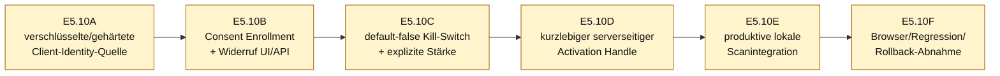

# E5.9.5 – Freigabeentscheidung vor produktiver Gruppenwirkung E5.10

**Stand:** 2026-07-12 15:19 CEST
**Branch:** `operator-workbench-phase1`
**Entscheidung:** **E5.9 technisch freigegeben; E5.10 derzeit NO-GO**

---

## 1. Executive Decision

| Gate | Entscheidung | Begründung |
|---|---:|---|
| E5.9 – vertrauenswürdige Resolver-Vorbereitung | **GO / abgeschlossen** | Baseline-Semantik, Owner-/Tenant-Source, Consent-Version/-Ablauf, Widerruf, Erasure und in-memory Draft-Brücke sind testgesichert |
| E5.10 – produktive Gruppenwirkung im normalen Scan | **NO-GO** | Reale Consent-Erfassung, produktive Client-Bindung, Kill-Switch, explizite Stärke und sicherer Worker-Transport fehlen |
| Geo G1+ | **NO-GO / nicht Teil dieses Releases** | Eigene versionierte Fachsemantik und separate Datenschutzgates fehlen weiterhin |

Das NO-GO ist kein Fehler von E5.9. E5.9 hat die Engine- und Trust-Verträge bewusst vorbereitet, ohne die produktiven Pfade vorzeitig zu öffnen.

---

## 2. Erfüllte E5.9-Gates

| Prüfkriterium | Status | Beleg |
|---|---:|---|
| Default ohne Opt-in ist baseline-äquivalent | ✅ | `tests/test_group_geo_default_equivalence.py`, `tests/test_group_e510_release_gate.py` |
| Pseudonyme, kanonische Mitglieds-IDs | ✅ | `core/profiles/group_vector.py`, `core/profiles/group_member_rate_resolver.py` |
| Mindestens zwei Mitglieder | ✅ | Gruppenvektor- und Resolvertests |
| Individuelle Mitgliedseinwilligung | ✅ | `GroupMemberIdentity.analysis_consent` + Source-Prüfung |
| Separate Draft-Analyse-Einwilligung | ✅ | `GroupContextDraft.analysis_consent` |
| Owner-/Workspace-/Tenant-Bindung | ✅ | `RuntimeManifestGroupMemberIdentitySource` |
| Identitätsintegrität gegen `cli-...`-Hash | ✅ | `stable_client_id(entry) == requested` |
| Versionierte Baseline-Semantik | ✅ | `group-member-baseline-v1` |
| Versionierte Einwilligung | ✅ | `group-analysis-v1` |
| Zeitlich begrenzte Einwilligung | ✅ | verpflichtendes, timezone-aware `valid_until` |
| Sofortiger Widerruf | ✅ | `enabled=False` macht Source-Auflösung unmöglich |
| Client-Erasure entzieht Resolverfähigkeit | ✅ | `tests/test_group_member_consent_revocation.py` |
| Exakte Draft-/Resolver-Mitgliedsmenge | ✅ | `build_resolved_group_draft_opt_in()` |
| Keine Rohvektoren aus Browser/CLI | ✅ | keine Request-/CLI-Felder |
| Keine Gruppenwerte in Reports/Traces/Manifesten | ✅ | Boundary-Suchen und Safe-Summary-Tests |
| Geo bleibt getrennt | ✅ | keine Geo-Aktivierung |

---

## 3. Produktive E5.10-Blocker

| Nr. | Blocker | Schwere | Live-Code-Beleg | Erforderliche Lösung |
|---:|---|---|---|---|
| 1 | Keine reale Bedien- oder API-Funktion für individuelle Gruppenanalyse-Einwilligung | hoch | `record_group_analysis_consent()` wird außerhalb Tests nirgends aufgerufen | dedizierter Consent-Enrollment-Gate mit Owner/Tenant-Prüfung, Ablauf und Widerruf |
| 2 | Aktive Session-/Artefaktregistrierung erzeugt weiterhin Legacy-Clients ohne Kontext | hoch | `runtime_manifest.py`: `create_session()` ruft `get_or_create_client(client)` ohne `context` auf | produktive Registrierung an aktuellen `OperatorContext` binden; Legacy weiter fail-closed |
| 3 | Runtime-Clientidentitäten liegen im bestehenden `clients.json` im Klartext | hoch | `RuntimeManifestService.save_store()` schreibt JSON; Clientfelder in `get_or_create_client()` | vor produktiver Gruppenaktivierung DPAPI- oder authentifizierten Tenant-Store festlegen/migrieren |
| 4 | Lokaler `OperatorContext` ist keine echte Authentifizierung | hoch | `operator_context.py:8-13` dokumentiert ausdrücklich nur Vorbereitungsschicht | E5.10 höchstens als lokaler Einoperator-Modus kennzeichnen; Netzwerk/Multiuser bleibt gesperrt |
| 5 | Kein serverseitiger Kill-Switch/Feature-Flag | hoch | keine Referenz `MORPHIC_GROUP_ANALYSIS_ENABLED` | default-false Feature-Flag; ohne Flag bitgleicher Altpfad |
| 6 | Keine explizite Gruppenstärke in der UI | hoch | kein `group-strength` unter `apps/web/static` | separates begrenztes Feld `[0,1]`, niemals versteckter Default |
| 7 | Keine sichere Übergabe an den produktiven Scan-Worker | hoch | aktive Analyse läuft über CLI-/Subprozess; Brücke ist absichtlich nicht geroutet | serverseitiger, kurzlebiger Aktivierungs-Handle oder in-process Gate; keine Raten im CLI/Jobpayload |
| 8 | Kein produktiver Rollback-/Disable-Akzeptanztest | mittel | nur Engine-Default-Äquivalenz vorhanden | Feature-Flag off, Consent revoke, Draft delete und Client erase jeweils gegen aktiven Integrationspfad testen |
| 9 | Kein redigierter produktiver Aktivierungs-Audit | mittel | Consent-Audit existiert, aber kein E5.10-Run-Audit | nur Version, Aktivierungsstatus, Stärke-Klasse/Policy und Outcome; keine IDs/Liste/Raten |

---

## 4. Dauerhafte NO-GO-Regression

Neu:

`tests/test_group_e510_release_gate.py`

Der Test beweist aktuell:

- `Phase1ScanRequest` besitzt keine Gruppenfelder;
- `main.py` und `group_drafts.py` importieren die Aktivierungsbrücke nicht;
- es gibt keine produktive Consent-Route;
- es gibt kein UI-Feld für Gruppenstärke;
- es gibt keinen Gruppen-Feature-Flag;
- aktive Runtime-Sessionregistrierung erzeugt noch Legacy-Clients;
- `group_opt_in=None` ist exakt baseline-äquivalent.

Dieser Test ist bewusst ein Release-Siegel: E5.10 darf ihn nicht einfach löschen. Bei späterer E5.10-Implementierung muss er gateweise in positive Aktivierungs-/Rollback-Verträge umgebaut werden.

---

## 5. Empfohlene E5.10-Gate-Reihenfolge

### E5.10A – Identity-Store-Härtung

1. Bestehende Klartext-Clients inventarisieren, aber nicht automatisch migrieren.
2. DPAPI-geschützten lokalen Store oder authentifizierten Tenant-Store definieren.
3. Legacy-Einträge bleiben für Gruppenwirkung untrusted.
4. Erasure und Retention auf den neuen Store erweitern.

### E5.10B – Consent Enrollment

1. Dedizierte Route außerhalb des Scanrequests.
2. Client muss owner-/workspace-/tenant-gebunden sein.
3. Default `enabled=False`.
4. Explizites `valid_until`.
5. Widerruf und Safe-Status ohne Identitätsfelder.

### E5.10C – Aktivierungspolicy

1. `MORPHIC_GROUP_ANALYSIS_ENABLED=0` als Default.
2. Explizite Stärke `[0,1]` in separatem lokalen UI-Bereich.
3. Gruppen-Draft-Speicherung aktiviert keine Analyse.
4. Consent allein startet keinen Scan.

### E5.10D – Worker-Transport

1. Keine Rohidentitäten oder Raten in CLI-Argumenten, Jobs oder Logs.
2. Kurzlebiger serverseitiger, owner-/tenant-gebundener Activation Handle.
3. Einmalige oder zeitlich eng begrenzte Nutzung.
4. Handle enthält/zeigt keine Rohgruppe und wird nach Run/Widerruf gelöscht.

### E5.10E/F – lokale Produktivwirkung und Abnahme

1. Ausschließlich lokaler Einoperator-Modus.
2. Positiver synthetischer Opt-in-Test verändert definierte Ergebnisse.
3. Feature-Flag off, kein Opt-in, Stärke 0, Widerruf und Erasure bleiben baseline-äquivalent.
4. Reports/Traces/Manifeste bleiben redigiert.
5. Desktop-/320px-Browser-Abnahme.
6. Separater Geo-Nichtwirkungsnachweis.

---

## 6. Freigabestatus

| Aussage | Status |
|---|---:|
| E5.9-Verträge sind bereit für den nächsten Architekturblock | **JA** |
| Produktive Gruppenanalyse kann jetzt sicher eingeschaltet werden | **NEIN** |
| Lokale Gruppenentwürfe bleiben nutzbar | **JA** |
| Direkte synthetische in-memory Wirkung bleibt testbar | **JA** |
| Normale Scans bleiben unverändert | **JA** |
| Multiuser-/Netzwerkbetrieb ist freigegeben | **NEIN** |
| Geo ist freigegeben | **NEIN** |

**Finale E5.9.5-Entscheidung:** `E5.9 GO`, `E5.10 NO-GO bis E5.10A–D abgeschlossen sind`.
