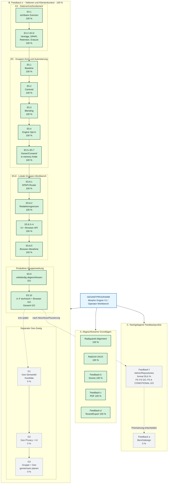

# Morphic Engine V1 – Gesamtstruktur und aktueller Fortschritt

**Stand:** 2026-07-15
**Worktree:** `C:\morphic_v1\.worktrees\operator-workbench-phase1`
**Branch:** `operator-workbench-phase1`
**Letzter Commit:** `619a1f5`

> **Hinweis zu Prozentangaben:** Die Werte sind nachvollziehbare Planungsabschätzungen und keine automatisch berechneten Produktmetriken. Bei großen Arbeitspaketen gewichten sie Datenschutz, Backend, UI, Produktivverdrahtung und Abnahme getrennt.

---

## 1. Kurzposition im Gesamtprogramm

| Gesamtbereich | Status | Fortschritt | Aktuelle Position / nächster Schritt |
|---|---:|---:|---|
| Radiquant4-Alignment | ✅ abgeschlossen | 100 % | Kein Handlungsbedarf ohne neue Integrationsanforderung |
| Radi144-UI/UX-Konsolidierung | ✅ abgeschlossen | 100 % | 9/9 Tasks umgesetzt |
| Feedback b – Score-Präzision | ✅ abgeschlossen | 100 % | Keine offenen Schritte |
| Feedback c – PDF-Layout | ✅ abgeschlossen | 100 % | Keine offenen Schritte |
| Feedback d – Tenant-/Export-Isolation | ✅ abgeschlossen | 100 % | Optionale niedrig priorisierte Config-Bereinigung offen |
| Feedback e – Radi144-Vektoren/Klientenkontext | ✅ abgeschlossen | 100 % | E5.10A–F einschließlich realer Browser-/Privacy-/Rollback-Abnahme GO; Geo bleibt separat |
| Feedback f – Admin/Repositories | 🟡 in Arbeit | formal 55,6 % | F0–F4 GO; F5-A CONDITIONAL GO nach technischem Doppel-APPROVE, Dokumentreviews/ShadowCopy offen; F5-B gesperrt |
| Feedback a – Einheitliches Berichtdesign | ⬜ offen | 0 % | Noch nicht terminiert |

**Feedbackprogramm nach Anzahl:** 4 von 6 Punkten abgeschlossen = **66,7 %**.
**Aktueller Hauptarbeitsbereich:** Punkt **e** ist einschließlich E5.10F abgeschlossen. Punkt **f** hat F0 bis F4 mit GO geschlossen. F5-A (F5.5/F5.4/F5.1) besitzt zwei driftfreie technische APPROVE und einen CONDITIONAL-GO-Record; wirksam wird das GO erst nach dokumentgebundenem Doppel-APPROVE und externer Post-State-Rückverifikation. Bis dahin ist F5-B gesperrt. Feedback f als Gesamtfeature, produktiver Admin-Catalog und Online-Repositories bleiben bis zu ihren getrennten Folgegates NO-GO. Geo bleibt ein separater, nicht freigegebener Zweig.

---

## 2. Tabellarisches Mermaid-Gesamtbild

---

## 3. Aktueller Punkt im Detail

```mermaid
flowchart LR
    classDef done fill:#d8f3dc,stroke:#2d6a4f,color:#102a1f,stroke-width:2px;
    classDef active fill:#fff3bf,stroke:#b08900,color:#3d3300,stroke-width:3px;
    classDef open fill:#f1f3f5,stroke:#868e96,color:#343a40;
    classDef gate fill:#e7f5ff,stroke:#1971c2,color:#0b3558,stroke-width:2px;

    S1["E5.8<br/>lokale DPAPI-Workbench<br/>100 %"] --> S2["E5.9<br/>Resolver/Consent/Erasure<br/>100 % · GO"]
    S2 --> D1{"E5.10 produktiv<br/>freigabefähig?"}
    D1 -- "Default/Opt-in fehlt" --> HOLD["Baseline<br/>normale Scans unverändert"]
    D1 -- "Identity-Store gehärtet" --> A["E5.10A<br/>Identity-Store<br/>100 %"]
    A --> B["E5.10B<br/>Consent Enrollment<br/>100 %"]
    B --> C["E5.10C<br/>Kill-Switch + Stärke<br/>100 %"]
    C --> D["E5.10D<br/>sicherer Worker-Transport<br/>100 %"]
    D --> E["E5.10E<br/>lokale Produktivintegration<br/>100 %"]
    E --> P["E5.10F<br/>Browser/Privacy/Rollback<br/>100 % · GO"]

    class S1,S2 done;
    class A,B,C,D,E,P done;
    class HOLD open;
    class D1 gate;
```

**E5.9 und E5.10A–F sind abgeschlossen. E5.10 ist nach realer Browser-, Privacy-, Audit-, Rollback- und Cleanup-Abnahme GO. Geo bleibt separat NO-GO; nächster Feedbackblock ist f.**

---

## 4. Punkt e – Phasen und Restaufwand

| Phase | Ergebnis | Status | Fortschritt | Offen |
|---|---|---:|---:|---|
| E4.1 | Gruppe/Geo sichtbar, aber ohne Wirkung | ✅ | 100 % | nichts |
| E4.2 | Strikte lokale Gruppen-/Geo-Verträge | ✅ | 100 % | nichts |
| E4.3 | Temp-only Windows-DPAPI-Store | ✅ | 100 % | keine Produktivablage ableiten |
| E4.4 | Retention und Erasure-Dry-Run | ✅ | 100 % | nichts im Feasibility-Scope |
| E4.5 | Exakte Löschbestätigung | ✅ | 100 % | nichts |
| E4.6 | Regression gegen Scan-/Artefaktverdrahtung | ✅ | 100 % | bei jeder späteren Integration weiterführen |
| E5.1 | Bitgleiche Baseline | ✅ | 100 % | nichts |
| E5.2 | Pseudonymer Gruppen-Centroid | ✅ | 100 % | nichts |
| E5.3 | Explizites begrenztes Blending | ✅ | 100 % | keine Gewichtung ohne Freigabe ändern |
| E5.4 | Direkter Engine-Opt-in | ✅ | 100 % | noch nicht produktiv erreichbar |
| E5.5 | Owner-/Consent-Autorisierung | ✅ | 100 % | spätere echte Identity-/Tenant-Integration |
| E5.6 | Draft-zu-Autorisierung | ✅ | 100 % | nichts im lokalen Scope |
| E5.7 | Einwilligungsgebundene in-memory Wirkung | ✅ | 100 % | keine externe Scanverdrahtung |
| E5.8.1 | Dedizierter Gruppen-Draft-Router | ✅ | 100 % | nichts Wesentliches |
| E5.8.2 | Redaktions-/Nichtwirkungstests | ✅ | 100 % | nichts |
| E5.8.3 | Gruppenkarte Phase 2 | ✅ | 100 % | nichts |
| E5.8.4 | Browser-API-Verdrahtung | ✅ | 100 % | Save/Load/Dry-Run/Delete-Reset abgenommen |
| E5.8.5 | Manuelle Browser-Abnahme | ✅ | 100 % | real auf Port 8001, Desktop/320 px, anschließend bereinigt |
| E5.9.0 | Tenant-/Workspace-gebundener Gruppen-Draft-Namespace | ✅ | 100 % | nichts |
| E5.9.1 | Versionierter `group-member-baseline-v1`-Resolver | ✅ | 100 % | nichts |
| E5.9.2 | Owner-/Tenant-/Consent-gebundener Identitäts-Source-Adapter | ✅ | 100 % | nichts |
| E5.9.3 | Draft→Source→Resolver→Opt-in-Brücke | ✅ | 100 % | nichts |
| E5.9.4 | Consent-Ablauf, Widerruf und Client-Erasure | ✅ | 100 % | nichts |
| E5.9.5 | Freigabeentscheidung vor E5.10 | ✅ | 100 % | E5.9 GO; nachfolgende E5.10A–F inzwischen ebenfalls GO |
| E5.10A | DPAPI-geschützter Identity-Store ohne Manifest-Fallback | ✅ | 100 % | als Grundlage des später separat freigegebenen Produktivpfads unverändert |
| E5.10B | lokales Consent Enrollment, Ablauf und Widerruf | ✅ | 100 % | nichts; Consent aktiviert keinen Scan |
| E5.10C | default-false Kill-Switch und explizite Stärke `[0,1]` | ✅ | 100 % | in E5.10F als sichtbares Browser-Gate abgenommen |
| E5.10D | sicherer kurzlebiger Worker-Transport | ✅ | 100 % | in E5.10E/F produktiv verdrahtet und redigiert abgenommen |
| E5.10E | streng lokale Gruppen-Produktivintegration über One-Time-Handles | ✅ | 100 % | Backend-/Workerpfad technisch grün; Browserfreigabe durch E5.10F erfolgt |
| E5.10F | Browser-, Privacy-, Audit- und Rollback-Gesamtfreigabe | ✅ | 100 % | reale aktivierte Top-3-Ausführung, Post-Issue-Erasure-Invalidierung, 51-Dateien-Artefaktaudit, 320-px-Abnahme und Cleanup bestanden |
| G1 | Versionierte Geo-Semantik | ⬜ | 0 % | fachliche Formel/Präzision freigeben |
| G2 | Geo-Kandidat, Privacy, UI und Opt-in | ⬜ | 0 % | erst nach G1 |
| G3 | Eventuelle kombinierte Gruppe+Geo-Wirkung | ⬜ | 0 % | erst nach getrennten Einzelabnahmen |

---

## 5. Priorisierte offene Punkte

| Priorität | Arbeitspaket | Konkrete Schritte | Abschlusskriterium |
|---:|---|---|---|
| **P0** | E5.10A Identity-Store-Härtung | abgeschlossen; separater DPAPI-Store, Erasure/Retention und Resolver ohne Manifest-Fallback | ✅ erfüllt |
| **P0** | E5.10B Consent Enrollment | abgeschlossen; dedizierte UI/API, Owner/Tenant, Version, Ablauf und Widerruf | ✅ erfüllt; keine Scanaktivierung |
| **P1** | E5.10C Aktivierungspolicy | abgeschlossen; default-false Kill-Switch und explizite Stärke `[0,1]` | ✅ erfüllt; Flag off/Stärke 0 ohne Wirkung |
| **P1** | E5.10D Worker-Transport | abgeschlossen; kurzlebiger DPAPI-One-Time-Handle ohne Rohdatenpayload | ✅ erfüllt und in E5.10E/F produktiv abgenommen |
| **P1** | E5.10E lokale Produktivintegration | abgeschlossen; Root-/Child-One-Time-Handles bis `AnalysisService` | ✅ technisch erfüllt; Gesamtfreigabe durch E5.10F erteilt |
| **P1** | E5.10F Gesamtfreigabe | abgeschlossen; positive synthetische Wirkung, Post-Issue-Erasure, Real-Artefakt-Redaction, Browserabnahme und Cleanup | ✅ E5.10 gesamt GO |
| **P2** | Geo-Semantik entscheiden | manuell, netzwerkfrei, versioniert, zulässige Präzision | explizite fachliche Freigabe |
| **P2** | Geo separat umsetzen | Kandidat, Privacy, Opt-in, UI, Abnahme | eigene Einzelabnahme; nicht zusammen mit Gruppe |
| **P3** | Feedback f – F5-A Abschluss | Dokumentgebundener Doppelreview und externe Post-State-Verifikation | F5-B bleibt bis zur Wirksamkeit des CONDITIONAL GO gesperrt |
| **P3** | Feedback a | HTML-/PDF-Designquellen und Zielreihenfolge bestimmen | abgestimmter Designplan |
| **P3** | Alte Export-Konfigurationen | `pyproject.toml`/`config.yaml` gegen gelöschte Testpfade prüfen | keine veralteten Referenzen oder dokumentierte bewusste Ausnahme |

---

## 6. Was ausdrücklich noch **nicht** produktiv aktiv ist

| Funktion | Aktueller Zustand |
|---|---|
| Gruppenwirkung über normalen Webscan | streng lokal aktivierbar nur mit Kill-Switch, Stärke >0, bewusster Draft-Auswahl und gültigen Einzelconsents |
| Gruppenwirkung über CLI | nur intern über kurzlebige Root-/Child-Handles; keine öffentliche Rohgruppen-CLI-Option |
| Rohgruppenwerte in `Phase1ScanRequest` | nicht vorhanden; nur bewusste `group_draft_id`-Referenz zulässig |
| Gruppenwerte in Jobs, Reports, Traces oder Manifesten | ausgeschlossen |
| Browser-Rohvektoren der Gruppenmitglieder | nicht vorgesehen |
| Geo-Kandidat oder Geo-Wirkung | nicht implementiert |
| Browser-Geolocation | durch `Permissions-Policy: geolocation=()` deaktiviert |
| Kombinierte Gruppen+Geo-Wirkung | nicht geplant, bevor beide Einzelpfade abgenommen sind |

---

## 7. Qualitäts- und Repositoryzustand

| Prüffeld | Aktueller Nachweis |
|---|---|
| Branch | `operator-workbench-phase1` |
| Post-Issue-Erasure-Fokus | RED `4 failed`; anschließend `44 passed` |
| Post-Issue-TOCTOU-Fokus | RED `1 failed`; anschließend relevanter Fokus `40 passed` |
| Review-Findings | RED `6 failed` plus ungebundene Root-Autorisierung RED `1 failed`; danach Fokus `76 passed` |
| unabhängiger Re-Review | `APPROVE`, Konfidenz hoch, keine neuen P0–P2-Befunde |
| Rest-Suite | `481 passed, 2 skipped`; 13 bekannte gemeinsame Rate-Limit-429-Ausreißer |
| Betroffene Tests isoliert | alle 13 429-Fälle jeweils in frischem Python-Prozess `1 passed` |
| Top-5-Smoke | `1 passed in 95.40s` |
| Python-Compile | bestanden |
| JavaScript-Syntax | bestanden |
| `git diff --check` | bestanden |
| Working Tree | umfangreich modified/untracked; nicht bereinigt, nicht committed |

> Die zahlreichen vorhandenen Modified-/Untracked-Dateien dürfen nicht pauschal bereinigt, gestaged oder gelöscht werden. Vor einem späteren Commit ist eine gezielte Scope- und Diff-Prüfung erforderlich.

---

## 8. Empfohlene Fortsetzung

1. **Feedback f – F5-A abschließen:** finalen Dokumentfreeze doppelt abnehmen und danach den externen Post-State vollständig rückverifizieren; F5-B bleibt bis dahin gesperrt.
2. **Repository-Grenze bewahren:** Online-Fetch/Sync bleibt bis F1–F6 technisch NO-GO; Source-Aktivierung, Fetch, Publish und Runtime-Aktivierung bleiben getrennte Aktionen.
3. **Feedback a priorisieren:** Zeitpunkt und Zielreihenfolge für einheitliches HTML-/PDF-Berichtdesign entscheiden.
4. **Geo weiterhin getrennt behandeln:** keine implizite Freigabe aus dem E5.10-Gruppen-GO ableiten.
5. **Golden Record beibehalten:** `PROJECT_MEMORY/00_CURRENT_STATE.md` ist auf F4-/F4.4-GO und den F5-A-CONDITIONAL-GO-Zwischenstand aktualisiert und bleibt die aktuelle Wiederanlaufquelle.

Feedback-f-Evidenz:

- Ist-Analyse: `docs/status/2026-07-13-feedback-f-admin-repositories-ist-analyse.md`
- Gateplan: `.hermes/plans/2026-07-13-feedback-f-admin-catalog-repositories.md`
- F1-Gate-Record: `docs/status/2026-07-13-feedback-f-F1-contracts-store.md`
- F2.1-Gate-Record: `docs/status/2026-07-13-feedback-f-F2-1-offline-service.md`
- F2.2-Gate-Record: `docs/status/2026-07-13-feedback-f-F2-2-pfadpolicy.md`
- F2.3-Gate-Record: `docs/status/2026-07-13-feedback-f-F2-3-backup-recovery.md`
- F2.4-Gate-Record: `docs/status/2026-07-13-feedback-f-F2-4-audit-integrity.md`
- F3.1-Gate-Record: `docs/status/2026-07-14-feedback-f-F3-1-legacy-profile-normalisierung.md`
- F3.2-Gate-Record: `docs/status/2026-07-14-feedback-f-F3-2-profil-draft-crud.md`
- F3.3-/F3-Gate-Record: `docs/status/2026-07-14-feedback-f-F3-3-runtime-shadow-adapter.md`
- F4.1-Gate-Record: `docs/status/2026-07-14-feedback-f-F4-1-legacy-remedy-import.md`
- F4.2-Gate-Record: `docs/status/2026-07-14-feedback-f-F4-2-legacy-multiplexmodelle.md`
- F4.3-Gate-Record: `docs/status/2026-07-14-feedback-f-F4-3-remedy-multiplex-draft-crud.md`
- F4.4-/F4-Gate-Record: `docs/status/2026-07-14-feedback-f-F4-4-legacy-remedy-launcher.md`
- F5-A-Gate-Record: `docs/status/2026-07-15-feedback-f-F5-A-source-pipeline-hardening-gate.md`
