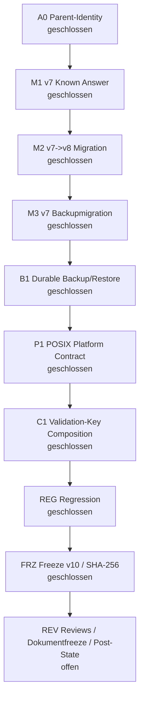
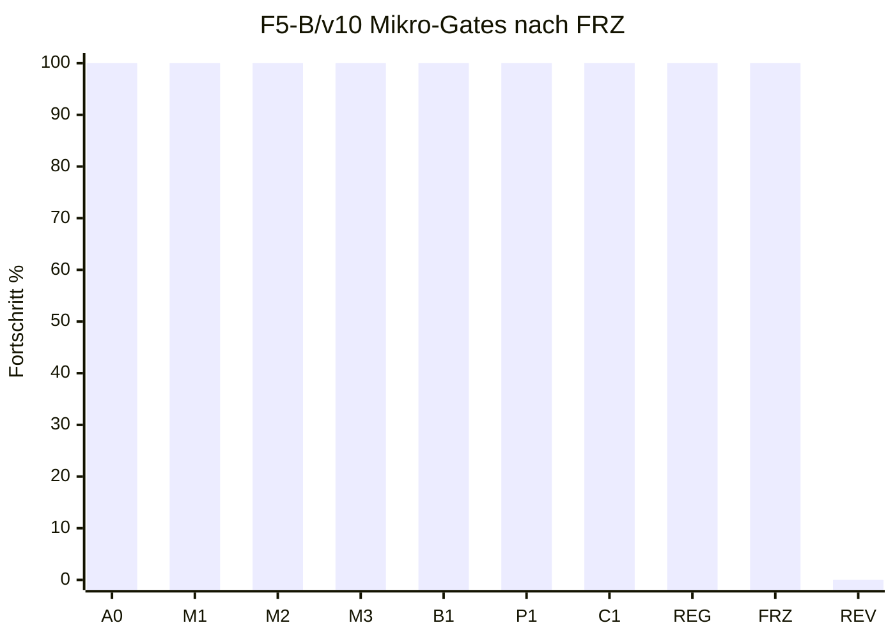

# Feedback f - F5-B technischer Freeze v10

Datum: 2026-07-17
Arbeitsort: `C:\morphic_v1\.worktrees\operator-workbench-phase1`
Branch: `operator-workbench-phase1`
HEAD: `619a1f5485a151816e32732929a6a823839ccb57`
Status: `FREEZE V10 CREATED / REVIEW PENDING / NO-GO`

## 1. Kurzfazit

Freeze v10 bindet den technisch geschlossenen und regressionsgeprueften
F5-B/v10-Stand nach A0, M1, M2, M3, B1, P1, C1 und REG an eine stabile
SHA-256-Scopebasis. Der Scope wurde deterministisch erzeugt und unmittelbar
gegen die aktuellen Dateien rueckverifiziert.

F5-B bleibt trotz dieses Freezes formal `NO-GO`. Der Freeze erlaubt jetzt
ausschliesslich die naechsten read-only Gates: zwei technische Reviews auf
exakt denselben Scope, danach Dokumentfreeze, Dokumentreviews und erst danach
eine Post-State-ShadowCopy.

## 2. Prozentstand nach FRZ

| Ebene | Vor FRZ | Nach FRZ | Bewertung |
|---|---:|---:|---|
| F5-B/v10 Mikro-Gates | 8/10 = 80 % | **9/10 = 90 %** | A0, M1, M2, M3, B1, P1, C1, REG und FRZ technisch geschlossen |
| F5 gezaehlte Arbeitseinheiten | 11/14 = 79 % | **12/14 = 86 %** | naechster Block ist REV |
| Feedback f gezaehlte Einheiten | 25/39 = 64 % | **26/39 = 67 %** | konservativ gerundet |
| Feedback f Hauptphasenmodell | 60 % | **61 %** | F1-F4 GO, F5 ca. 86 %, F6-F8 0 % |
| Nutzerfeedback a-f gesamt | 77 % | **78 %** | b/c/d/e erledigt, f ca. 67 %, a offen |

## 3. Mermaid-Status

## 4. Freeze-Artefakte

| Artefakt | Wert |
|---|---|
| Scope-Datei | `docs/status/2026-07-17-feedback-f-F5-B-technical-freeze-v10.scope.txt` |
| Scope-Datei SHA-256 | `dd9449cd364e10920280b5d7f022f1c8f453d32b1cf7b29f03473dc95eaf15fd` |
| Hash-Manifest | `docs/status/2026-07-17-feedback-f-F5-B-technical-freeze-v10.sha256` |
| Hash-Manifest SHA-256 | `19b851aead78c27885eb5a36b75430b231e9dcb9ea887ffe486b52ab35cd6cb1` |
| Scope-Dateien | `113` |
| Rueckverifikation | `113/113 OK` |

Das Freeze-Dokument selbst ist bewusst nicht Bestandteil seines eigenen
Scope-Manifests. Reviewer muessen den SHA-256 dieses Dokuments separat am
Anfang und unmittelbar vor ihrem Verdict erfassen.

## 5. Scope-Zusammensetzung

| Klasse | Anzahl | Inhalt |
|---|---:|---|
| `core/admin_catalog/*.py` | 17 | Store, Backup, Migration, Attestation, Validation-Key-Composition, Service und Adapter |
| Source-Authority-Code | 2 | `core/source_registry.py`, `core/source_data_promotion.py` |
| CLI-Code | 2 | `apps/cli/main.py`, `apps/cli/commands/sources.py` |
| Admin-/Source-/F5-B-Tests | 25 | Admin-Catalog-, Migration-, Backup-, Source-, CLI- und Review-Finding-Tests |
| Web-/Workbench-/Top-5-Regressionsnachweise | 41 | Web-, Workbench-, WebUI-Launcher- und Top-5-Smoke-Tests aus REG |
| Historische F5-B-Freezes/Reviews | 14 | Freeze v4-v9 und technische Reviewreports v6-v9 |
| v10-Status-/Plan-Dokumente | 10 | A0, M1, M2, M3, B1, P1, C1, REG und aktuelle Uebersichten |
| Plan-/Konfigurationskontext | 2 | `.hermes`-Gesamtplan und `tests/conftest.py` |

Reviewscope sind exakt die 113 Dateien in
`2026-07-17-feedback-f-F5-B-technical-freeze-v10.scope.txt` und die zugehoerigen
Hashes in `2026-07-17-feedback-f-F5-B-technical-freeze-v10.sha256`.

## 6. Regressionsevidenz aus REG

| Matrix | Ergebnis | Bewertung |
|---|---:|---|
| Admin-Catalog breit | `452 passed, 6 skipped in 31.13s` | bestanden |
| Source Registry / Atomicity / Promotion / Draft / CLI | `219 passed, 1 skipped in 10.52s` | bestanden |
| Web / Workbench / WebUI Launcher | `153 passed in 4.90s` | bestanden |
| Vollsuite ohne Top-5 nach Lintfix | `1076 passed, 8 skipped in 70.51s` | bestanden |
| Top-5-Smoke nach Lintfix | `1 passed in 95.82s` | bestanden |
| Legacy-Multiplex-Suite nach Lintfix | `30 passed, 2 skipped in 4.54s` | bestanden |
| REG-Scope `py_compile` | Exitcode 0 | bestanden |
| REG-Scope `ruff check` | Exitcode 0 | bestanden |
| `git diff --check` | Exitcode 0; bekannte LF/CRLF-Warnungen im bestehenden tracked Diff | bestanden |
| Direkter trailing-whitespace-Scan | keine Treffer | bestanden |
| Direkter Konfliktmarker-Scan | keine Treffer | bestanden |

Der initiale Admin-Matrix-Versuch mit `--basetemp C:\tmp\...` war ungueltig,
weil Pytest den Basetemp dort nicht anlegen konnte. Die Matrix wurde ohne
Codeaenderung mit `%TEMP%` wiederholt und war gruen.

## 7. Operative Nachweise

| Pruefung | Ergebnis |
|---|---|
| `config/source_repositories.json` SHA-256 | `6C93C5A1AAB9B022BF22E3A8C8097B07BDE2738EFEC3678645FFADF849E4A0B3` |
| `data/remedies.db` SHA-256 | `C67D4E899DAB9547A2171EC0D5604D9628721B6757A87D33EF8D34F0C0DADFA0` |
| `config/source_repositories.json.stage-key` | fehlt |
| `MORPHIC_ADMIN_STAGE_KEY` | unset |
| `MORPHIC_ADMIN_VALIDATION_KEYRING_FILE` | unset |
| `MORPHIC_ADMIN_VALIDATION_KEYRING` | unset |
| `MORPHIC_ADMIN_VALIDATION_AUTHORITY_ID` | unset |
| `MORPHIC_ADMIN_VALIDATION_KEY_ID` | unset |
| `MORPHIC_ADMIN_VALIDATION_KEY_HEX` | unset |
| Port `127.0.0.1:8000` / `127.0.0.1:8090` | kein Listener in der REG-Momentaufnahme |
| Git-Status kompakt vor FRZ | dirty; `397` kompakte Statuszeilen |

Keine produktive Registry, keine Remedy-DB, kein Stage-Key, kein Backup und
keine Post-State-ShadowCopy wurden durch diesen Freeze erzeugt.

## 8. Reviewauftrag

Beide technischen Reviews muessen unabhaengig, adversarial, statisch und
read-only auf exakt diesem Freeze arbeiten.

| Pflicht | Erwartung |
|---|---|
| Freeze-SHA | SHA-256 dieses Dokuments am Anfang und unmittelbar vor Verdict erfassen |
| Scope-Datei | SHA `dd9449cd364e10920280b5d7f022f1c8f453d32b1cf7b29f03473dc95eaf15fd` verifizieren |
| Hash-Manifest | SHA `19b851aead78c27885eb5a36b75430b231e9dcb9ea887ffe486b52ab35cd6cb1` verifizieren |
| Scope-Hashes | alle `113/113` Hashes erneut gegen die Dateien pruefen |
| Driftregel | bei jeder Abweichung `INVALIDATED BY SCOPE DRIFT` |
| Verdictregel | `APPROVE` nur bei `P0=P1=P2=P3=0`; sonst `REQUEST CHANGES` |

Zu pruefen sind insbesondere:

1. Validate->Publish gegen kohaerente Manipulation aller Draftmarker.
2. Unabhaengige, immutable und extern authentisierte Validation-Attestation.
3. v7/v8-Migrationen, Backupmigration und Restore-Vertrag.
4. Durable Backup-/Restore-Publikation mit Completion-Authority.
5. Parent-/Handlebindung, Same-Parent-Authority und POSIX-`dir_fd`-Fail-Closed.
6. Validation-Key-Composition, Rotation, Unknown-Key-Fail-Closed und CLI-Injektion.
7. Source Registry, Stage, Stage-Index, Ledger, Rollback-Snapshot und Stage-Key.
8. Alle v6-v9-Reviewfindings auf tatsaechliche Closure ohne Regression.
9. Freeze-, Scope-, Branch-, HEAD-, Authority-, Stage-Key- und Port-Nachweise.

## 9. Explizite Schranken

- F5-B bleibt bis nach zwei technischen `APPROVE`-Reviews, Dokumentfreeze,
  Dokumentreviews und Post-State-ShadowCopy `NO-GO`.
- Keine Tests, Server, Netzwerkzugriffe oder Dateischreiboperationen innerhalb
  der technischen Reviews.
- Kein Commit, Staging, Push, Reset, Cleanup oder Archivverschieben ohne
  explizite Nutzerfreigabe.
- Keine produktive Registry- oder Remedy-DB-Mutation.
- Kein produktiver Stage-Key.
- Kein Backup und keine Post-State-ShadowCopy vor den vorgeschriebenen
  APPROVE-Gates.
- F6, F7 und F8 nicht vorziehen.

## 10. Exakt hier weiter

Der naechste Block ist **REV: zwei technische read-only Reviews auf Freeze v10**.

| Reihenfolge | Schritt | Exit-Kriterium |
|---:|---|---|
| 1 | Freeze-v10-SHA dieses Dokuments erfassen | Reviewanker vorhanden |
| 2 | Review 1 read-only ausfuehren | Verdict mit P0-P3 und Driftstatus |
| 3 | Review 2 read-only ausfuehren | unabhaengiges Verdict mit P0-P3 und Driftstatus |
| 4 | Findings konsolidieren | bei Findings: Freeze superseden; bei 2x APPROVE: weiter |
| 5 | Dokumentfreeze und Dokumentreviews | Dokumentlage konsistent |
| 6 | Post-State-ShadowCopy | Manifest vollstaendig rueckverifiziert |

## 11. Schlussstatus

FRZ ist technisch geschlossen. F5-B/v10 steht damit bei 9/10 Mikro-Gates
beziehungsweise 90 %, bleibt aber formal `NO-GO`, bis REV und die nachgelagerten
Freigaben abgeschlossen sind.
