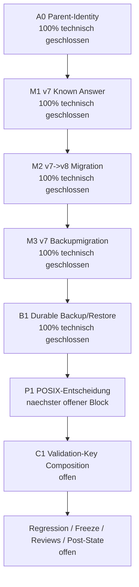
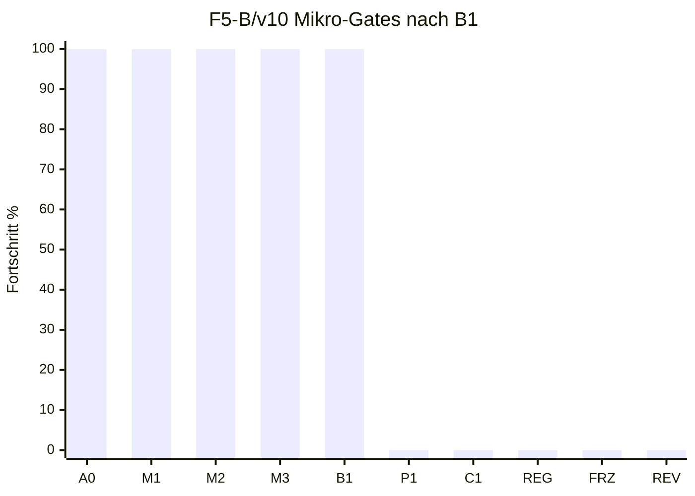

# Feedback f / F5-B v10 / Gate B1: Durable Backup-/Restore-Publikation

Stand: 2026-07-17
Arbeitsort: `C:\morphic_v1\.worktrees\operator-workbench-phase1`
Branch: `operator-workbench-phase1`
HEAD: `619a1f5`
Status: **B1 technisch geschlossen; F5-B bleibt formal NO-GO**

## 1. Kurzfazit

Gate B1 ist im fokussierten Backup-/Restore-Scope umgesetzt und verifiziert. Backup-Bundles bestehen jetzt aus genau drei autoritativen Dateien:

| Datei | Rolle | Authority |
|---|---|---|
| `catalog.sqlite3` | konsistenter SQLite-Snapshot | Datenautoritaet |
| `manifest.json` | Groesse, Hash, Katalogschema, Aktivierungsgrenze | Manifestautoritaet |
| `completion.json` | finaler Abschlussrecord mit Hash auf Manifest und DB | Bundle-Completion-Authority |

Restore konsumiert ein Bundle erst, wenn `completion.json` vorhanden, sicher lesbar und konsistent mit Manifest und Datenbank ist. Backup-Erzeugung und Restore-Zielpublikation verwenden jetzt dieselbe guard-basierte Publish-Boundary aus `core.source_registry`.

## 2. Prozentstand nach B1

| Ebene | Vor B1 | Nach B1 | Bewertung |
|---|---:|---:|---|
| F5-B/v10 Mikro-Gates | 4/10 = 40 % | **5/10 = 50 %** | A0, M1, M2, M3, B1 technisch geschlossen |
| F5 gezählte Arbeitseinheiten | 7/14 = 50 % | **8/14 = 57 %** | F5-B bleibt NO-GO, aber B1 ist nicht mehr offen |
| Feedback f gezählte Einheiten | 21/39 = 54 % | **22/39 = 56 %** | konservativ gerundet |
| Feedback f Hauptphasenmodell | 56 % | **57 %** | F1-F4 GO, F5 ca. 57 %, F6-F8 0 % |
| Nutzerfeedback a-f gesamt | 76 % | **76 %** | Rundung bleibt unveraendert, weil Feedback a offen bleibt |

## 3. Mermaid-Status

## 4. Umgesetzte technische Aenderungen

| Datei | Aenderung | Status |
|---|---|---|
| `core/admin_catalog/backup.py` | `BACKUP_COMPLETION_SCHEMA_VERSION = 1` und `BACKUP_COMPLETION_FILENAME = "completion.json"` eingefuehrt | erledigt |
| `core/admin_catalog/backup.py` | `_completion_payload()` erzeugt den finalen Completion-Record mit Manifest-Hash, DB-Hash und `no_productive_activation: true` | erledigt |
| `core/admin_catalog/backup.py` | `_load_completion()` validiert Completion-Schema, Katalogschema, Dateinamen, Manifest-Hash und DB-Hash gegen das Manifest | erledigt |
| `core/admin_catalog/backup.py` | `_publish_without_overwrite()` nutzt `_directory_commit_guard`, `_held_file_identity` und `_link_in_guard` aus `core.source_registry` | erledigt |
| `core/admin_catalog/backup.py` | Backup publiziert DB, Manifest und Completion ueber dieselbe Parent-Identity-gebundene Boundary | erledigt |
| `core/admin_catalog/backup.py` | Restore verlangt exakt `{catalog.sqlite3, manifest.json, completion.json}` und prueft Completion vor dem Zielpublish | erledigt |
| `core/admin_catalog/backup.py` | Restore publiziert das Ziel ueber die guard-basierte Boundary und prueft danach Identitaet, Hash, Groesse und Schema erneut | erledigt |
| `core/admin_catalog/backup.py` | `migrate_catalog_backup_v7_to_v8()` laedt zuerst das v7-Manifest, damit aktuelle v8-Bundles weiterhin per Schema abgewiesen werden | erledigt |
| `tests/test_admin_catalog_backup.py` | RED/GREEN-Test fuer finalen Completion-Record hinzugefuegt | erledigt |
| `tests/test_admin_catalog_backup.py` | RED/GREEN-Test fuer fehlenden Completion-Record vor Restore-Zielanlage hinzugefuegt | erledigt |
| `tests/test_admin_catalog_backup.py` | Tests mit absichtlich umgeschriebenem Manifest aktualisieren jetzt auch `completion.json` | erledigt |
| `tests/test_admin_catalog_backup.py` | Race-/Postpublish-Monkeypatches reichen die neue `expected_parent_identity`-Option durch | erledigt |

## 5. Verifikation

| Check | Ergebnis | Bewertung |
|---|---:|---|
| RED zielgerichtet: Completion-Record und fehlende Completion | 2 erwartete Fehler vor Implementierung | TDD-RED bestaetigt |
| GREEN zielgerichtet: Completion-Record und fehlende Completion | `2 passed in 0.30s` | bestanden |
| Admin-Backup-Suite | `33 passed, 1 skipped in 2.78s` | bestanden |
| V7-Backup-Migrationskontrakt | `14 passed in 1.67s` | bestanden |
| Kombinierte Fokusmatrix: Backup + V7-Backupmigration + V7-Migration | `61 passed, 1 skipped in 5.62s` | bestanden |
| `py_compile` fuer geaenderte Python-Dateien | Exitcode 0 | bestanden |
| Ruff im Worktree-Venv | nicht verfuegbar: `No module named ruff` | durch globalen Ruff ersetzt |
| Globaler Ruff-Check | Exitcode 0 | bestanden |
| `git diff --check` | Exitcode 0; tracked-diff-Check, nur bestehende LF/CRLF-Warnungen in anderen Dateien | bestanden, aber untracked B1-Dateien dadurch nicht abgedeckt |
| Direkter trailing-whitespace-Scan mit `rg` auf relevantem B1-Scope | keine Treffer | bestanden |
| Direkter Konfliktmarker-Scan mit `rg` auf relevantem B1-Scope | keine Treffer | bestanden |

## 6. Aktueller Gate-Status

| Reihenfolge | Gate | Inhalt | Status | Fortschritt |
|---:|---|---|---|---:|
| 1 | A0 | Parentbindung aller F5-B-Dateiauthorities | technisch geschlossen | 100 % |
| 2 | M1 | Historische v7-Known-Answer-Fixtures | technisch geschlossen | 100 % |
| 3 | M2 | Atomare v7->v8-Migration | technisch geschlossen | 100 % |
| 4 | M3 | v7-Backupmigration zu neuem v8-Bundle | technisch geschlossen | 100 % |
| 5 | B1 | Gemeinsame durable Backup-/Restore-Publikation | technisch geschlossen | 100 % |
| 6 | P1 | POSIX-Entscheidung oder fail-closed Plattformvertrag | offen, naechster Block | 0 % |
| 7 | C1 | Produktive Validation-Key-Composition | offen | 0 % |
| 8 | REG | Fokus-, Admin-, Source-, Web-, Vollsuite- und Top-5-Regression | offen | 0 % |
| 9 | FRZ | Freeze v10 mit SHA-256 und Rueckverifikation | offen | 0 % |
| 10 | REV | Reviews, Dokumentfreeze, Dokumentreviews, Post-State-ShadowCopy | offen | 0 % |

## 7. Noch offene Luecken

| Luecke | Risiko | Naechster Umgang |
|---|---|---|
| P1 ist offen | POSIX-Durable-Semantik der shared Publish-Primitives ist noch nicht formal entschieden | als naechsten Block gezielt pruefen und entweder belegen oder fail-closed absichern |
| C1 ist offen | Produktive Validation-Key-Composition darf weiterhin nicht aktiviert werden | erst nach P1 bearbeiten |
| F5-B Regression/Freeze offen | Einzelgates sind gruen, aber kein v10-Gesamtfreeze | nach P1/C1 mit breiter Matrix ausfuehren |
| Reviews/Post-State offen | keine formale Freigabe fuer F5-B GO | nach technischer Matrix nachziehen |
| Worktree ist vorbestehend dirty | viele untracked/modified Dateien ausserhalb B1 | nicht pauschal stagen, loeschen oder bereinigen ohne Freigabe |

## 8. Exakt hier weiter

Der naechste stabile Anschluss ist **P1: POSIX-Entscheidung oder fail-closed Plattformvertrag**.

Konkrete naechste Schritte:

| Reihenfolge | Schritt | Ziel |
|---:|---|---|
| 1 | `core.source_registry` Publish-Primitives fuer Windows und POSIX gegen B1-Anforderungen lesen | genaue Plattformgrenzen feststellen |
| 2 | POSIX-Kontrakt als RED-Test ausdruecken | Entscheidung testbar machen |
| 3 | Falls Semantik belegbar ist: POSIX als supported dokumentieren | keine stille Plattformannahme |
| 4 | Falls Semantik nicht belegbar ist: fail-closed Gate fuer unsichere Plattformen einziehen | keine halb-durable Publish-Illusion |
| 5 | Source-Registry- und Admin-Backup-Fokusmatrix ausfuehren | A0-M3-B1 nicht regressieren |
| 6 | P1-Statusdokument schreiben | naechsten Gate-Record erzeugen |

## 9. Schlussstatus

B1 ist technisch geschlossen. Der Umsetzungsplan geht jetzt nicht mehr bei Backup-/Restore-Completion weiter, sondern bei **P1**. F5-B bleibt formal **NO-GO**, bis P1, C1, Regression, Freeze, Reviews und Post-State-ShadowCopy abgeschlossen sind.
