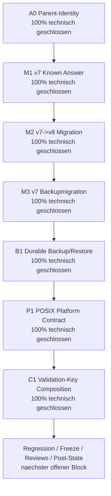
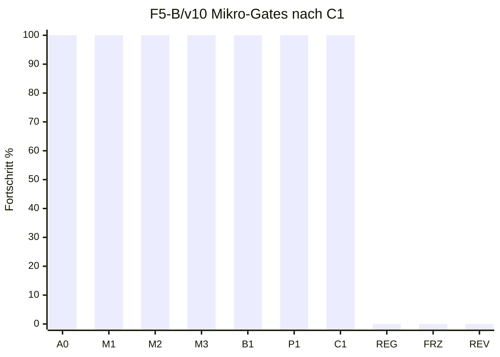

# Feedback f / F5-B v10 / Gate C1: Validation-Key Composition

Stand: 2026-07-17
Arbeitsort: `C:\morphic_v1\.worktrees\operator-workbench-phase1`
Branch: `operator-workbench-phase1`
HEAD: `619a1f5`
Status: **C1 technisch geschlossen; F5-B bleibt formal NO-GO**

## 1. Kurzfazit

Gate C1 ist im produktiven Composition-Scope technisch umgesetzt. Die
Store-Grenze hatte bereits den HMAC-Vertrag; C1 schliesst jetzt den fehlenden
Composition Root:

| Vertrag | Ergebnis |
|---|---|
| Fehlende produktive Validation-Key-Konfiguration | fail-closed, wenn ein mutierender Service explizit einen Validation-Key verlangt |
| Optionaler Draft-Import ohne Publish/Activation | bleibt kompatibel, erzeugt keinen stillen Default-Key |
| Expliziter Keyring | JSON-Keyring mit Purpose `morphic_admin_catalog_validation_hmac_v1` |
| Stage-/Audit-Key-Verwechslung | raw Stage-Key-Dateien und Audit-Purpose-Keyrings werden abgewiesen |
| Unknown Active Key-ID | fail-closed vor DB-Oeffnung, ohne Secret-Leak in Fehlermeldungen |
| Rotation | Keyring kann mehrere Key-IDs halten; die aktive Key-ID ist explizit |
| CLI-Injektion | `sources data-import-draft --validation-keyring` injiziert den Provider in `CatalogStore` |

Damit gibt es weiter keinen produktiven Admin-Default-Key. Secrets werden nicht
in DB, Backup, Manifest, Logs oder Dokumente geschrieben; Tests nutzen nur
synthetische Keymaterialien.

## 2. Prozentstand nach C1

| Ebene | Vor C1 | Nach C1 | Bewertung |
|---|---:|---:|---|
| F5-B/v10 Mikro-Gates | 6/10 = 60 % | **7/10 = 70 %** | A0, M1, M2, M3, B1, P1, C1 technisch geschlossen |
| F5 gezaehlte Arbeitseinheiten | 9/14 = 64 % | **10/14 = 71 %** | naechster Block ist v10-Regression |
| Feedback f gezaehlte Einheiten | 23/39 = 59 % | **24/39 = 62 %** | konservativ gerundet |
| Feedback f Hauptphasenmodell | 58 % | **59 %** | F1-F4 GO, F5 ca. 71 %, F6-F8 0 % |
| Nutzerfeedback a-f gesamt | 76-77 % | **77 %** | Rundungsbereich; Feedback a bleibt offen |

## 3. Mermaid-Status

## 4. Umgesetzte technische Aenderungen

| Datei | Aenderung | Status |
|---|---|---|
| `core/admin_catalog/validation_key_composition.py` | neue Composition-Helfer fuer externe Validation-HMAC-Keyrings | erledigt |
| `core/admin_catalog/validation_key_composition.py` | `ValidationKeyCompositionError` fuer fehlende, falsche oder unsichere Konfiguration | erledigt |
| `core/admin_catalog/validation_key_composition.py` | JSON-Keyring-Purpose, Authority-ID, Active-Key-ID und Keymap werden geprueft | erledigt |
| `core/admin_catalog/validation_key_composition.py` | Env-Komposition ueber `MORPHIC_ADMIN_VALIDATION_KEYRING_FILE` / `MORPHIC_ADMIN_VALIDATION_KEYRING` oder direkte Validation-Key-Variablen | erledigt |
| `core/admin_catalog/validation_key_composition.py` | `build_admin_catalog_service()` komponiert Provider vor DB-Oeffnung | erledigt |
| `apps/cli/commands/sources.py` | `sources data-import-draft` akzeptiert `--validation-keyring` und injiziert den Provider in `CatalogStore` | erledigt |
| `tests/test_admin_catalog_validation_key_composition.py` | RED/GREEN-Vertraege fuer fehlende Keys, Cross-Key, Unknown Key-ID, Rotation und Service-Komposition | erledigt |
| `tests/test_source_registry_cli.py` | CLI-Vertrag fuer explizite Provider-Injektion ohne Secret-Ausgabe | erledigt |

## 5. Verifikation

| Check | Ergebnis | Bewertung |
|---|---:|---|
| C1 RED Composition + CLI | `8 failed` vor Implementierung | TDD-RED bestaetigt |
| C1 GREEN Composition + CLI | `8 passed in 0.76s` | bestanden |
| C1/F5-B Fokusmatrix | `181 passed in 12.97s` | bestanden |
| P1/B1/Migrationsmatrix plus C1 | `117 passed, 1 skipped in 6.16s` | bestanden |
| `py_compile` fuer C1-Fokusdateien | Exitcode 0 | bestanden |
| Globaler Ruff-Check fuer C1-Fokusdateien | Exitcode 0 | bestanden |
| `git diff --check` | Exitcode 0; bekannte LF/CRLF-Warnungen in bestehendem tracked Diff | bestanden, aber untracked Dateien dadurch nicht abgedeckt |
| Direkter trailing-whitespace-Scan mit `rg` auf C1-Fokusdateien | keine Treffer | bestanden |
| Direkter Konfliktmarker-Scan mit `rg` auf C1-Fokusdateien | keine Treffer | bestanden |

Hinweis: Die lokale `.venv` enthaelt kein `ruff`-Modul und kein `ruff.exe`; der
Ruff-Check wurde deshalb ueber den globalen `ruff.exe` im PATH ausgefuehrt.

## 6. Aktueller Gate-Status

| Reihenfolge | Gate | Inhalt | Status | Fortschritt |
|---:|---|---|---|---:|
| 1 | A0 | Parentbindung aller F5-B-Dateiauthorities | technisch geschlossen | 100 % |
| 2 | M1 | Historische v7-Known-Answer-Fixtures | technisch geschlossen | 100 % |
| 3 | M2 | Atomare v7->v8-Migration | technisch geschlossen | 100 % |
| 4 | M3 | v7-Backupmigration zu neuem v8-Bundle | technisch geschlossen | 100 % |
| 5 | B1 | Gemeinsame durable Backup-/Restore-Publikation | technisch geschlossen | 100 % |
| 6 | P1 | POSIX-Entscheidung oder fail-closed Plattformvertrag | technisch geschlossen | 100 % |
| 7 | C1 | Produktive Validation-Key-Composition | technisch geschlossen | 100 % |
| 8 | REG | Fokus-, Admin-, Source-, Web-, Vollsuite- und Top-5-Regression | offen, naechster Block | 0 % |
| 9 | FRZ | Freeze v10 mit SHA-256 und Rueckverifikation | offen | 0 % |
| 10 | REV | Reviews, Dokumentfreeze, Dokumentreviews, Post-State-ShadowCopy | offen | 0 % |

## 7. Noch offene Luecken

| Luecke | Risiko | Naechster Umgang |
|---|---|---|
| v10-Gesamtregression offen | C1/P1/B1 sind gezielt gruen, aber noch kein Gesamtfreeze | als naechsten Block breite Regression ausfuehren |
| Freeze/Reviews/Post-State offen | keine formale F5-B-Freigabe | nach Regression Freeze erzeugen und Reviews einholen |
| F6/F7/F8 offen | keine produktive Admin-API/UI, kein Onlineadapter, keine Runtime-Umschaltung | nicht vorziehen |
| Worktree vorbestehend dirty | viele untracked/modified Dateien ausserhalb C1 | nicht pauschal stagen, loeschen oder verschieben |

## 8. Exakt hier weiter

Der naechste stabile Anschluss ist **REG: v10-Regression und Freeze-Vorbereitung**.

Konkrete naechste Schritte:

| Reihenfolge | Schritt | Ziel |
|---:|---|---|
| 1 | C1-Scope nochmals gegen Plan pruefen | keine F6/F7/F8-Vorwegnahme |
| 2 | Admin-Catalog-Fokusmatrix breit ausfuehren | F1-F4/M1-M3/C1 nicht regressieren |
| 3 | Source-Registry-/Source-Data-Matrix ausfuehren | A0/B1/P1/C1 nicht regressieren |
| 4 | Web-/Workbench- und bekannte Baseline-Regression einordnen | nur neue C1/F5-B-Deltas werten |
| 5 | Freeze-v10-SHA-256 vorbereiten | erst bei gruener Matrix und klarer Baseline |

## 9. Schlussstatus

C1 ist technisch geschlossen. F5-B bleibt formal **NO-GO**, bis Regression,
Freeze v10, technische Reviews, Dokumentfreeze/Dokumentreviews und
Post-State-ShadowCopy abgeschlossen sind.
