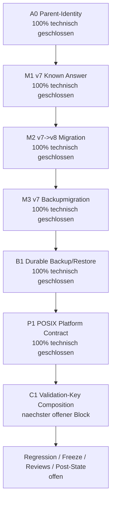
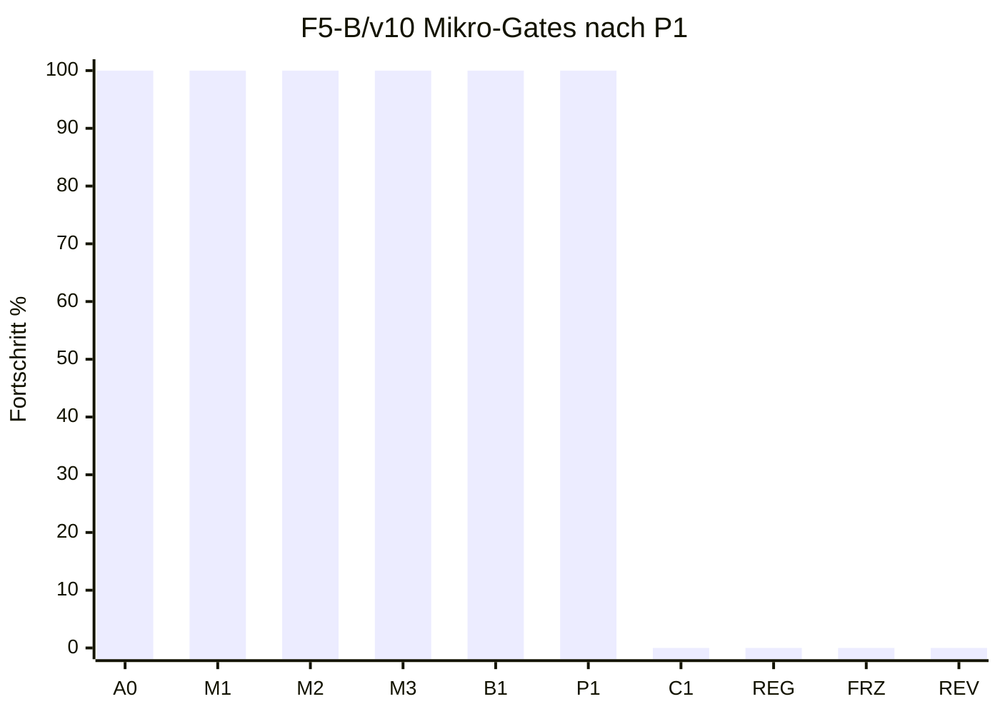

# Feedback f / F5-B v10 / Gate P1: POSIX Platform Contract

Stand: 2026-07-17
Arbeitsort: `C:\morphic_v1\.worktrees\operator-workbench-phase1`
Branch: `operator-workbench-phase1`
HEAD: `619a1f5`
Status: **P1 technisch geschlossen; F5-B bleibt formal NO-GO**

## 1. Kurzfazit

Gate P1 ist im fokussierten Source-Registry-/Backup-Publish-Scope umgesetzt und verifiziert. Die gemeinsame Publish-Boundary ist jetzt explizit:

| Plattformpfad | Entscheidung | Vertrag |
|---|---|---|
| Windows | supported | handle-bound temp file plus bound authority parent |
| POSIX mit `dir_fd` fuer Operation | supported | source und target muessen im selben gebundenen Authority-Parent liegen; Publish nutzt `src_dir_fd`/`dst_dir_fd` und Directory-Flush |
| POSIX ohne `dir_fd` fuer Operation | fail-closed | `_replace_in_guard()` / `_link_in_guard()` werfen `SourceRegistryError` vor Publish |
| Cross-parent Source oder Target | fail-closed | beide Pfade muessen unter dem Guard-Parent liegen |

Damit ist P1 nicht als generische "alle POSIX-Mounts sind garantiert durable"-Behauptung abgeschlossen, sondern als enger Plattformvertrag: Die Codepfade laufen nur, wenn die benoetigten lokalen Authority-Primitives vorhanden sind und Source/Target dieselbe Parent-Authority verwenden.

## 2. Prozentstand nach P1

| Ebene | Vor P1 | Nach P1 | Bewertung |
|---|---:|---:|---|
| F5-B/v10 Mikro-Gates | 5/10 = 50 % | **6/10 = 60 %** | A0, M1, M2, M3, B1, P1 technisch geschlossen |
| F5 gezaehlte Arbeitseinheiten | 8/14 = 57 % | **9/14 = 64 %** | C1 ist naechster offener Block |
| Feedback f gezaehlte Einheiten | 22/39 = 56 % | **23/39 = 59 %** | konservativ gerundet |
| Feedback f Hauptphasenmodell | 57 % | **58 %** | F1-F4 GO, F5 ca. 64 %, F6-F8 0 % |
| Nutzerfeedback a-f gesamt | 76 % | **76-77 %** | Rundungsbereich; Feedback a bleibt offen |

## 3. Mermaid-Status

## 4. Umgesetzte technische Aenderungen

| Datei | Aenderung | Status |
|---|---|---|
| `core/source_registry.py` | `_guard_authority_parent()` validiert die Guard-Parent-Authority | erledigt |
| `core/source_registry.py` | `_require_guarded_publish_paths()` erzwingt, dass Source und Target unter demselben gebundenen Authority-Parent liegen | erledigt |
| `core/source_registry.py` | `_replace_in_guard()` prueft vor Publish POSIX-`dir_fd`-Support und Same-Parent-Boundary | erledigt |
| `core/source_registry.py` | `_link_in_guard()` prueft vor Publish POSIX-`dir_fd`-Support und Same-Parent-Boundary | erledigt |
| `tests/test_source_registry_atomicity.py` | RED/GREEN-Test fuer Cross-Parent-Source und Cross-Parent-Target in Replace/Link | erledigt |
| `tests/test_source_registry_atomicity.py` | RED/GREEN-Test fuer POSIX fail-closed bei fehlendem `dir_fd`-Support | erledigt |

## 5. Verifikation

| Check | Ergebnis | Bewertung |
|---|---:|---|
| RED Same-Parent-Guard | `4 failed` vor Implementierung | TDD-RED bestaetigt |
| GREEN Same-Parent-Guard | `4 passed in 0.19s` | bestanden |
| RED POSIX `dir_fd` fail-closed | `2 failed` vor Implementierung | TDD-RED bestaetigt |
| GREEN POSIX `dir_fd` fail-closed | `2 passed in 0.18s` | bestanden |
| Source-Registry-Atomicity-Suite | `31 passed in 0.64s` | bestanden |
| Source-Registry-Suite | `18 passed in 0.43s` | bestanden |
| Admin-Backup + Migrationsmatrix | `61 passed, 1 skipped in 7.97s` | bestanden |
| Kombinierte P1/B1-Fokusmatrix | `110 passed, 1 skipped in 8.86s` | bestanden |
| `py_compile` fuer P1/B1-Fokusdateien | Exitcode 0 | bestanden |
| Globaler Ruff-Check fuer P1/B1-Fokusdateien | Exitcode 0 | bestanden |
| `git diff --check` | Exitcode 0; tracked-diff-Check, nur bekannte LF/CRLF-Warnungen in anderen Dateien | bestanden, aber untracked Dateien dadurch nicht abgedeckt |
| Direkter trailing-whitespace-Scan mit `rg` auf relevantem P1/B1-Scope | keine Treffer | bestanden |
| Direkter Konfliktmarker-Scan mit `rg` auf relevantem P1/B1-Scope | keine Treffer | bestanden |

Hinweis: Der erste Entwurf des POSIX-RED-Tests hatte `os.name` ueber `monkeypatch` veraendert und dadurch Pytest/`pathlib` auf Windows intern gestoert. Der Test wurde vor der Implementierung stabilisiert, indem `os.name` im `finally` vor der Fehlerberichterstattung wiederhergestellt wird.

## 6. Aktueller Gate-Status

| Reihenfolge | Gate | Inhalt | Status | Fortschritt |
|---:|---|---|---|---:|
| 1 | A0 | Parentbindung aller F5-B-Dateiauthorities | technisch geschlossen | 100 % |
| 2 | M1 | Historische v7-Known-Answer-Fixtures | technisch geschlossen | 100 % |
| 3 | M2 | Atomare v7->v8-Migration | technisch geschlossen | 100 % |
| 4 | M3 | v7-Backupmigration zu neuem v8-Bundle | technisch geschlossen | 100 % |
| 5 | B1 | Gemeinsame durable Backup-/Restore-Publikation | technisch geschlossen | 100 % |
| 6 | P1 | POSIX-Entscheidung oder fail-closed Plattformvertrag | technisch geschlossen | 100 % |
| 7 | C1 | Produktive Validation-Key-Composition | offen, naechster Block | 0 % |
| 8 | REG | Fokus-, Admin-, Source-, Web-, Vollsuite- und Top-5-Regression | offen | 0 % |
| 9 | FRZ | Freeze v10 mit SHA-256 und Rueckverifikation | offen | 0 % |
| 10 | REV | Reviews, Dokumentfreeze, Dokumentreviews, Post-State-ShadowCopy | offen | 0 % |

## 7. Noch offene Luecken

| Luecke | Risiko | Naechster Umgang |
|---|---|---|
| C1 ist offen | Produktive Validation-Key-Composition darf weiterhin nicht aktiviert werden | als naechsten Block gezielt bearbeiten |
| F5-B Regression/Freeze offen | Einzelgates sind gruen, aber kein v10-Gesamtfreeze | nach C1 mit breiter Matrix ausfuehren |
| Reviews/Post-State offen | keine formale Freigabe fuer F5-B GO | nach technischer Matrix nachziehen |
| Worktree ist vorbestehend dirty | viele untracked/modified Dateien ausserhalb P1 | nicht pauschal stagen, loeschen oder bereinigen ohne Freigabe |

## 8. Exakt hier weiter

Der naechste stabile Anschluss ist **C1: produktive Validation-Key-Composition**.

Konkrete naechste Schritte:

| Reihenfolge | Schritt | Ziel |
|---:|---|---|
| 1 | Composition-Root fuer produktive Validate/Publish-Pfade lesen | alle impliziten/fehlenden Key-Pfade finden |
| 2 | RED: fehlender Key, unknown Key-ID und Cross-Key-Verwechslung fail-closed | produktive HMAC-Verwendung testbar machen |
| 3 | Minimal-GREEN: separater Provider, Key-ID und Rotation/Unknown-Key-Grenzen | keine stille Default-Key-Nutzung |
| 4 | Source-Registry-, Source-Data- und Admin-Catalog-Fokusmatrix ausfuehren | A0-M3-B1-P1 nicht regressieren |
| 5 | C1-Statusdokument schreiben | naechsten Gate-Record erzeugen |

## 9. Schlussstatus

P1 ist technisch geschlossen. Der Umsetzungsplan geht jetzt bei **C1** weiter. F5-B bleibt formal **NO-GO**, bis C1, Regression, Freeze, Reviews und Post-State-ShadowCopy abgeschlossen sind.
