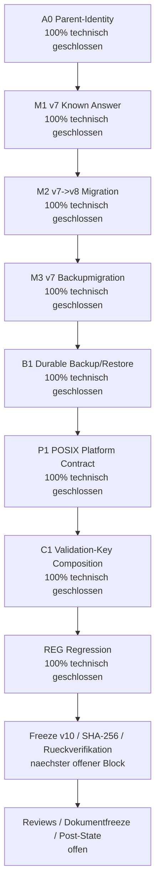
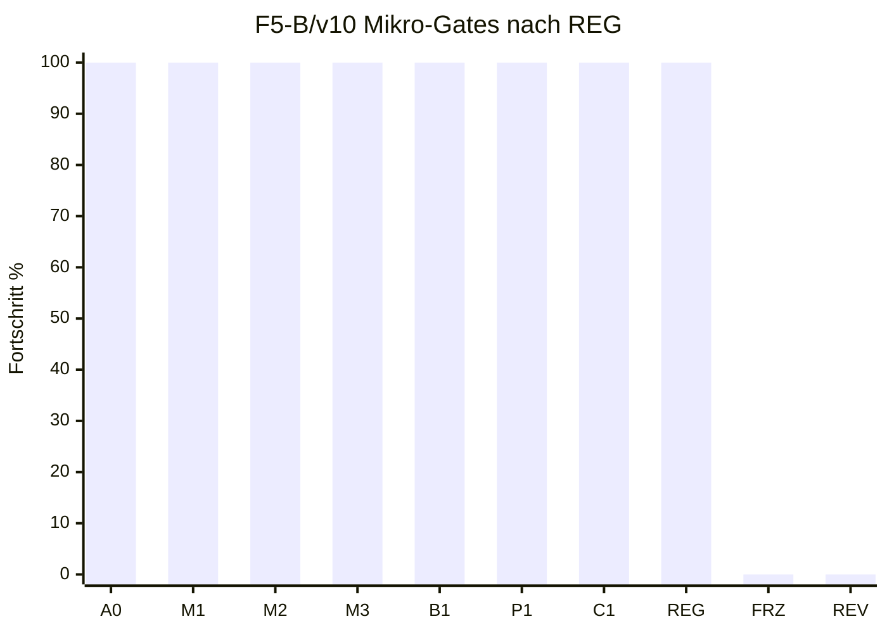

# Feedback f / F5-B v10 / Gate REG: Regression und Freeze-Vorbereitung

Stand: 2026-07-17
Arbeitsort: `C:\morphic_v1\.worktrees\operator-workbench-phase1`
Branch: `operator-workbench-phase1`
HEAD: `619a1f5485a151816e32732929a6a823839ccb57`
Status: **REG technisch geschlossen; F5-B bleibt formal NO-GO**

## 1. Kurzfazit

Gate REG ist als frische v10-Regression technisch geschlossen. Nach C1 wurden
die relevanten Admin-Catalog-, Source-, Web-/Workbench-, Vollsuite- und
Top-5-Nachweise neu ausgefuehrt. Es gibt im aktuellen REG-Lauf keine bekannten
HTTP-429-Baseline-Ausreisser und keine neuen F5-B-Deltas.

Ein initialer Admin-Matrix-Lauf mit `--basetemp C:\tmp\...` war ungueltig:
Pytest konnte den Basetemp auf diesem Windows-System nicht anlegen
(`PermissionError`). Der Lauf wurde ohne Codeaenderung mit `%TEMP%` als
Basetemp wiederholt und war gruen.

## 2. Prozentstand nach REG

| Ebene | Vor REG | Nach REG | Bewertung |
|---|---:|---:|---|
| F5-B/v10 Mikro-Gates | 7/10 = 70 % | **8/10 = 80 %** | A0, M1, M2, M3, B1, P1, C1 und REG technisch geschlossen |
| F5 gezaehlte Arbeitseinheiten | 10/14 = 71 % | **11/14 = 79 %** | naechster Block ist Freeze v10 |
| Feedback f gezaehlte Einheiten | 24/39 = 62 % | **25/39 = 64 %** | konservativ gerundet |
| Feedback f Hauptphasenmodell | 59 % | **60 %** | F1-F4 GO, F5 ca. 79 %, F6-F8 0 % |
| Nutzerfeedback a-f gesamt | 77 % | **77 %** | Rundungsbereich; Feedback a bleibt offen |

## 3. Mermaid-Status

## 4. Regressionsergebnisse

| Matrix | Ergebnis | Bewertung |
|---|---:|---|
| Admin-Catalog breit | `452 passed, 6 skipped in 31.13s` | bestanden |
| Source Registry / Atomicity / Promotion / Draft / CLI | `219 passed, 1 skipped in 10.52s` | bestanden |
| Web / Workbench / WebUI Launcher | `153 passed in 4.90s` | bestanden |
| Vollsuite ohne Top-5 nach Lintfix | `1076 passed, 8 skipped in 70.51s` | bestanden |
| Top-5-Smoke nach Lintfix | `1 passed in 95.82s` | bestanden |
| Legacy-Multiplex-Suite nach Lintfix | `30 passed, 2 skipped in 4.54s` | bestanden |

## 5. Statische Checks

| Check | Ergebnis | Bewertung |
|---|---:|---|
| REG-Scope `py_compile` | Exitcode 0 | bestanden |
| REG-Scope `ruff check` | Exitcode 0 nach Entfernung eines unbenutzten Imports | bestanden |
| `git diff --check` | Exitcode 0; bekannte LF/CRLF-Warnungen in bestehendem tracked Diff | bestanden |
| Direkter trailing-whitespace-Scan mit `rg` | keine Treffer | bestanden |
| Direkter Konfliktmarker-Scan mit `rg` | keine Treffer | bestanden |

Der einzige gefundene statische Befund war `F401` fuer einen unbenutzten
`Sequence`-Import in `core/admin_catalog/legacy_multiplex_adapter.py`. Dieser
Import wurde entfernt; danach waren Ruff, Compile und die betroffene
Legacy-Multiplex-Suite gruen.

## 6. Operative Nachweise

| Pruefung | Ergebnis |
|---|---|
| `config/source_repositories.json` SHA-256 | `6C93C5A1AAB9B022BF22E3A8C8097B07BDE2738EFEC3678645FFADF849E4A0B3` |
| `data/remedies.db` SHA-256 | `C67D4E899DAB9547A2171EC0D5604D9628721B6757A87D33EF8D34F0C0DADFA0` |
| `config/source_repositories.json.stage-key` | fehlt |
| `MORPHIC_ADMIN_STAGE_KEY` | unset |
| `MORPHIC_ADMIN_VALIDATION_KEYRING_FILE` | unset |
| `MORPHIC_ADMIN_VALIDATION_KEYRING` | unset |
| `MORPHIC_ADMIN_VALIDATION_AUTHORITY_ID` | unset |
| `MORPHIC_ADMIN_VALIDATION_KEY_ID` | unset |
| `MORPHIC_ADMIN_VALIDATION_KEY_HEX` | unset |
| Port `127.0.0.1:8000` / `127.0.0.1:8090` | kein Listener in der erhobenen Momentaufnahme |
| Git-Status kompakt | weiterhin dirty; `397` kompakte Statuszeilen |

## 7. Aktueller Gate-Status

| Reihenfolge | Gate | Inhalt | Status | Fortschritt |
|---:|---|---|---|---:|
| 1 | A0 | Parentbindung aller F5-B-Dateiauthorities | technisch geschlossen | 100 % |
| 2 | M1 | Historische v7-Known-Answer-Fixtures | technisch geschlossen | 100 % |
| 3 | M2 | Atomare v7->v8-Migration | technisch geschlossen | 100 % |
| 4 | M3 | v7-Backupmigration zu neuem v8-Bundle | technisch geschlossen | 100 % |
| 5 | B1 | Gemeinsame durable Backup-/Restore-Publikation | technisch geschlossen | 100 % |
| 6 | P1 | POSIX-Entscheidung oder fail-closed Plattformvertrag | technisch geschlossen | 100 % |
| 7 | C1 | Produktive Validation-Key-Composition | technisch geschlossen | 100 % |
| 8 | REG | Fokus-, Admin-, Source-, Web-, Vollsuite- und Top-5-Regression | technisch geschlossen | 100 % |
| 9 | FRZ | Freeze v10 mit SHA-256 und Rueckverifikation | offen, naechster Block | 0 % |
| 10 | REV | Reviews, Dokumentfreeze, Dokumentreviews, Post-State-ShadowCopy | offen | 0 % |

## 8. Noch offene Luecken

| Luecke | Risiko | Naechster Umgang |
|---|---|---|
| Freeze v10 offen | Es gibt noch keine stabile Scope-/Hashbasis fuer Reviews | als naechsten Block erzeugen |
| Reviews/Post-State offen | keine formale F5-B-Freigabe | erst nach Freeze v10 |
| F6/F7/F8 offen | keine produktive Admin-API/UI, kein Onlineadapter, keine Runtime-Umschaltung | nicht vorziehen |
| Worktree vorbestehend dirty | viele untracked/modified Dateien ausserhalb REG | nicht pauschal stagen, loeschen oder verschieben |

## 9. Exakt hier weiter

Der naechste stabile Anschluss ist **FRZ: Freeze v10 mit SHA-256 und
Rueckverifikation**.

Konkrete naechste Schritte:

| Reihenfolge | Schritt | Ziel |
|---:|---|---|
| 1 | Freeze-Scope festlegen | alle transitiv relevanten Code-, Test- und Doku-Dateien erfassen |
| 2 | SHA-256 je Scope-Datei erzeugen | stabile Reviewbasis schaffen |
| 3 | Manifest direkt rueckverifizieren | Drift ausschliessen |
| 4 | Freeze-v10-Statusdokument schreiben | Reviewpaket vorbereiten |
| 5 | Zwei technische Reviews an exakt denselben Freeze binden | formale Freigabe vorbereiten |

## 10. Schlussstatus

REG ist technisch geschlossen. F5-B bleibt formal **NO-GO**, bis Freeze v10,
technische Reviews, Dokumentfreeze/Dokumentreviews und Post-State-ShadowCopy
abgeschlossen sind.
