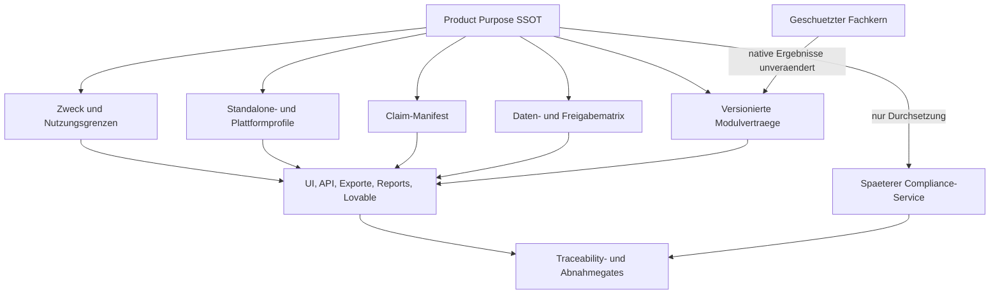

# Radiquant Wellbeing Product Purpose Contract

**Dokument-ID:** `RQ-PPC`  
**Vertragsversion:** `1.0.0`  
**Status:** `approved` - schriftliche Gesamtabnahme erteilt  
**Stand:** 24.07.2026  
**Geltung:** Radiquant Standalone, Radiquant-Plattform, Lovable Experience-/Control-Plane und alle sechs Radiquant-Module  
**Normative Sprache:** Deutsch

## 1. Zweck und Status dieses Dokuments

Dieses Dokument ist die menschenlesbare, versionierte Single Source of Truth (SSOT) fuer den Produktzweck und die Wellbeing-Compliance von Radiquant. Es konsolidiert die acht am 23.07.2026 einzeln genehmigten Designabschnitte.

Der Status `approved` bedeutet:

- die enthaltenen Designabschnitte wurden einzeln fachlich genehmigt,
- die schriftliche Gesamtabnahme des konsolidierten Vertrags wurde erteilt,
- das Dokument ist genehmigt, aber noch nicht `active`,
- aus diesem Dokument folgt keine Behauptung technischer, rechtlicher, regulatorischer oder produktiver Freigabe,
- Produktcode, Modulkerne und Integrationen wurden durch diese Spezifikation nicht veraendert.

Mit der schriftlichen Gesamtabnahme ist dieser Vertrag als Version `1.0.0` genehmigt. Der Status `approved` ist keine technische Aktivierung; diese bleibt an die in diesem Dokument definierten Nachweise und Gates gebunden.

## 2. Normative Auslegung

Die Schluesselwoerter einschliesslich ihrer grammatisch notwendigen Singular- und Pluralformen werden wie folgt verwendet:

| Begriff | Bedeutung |
|---|---|
| **MUSS** / **MUESSEN** | verbindliche Anforderung |
| **DARF NICHT** / **DUERFEN NICHT** | verbindliches Verbot |
| **SOLL** / **SOLLEN** | starke Empfehlung; Abweichung nur mit dokumentierter Begruendung |
| **DARF** / **DUERFEN** | ausdruecklich zulaessige Option innerhalb der uebrigen Regeln |

Alle normativen Anforderungen und Gates besitzen eine stabile ID. Erlaeuternde Texte ohne solche ID begruenden keine eigenstaendige Erweiterung des Produktzwecks.

Dieses Dokument ist technische Produkt- und Compliance-Governance. Es ersetzt keine Rechtsberatung, Datenschutz-Folgenabschaetzung, medizinprodukterechtliche Bewertung oder wissenschaftliche Validierung.

## 3. Geltung und Normenhierarchie

| Requirement-ID | Normative Anforderung |
|---|---|
| `PPC-SCP-001` | Der `Radiquant Wellbeing Product Purpose Contract` MUSS die oberste normative Produktzweckinstanz der Produktfamilie sein. |
| `PPC-SCP-002` | Eine einzige versionierte Produktzweck-SSOT MUSS fuer Radiquant Standalone, Radiquant-Plattform, Lovable und die sechs Module gelten. Getrennte oder konkurrierende Zweckbestimmungen sind unzulaessig. |
| `PPC-SCP-003` | Die kanonischen Module sind `radi144`, `radiworks`, `radimorphic`, `radiblohm`, `radithoms` und `radicopen`. |
| `PPC-SCP-004` | Standalone, Plattform, Cloud, Edge und einzelne Module DUERFEN nur Betriebsprofile innerhalb desselben Vertrags erhalten. |
| `PPC-SCP-005` | Ein Betriebsprofil DARF Regeln verschaerfen oder Funktionen deaktivieren, aber den Produktzweck, Claims oder Datenfreigaben NICHT erweitern oder abschwaechen. |
| `PPC-SCP-006` | Bei Widerspruechen MUSS diese SSOT Vorrang vor Profilen, Modulbeschreibungen, UI-Texten, API-Beschreibungen, Exporten, Reports und spaeteren Enforcement-Diensten haben. |
| `PPC-SCP-007` | Modulvertraege, API-Schemas, Oberflaechen, Exporte, Events und Enforcement-Dienste MUESSEN die verwendete Produktzweckversion referenzieren. |
| `PPC-SCP-008` | Die Integration der sechs Module bleibt bis zu einer ausdruecklichen Freigabe pausiert. Diese Spezifikation ist keine Integrationsfreigabe. |

## 4. Normativer Produktzweck

> Radiquant ist ein nichtmedizinisches Wellbeing-, Reflexions-, Forschungs- und Simulationssystem. Es erzeugt mithilfe versionierter Module personalisierte algorithmische Muster, Visualisierungen, Scores, Audio-, Harmonisierungs- und Sessionartefakte. Diese dienen der Selbstreflexion, Meditation, nichtmedizinischen Gespraechsbegleitung, explorativen Simulation und dokumentierten Wellbeing-Nutzung.

### 4.1 Zielgruppen und Nutzung

| Requirement-ID | Normative Anforderung |
|---|---|
| `PPC-PUR-001` | Radiquant MUSS als nichtmedizinisches Wellbeing-, Reflexions-, Forschungs- und Simulationssystem positioniert und betrieben werden. |
| `PPC-PUR-002` | Zulaessige Zielgruppen sind private Einzelanwender, nichtmedizinische Wellbeing-Fachanwender und Begleiter, entsprechend arbeitende Coaches und Praxen, spaeter freigegebene Organisationen und Teams sowie Entwickler und Forscher in nichtklinischen explorativen Kontexten. |
| `PPC-PUR-003` | Eine medizinische oder sonstige berufliche Qualifikation des Anwenders DARF den zulaessigen Produktzweck nicht in Richtung Diagnose, Prognose oder Therapie erweitern. |
| `PPC-PUR-004` | Zulaessig sind Reflexions- und Visualisierungsimpulse, Meditation, persoenliche Fokussierung, nichtmedizinische Sessionbegleitung, explorativer Vergleich algorithmischer Muster, technische Simulation und Dokumentation erzeugter Artefakte. |
| `PPC-PUR-005` | Scores, Matrizen, Muster, Visualisierungen und Zusammenfassungen DUERFEN NICHT als objektive Wahrheit, kalibrierte Wahrscheinlichkeit, klinische Kennzahl oder entscheidende Autoritaet dargestellt werden. |
| `PPC-PUR-006` | Diagnose, Verdachtsdiagnose, Prognose, medizinische Risikobewertung, Therapie-, Medikations- oder Behandlungsentscheidung sowie Heil- und Wirksamkeitsversprechen sind verboten. |
| `PPC-PUR-007` | Forschung MUSS im aktuellen Vertrag als technische, explorative und nichtklinische Forschung verstanden werden. Klinische Forschung oder gesundheitsbezogene Entscheidungen benoetigen einen getrennten, vorab genehmigten Governance- und Evidenzrahmen. |
| `PPC-PUR-008` | Die Begriffe Resonanz, Quantum, EMF, energetisch und Harmonisierung DUERFEN nur gemaess dem Claim-Manifest in Abschnitt 8 verwendet werden. |

## 5. Dual-Mode-Betrieb und Autoritaeten

### 5.1 Radiquant Standalone

| Requirement-ID | Normative Anforderung |
|---|---|
| `PPC-AUT-001` | Radiquant Standalone MUSS dauerhaft vollstaendig offline und ohne Lovable-, Cloud-, Radiquant-Plattform- oder Internetverbindung funktionsfaehig bleiben. |
| `PPC-AUT-002` | Standalone MUSS Analyse, Visualisierung, Harmonisierung und lokale Exporte eigenstaendig ausfuehren koennen. |
| `PPC-AUT-003` | Standalone MUSS innerhalb seines lokalen Betriebsprofils die Autoritaet ueber lokale Nutzer-, Session-, Run- und Artefaktzustaende besitzen und DARF diese Autoritaet NICHT auf Cloud- oder Plattformkontexte ausdehnen. |
| `PPC-AUT-004` | Standalone DARF keine Cloud-Tenant-, Membership- oder plattformweite Identitaetsautoritaet beanspruchen. |
| `PPC-AUT-005` | Standalone und Plattform teilen Vertraege, aber niemals implizit Zustand. Ein Austausch DARF nur ueber einen ausdruecklich versionierten Import-, Export- oder Synchronisationsvertrag erfolgen. |

### 5.2 Radiquant-Plattform

| Requirement-ID | Normative Anforderung |
|---|---|
| `PPC-AUT-006` | Die Radiquant-Plattform MUSS SSOT fuer serverseitig validierte Identitaet, Membership, Rollen, Tenant, Einwilligung, Session, Run, Job, Artefaktreferenz, Entitlement, Abrechnung und moduluebergreifenden Workflow sein. |
| `PPC-AUT-007` | Jeder Plattformrequest MUSS am typisierten Radiquant-Gateway serverseitig und fail-closed validiert werden. |
| `PPC-AUT-008` | Modulauftraege MUESSEN versioniert sowie tenant-, principal-, session-, run-, request- und contractgebunden sein. |
| `PPC-AUT-009` | Die Plattform DARF native Modulergebnisse transportieren, verpacken und additiv projizieren, aber fachlich NICHT veraendern oder umdeuten. |

### 5.3 Lovable Experience- und Control-Plane

| Requirement-ID | Normative Anforderung |
|---|---|
| `PPC-AUT-010` | Lovable DARF UI/UX, Administration, Authentifizierungs-Einstieg, Tenant-Auswahl, Workflow- und Run-Steuerung, Statusdarstellung und Realtime-Vermittlung verantworten. |
| `PPC-AUT-011` | Lovable DARF NICHT Autoritaet fuer Identitaet, Tenant, Membership, Rollen, Kryptografie, Algorithmen oder native Modulergebnisse sein. |
| `PPC-AUT-012` | Lovable DARF Hardware oder Engines NICHT unmittelbar aktivieren und keine fachliche Modulberechnung im Frontend ausfuehren. |
| `PPC-AUT-013` | Lovable MUSS ausschliesslich serverseitig validierte Radiquant-Projektionen verwenden. Frontendzustand und Lovable-Tokens sind nicht autoritativ. |

### 5.4 Edge- und Engine-Ebene

| Requirement-ID | Normative Anforderung |
|---|---|
| `PPC-AUT-014` | Lokale oder abgesicherte Edge-Worker SOLLEN CPU-, GPU-, Engine- und Hardwareoperationen ausfuehren. |
| `PPC-AUT-015` | Radi144 und RadiMorphic MUESSEN im Zielbild als versionierte Engines hinter dem gemeinsamen Radiquant-Backbone erscheinen. |
| `PPC-AUT-016` | Engines DUERFEN nur die fuer den Auftrag erforderlichen validierten Facheingaben und kurzlebigen Berechtigungsnachweise erhalten. |
| `PPC-AUT-017` | Tenant-, Membership-, Abrechnungs-, UI- und Cloud-Control-Plane-Logik MUSS ausserhalb der Fachkerne bleiben. |
| `PPC-AUT-018` | Kein Modul oder Prototyp DARF eine parallele Auth-, Tenant-, Run-, Event-, Kryptografie- oder Persistenzautoritaet aufbauen. |

## 6. Geschuetzter Fachkern

| Requirement-ID | Normative Anforderung |
|---|---|
| `PPC-COR-001` | Kernengine, Matrix- und Scorelogik, Analysealgorithmen, Harmonisierungsfunktionen und interne Radi144-Workflowsequenz bilden eine geschuetzte Fachzone. |
| `PPC-COR-002` | Plattform-, Tenant-, Auth-, Event-, Kryptografie- und Lovable-Abhaengigkeiten DUERFEN NICHT in die geschuetzte Fachzone eingebaut werden. |
| `PPC-COR-003` | Neue Plattformfelder MUESSEN zunaechst reine Metadaten bleiben und DUERFEN kein Berechnungsergebnis beeinflussen. |
| `PPC-COR-004` | Jede fachlich wirksame Aenderung benoetigt eine separate ausdrueckliche Freigabe, dokumentierte Zweckbegruendung und einen Vorher-/Nachher-Nachweis. |
| `PPC-COR-005` | Vor einer fachlich wirksamen Aenderung MUSS eine unveraenderliche Charakterisierungsbaseline mit Referenzeingaben, nativen Ausgaben, Artefakten, Versionen und Hashes bestehen. |
| `PPC-COR-006` | Vermeintliche Bugfixes sind als fachlich wirksam zu behandeln, sobald sie native Ergebnisse oder Workflowsemantik veraendern koennen. |

## 7. Versionierte Enginevertraege

### 7.1 Requestvertrag

Der durch `PPC-CTR-009` definierte Mindestumfang eines Plattformauftrags ist:

| Feld | Zweck |
|---|---|
| `contract_id` | eindeutige Vertragsfamilie |
| `schema_version` | Requestschema-Version |
| `request_id` | eindeutige Requestkorrelation |
| `trace_id` | technische End-to-End-Korrelation |
| `tenant_id` | servervalidierter Tenantkontext |
| `principal_id` | servervalidierter Akteur |
| `session_id` | kanonische Session |
| `run_id` | kanonischer Run |
| `module_id` | kanonisches Zielmodul |
| `purpose_contract_version` | verwendete Produktzweckversion |
| `validated_inputs` | validierte Facheingaben |
| `options` | explizite, vertraglich bekannte Optionen |
| `idempotency_key` | stabile Wiederholungsidentitaet |
| `authorization_bounds` | Ablauf- und Autorisierungsgrenzen |

### 7.2 Responsevertrag

Der durch `PPC-CTR-010` definierte Mindestumfang einer Plattformantwort ist:

- Vertrags- und Korrelationskennungen,
- Status und eindeutig typisierte Fehler,
- das unveraenderte native Modulergebnis,
- einen additiv abgeleiteten `StandardAnalysisBlock`,
- opaque Artefaktreferenzen,
- Provenienz- und Versionsangaben,
- ausschliesslich freigegebene nicht-sensitive Statusprojektionen.

### 7.3 Vertragsverhalten

| Requirement-ID | Normative Anforderung |
|---|---|
| `PPC-CTR-001` | Die Engine MUSS nur die fuer ihre Berechnung erforderlichen Daten erhalten. Plattformkontext MUSS im Adapter validiert und gefiltert werden. |
| `PPC-CTR-002` | Das native Modulergebnis MUSS unveraendert erhalten bleiben. Plattformdarstellungen DUERFEN nur additiv abgeleitet werden. |
| `PPC-CTR-003` | Unbekannte Vertragsversionen und unbekannte fachlich wirksame Felder MUESSEN fail-closed abgelehnt werden. |
| `PPC-CTR-004` | Defaults DUERFEN keine bestehende Berechnungssemantik veraendern. |
| `PPC-CTR-005` | Retries MUESSEN denselben Idempotency-Key verwenden. |
| `PPC-CTR-006` | Schema-, Autorisierungs-, Authority-, Engine- und Infrastrukturfehler MUESSEN unterscheidbar bleiben. |
| `PPC-CTR-007` | Adapter DUERFEN fehlende Daten NICHT durch fachlich wirksame Annahmen ersetzen. |
| `PPC-CTR-008` | Morphic- oder Lovable-Komponenten DUERFEN NICHT direkt in den Radi144-Fachkern uebernommen werden. Wiederverwendbar sind nur gepruefte Muster und explizite Vertraege. |
| `PPC-CTR-009` | Jeder Plattformauftrag MUSS mindestens alle in Abschnitt 7.1 aufgefuehrten Vertragsfelder fuehren. |
| `PPC-CTR-010` | Jede Plattformantwort MUSS mindestens alle in Abschnitt 7.2 aufgefuehrten Vertragsbestandteile enthalten. |

## 8. Claim- und Begriffssteuerung

### 8.1 Vier Claim-Klassen

| Klasse | Regel |
|---|---|
| `allowed` | Sachliche Aussagen zu Funktionen, Ablaeufen, Artefakten und nichtmedizinischer Wellbeing-Nutzung sind zulaessig. |
| `qualified` | Mehrdeutige Fach- und Produktbegriffe sind nur mit unmittelbar verstaendlicher Pflichtqualifizierung zulaessig. |
| `evidence_bound` | Aussagen ueber reale Sensorik, physikalische Messung, trainierte KI, Quantenberechnung oder wissenschaftliche Validierung benoetigen dokumentierte Evidenz, ausdrueckliche Freigabe und ein Release-Gate. |
| `prohibited` | Medizinische, diagnostische, prognostische, therapeutische oder heilungsbezogene Claims sind im aktuellen Produktzweck unzulaessig. |

### 8.2 Initiales Claim-Inventar

| Claim-ID | Begriff/Aussage | Klasse | Verbindliche Auslegung |
|---|---|---|---|
| `CLM-RES-001` | Resonanz | `qualified` | algorithmische, experimentelle oder gestalterische Musterbeziehung; keine physikalische oder medizinische Messgroesse |
| `CLM-SCORE-001` | Resonanzscore | `qualified` | algorithmischer Vergleichs- oder Darstellungswert; keine kalibrierte Wahrscheinlichkeit, Genauigkeit oder klinische Kennzahl |
| `CLM-ENERGY-001` | energetisch / Energie | `qualified` | wellbeingbezogene oder gestalterische Metapher; keine nachgewiesene physikalische Energieuebertragung |
| `CLM-EMF-001` | EMF | `qualified` | algorithmisches Systemrausch-, Profil- oder Simulationskonzept, solange keine validierte Sensorik eingesetzt wird |
| `CLM-EMF-002` | reale Feldmessung | `evidence_bound` | nur mit kalibrierter Sensorik, definierter Messgroesse, Unsicherheit und freigegebener Evidenz |
| `CLM-QUANT-001` | Quantum / D-Wave | `qualified` | experimentell, simulativ oder als nicht implementiert zu kennzeichnen, solange keine echte Quantenberechnung belegt ist |
| `CLM-QUANT-002` | echte Quantenberechnung | `evidence_bound` | nur mit nachgewiesener technischer Ausfuehrung und freigegebener Provenienz |
| `CLM-HARM-001` | Harmonisierung | `qualified` | nichtmedizinischer visueller, auditiver oder sessionbezogener Wellbeing-Prozess; keine biologische oder therapeutische Wirkung |
| `CLM-AI-001` | KI / trainiertes Modell | `evidence_bound` | nur bei tatsaechlich trainiertem, versioniertem und dokumentiertem Modell |
| `CLM-SCI-001` | wissenschaftlich validiert | `evidence_bound` | nur mit fuer die konkrete Aussage geeigneter, reproduzierbarer und freigegebener Evidenz |
| `CLM-MED-001` | Diagnose / Verdachtsdiagnose | `prohibited` | im aktuellen Produktzweck nicht zulaessig |
| `CLM-MED-002` | Prognose / medizinische Risikobewertung | `prohibited` | im aktuellen Produktzweck nicht zulaessig |
| `CLM-MED-003` | Therapie-, Medikations- oder Behandlungsentscheidung | `prohibited` | im aktuellen Produktzweck nicht zulaessig |
| `CLM-MED-004` | Heilung / garantierte oder klinische Wirksamkeit | `prohibited` | im aktuellen Produktzweck nicht zulaessig |

### 8.3 Manifestregeln

| Requirement-ID | Normative Anforderung |
|---|---|
| `PPC-CLM-001` | Jeder systemseitige Produktclaim MUSS eine `claim_id`, Version, Sprachvariante, Klasse, zulaessige Oberflaechen und gegebenenfalls Pflichtqualifizierung oder Evidenzreferenz besitzen. |
| `PPC-CLM-002` | Das Claim-Manifest MUSS fuer UI, API-Beschreibungen, Hilfetexte, Exporte, Reports, Modulbeschreibungen, Lovable-Oberflaechen und freigegebene Marketingtexte gelten. |
| `PPC-CLM-003` | Unbekannte oder nicht inventarisierte systemseitige Claims MUESSEN fail-closed behandelt werden. |
| `PPC-CLM-004` | Native Modulergebnisse bleiben unveraendert; die Darstellungsschicht MUSS die erforderliche Claim-Klassifikation und Erlaeuterung ergaenzen. |
| `PPC-CLM-005` | Nutzertexte sind nicht automatisch Produktclaims. Das System DARF sie jedoch NICHT als eigene Tatsachenfeststellung, Empfehlung oder validiertes Ergebnis wiedergeben. |
| `PPC-CLM-006` | Neue Evidenz DARF einen Claim NICHT automatisch aktivieren. Sie benoetigt dokumentierte Pruefung, Freigabe und Versionierung. |
| `PPC-CLM-007` | Texte und Disclaimer unterstuetzen den Vertrag, ersetzen aber NICHT die maschinenpruefbare Durchsetzung. |

## 9. Datenfreigabe und Sensitivitaetsgrenzen

### 9.1 Sensitivitaetsklassen

| Datenklasse | Beispiele | Grundregel |
|---|---|---|
| `public` | freigegebene Produktinformationen, Hilfetexte, allgemeine Claim-Definitionen | darf nach Claim- und Releasefreigabe oeffentlich erscheinen |
| `internal_operational` | technische Zustaende ohne Klienten-, Fokus-, Eingabe- oder Ergebnisinhalt | nur fuer freigegebene Betriebs- und Statuszwecke |
| `tenant_confidential` | pseudonymisierte Sessions, Runs, Artefaktdaten sowie fachliche Ein- und Ausgaben | nur im autorisierten Tenant-/Edge-Kontext; Cloud nur gemaess Freigabematrix |
| `restricted_client` | direkte Identifikatoren, Einwilligungen, Freitexte, Bilder, Audio, sensible Klientendaten, entschluesselte Ergebnisse und Schluesselmaterial | streng begrenzt; Cloudbetreiber und Lovable erhalten keinen Klartext |

### 9.2 Normative Datenregeln

| Requirement-ID | Normative Anforderung |
|---|---|
| `PPC-DAT-001` | Eine fehlende oder unbekannte Datenklassifikation MUSS fail-closed als `restricted_client` behandelt werden. |
| `PPC-DAT-002` | Abgeleitete Scores, Muster, Visualisierungen und Zusammenfassungen MUESSEN mindestens die hoechste Sensitivitaet ihrer Quellen erben. |
| `PPC-DAT-003` | Pseudonymisierung DARF die Sensitivitaetsklasse nicht automatisch senken. |
| `PPC-DAT-004` | Eine Herabstufung benoetigt eine dokumentierte, versionierte Transformation mit Provenienz und Freigabe. |
| `PPC-DAT-005` | Synthetische Testdaten sind im ausgewiesenen Testbetrieb zulaessig. |
| `PPC-DAT-006` | Kontrolliert pseudonymisierte Daten sind vor den Produktivgates nur in klar abgegrenzten, nichtproduktiven Pruefkontexten zulaessig. |
| `PPC-DAT-007` | Reale oder identifizierbare Klientendaten bleiben gesperrt, bis Rechtsgrundlage oder Einwilligung, Rollen, Tenant-Isolation, Verschluesselung, Schluesselverwaltung, Retention, Loeschung, Audit, Backup/Recovery und negative Isolationstests nachweislich freigegeben sind. |
| `PPC-DAT-008` | Standalone MUSS Daten standardmaessig lokal verarbeiten und DARF keine automatische Cloud-Synchronisierung ausfuehren. |
| `PPC-DAT-009` | Export oder Synchronisierung MUSS auf einer ausdruecklichen, nachvollziehbaren Nutzeraktion und einem versionierten Vertrag beruhen. |
| `PPC-DAT-010` | Radiquant- und Lovable-Cloudkomponenten DUERFEN Daten, die weiterhin als `tenant_confidential` oder `restricted_client` klassifiziert sind, nur als Ciphertext oder opaque Referenzen erhalten. Eine Klartextprojektion DARF dort nur erscheinen, wenn sie gemaess `PPC-DAT-004` nachweislich durch eine dokumentierte, versionierte und freigegebene Transformation mit Provenienz auf `public` oder `internal_operational` herabgestuft wurde; andernfalls DUERFEN diese Cloudkomponenten keinen Klartext erhalten. |
| `PPC-DAT-011` | Entschluesselung DARF nur in autorisierten lokalen Standalone-, Tenant- oder Edge-Kontexten erfolgen und DARF NICHT durch Radiquant- oder Lovable-Cloudkomponenten erfolgen. |
| `PPC-DAT-012` | Status, Events, Logs und Telemetrie DUERFEN keine Klienten-, Fokus-, Eingabe- oder Ergebnisinhalte enthalten. |
| `PPC-DAT-013` | Jede Realtime- und Metadatenprojektion MUSS eine explizite Sensitivitaetsklasse besitzen. |
| `PPC-DAT-014` | Jedes Betriebsprofil MUSS eine versionierte Freigabematrix aus Datenklasse, Zweck, Kontext, Empfaenger, Projektion und erforderlichen Gates fuehren. |
| `PPC-DAT-015` | Ein Betriebsprofil DARF Datenfreigaben einschraenken, aber NICHT eigenstaendig erweitern. |
| `PPC-DAT-016` | Die verbindliche Schutzordnung lautet `public` < `internal_operational` < `tenant_confidential` < `restricted_client`. Die hoechste Sensitivitaet ist die in dieser Ordnung am weitesten rechts stehende Klasse. |

## 10. Traceability, Driftkontrolle und Abnahmegates

### 10.1 Traceability-Modell

| Requirement-ID | Normative Anforderung |
|---|---|
| `PPC-TRC-001` | Jede normative Regel MUSS ueber ihre `requirement_id` mit allen fuer ihren Regelinhalt jeweils einschlaegigen Artefakten und pruefbaren Nachweisen rueckverfolgbar sein, insbesondere mit betroffenen Policy-Eintraegen, Profilen, Oberflaechen, API-Schemas, Modulvertraegen, Dokumentation, Tests und Freigaben. Die Einschlaegigkeit MUSS anhand des Regelinhalts sowie der bereichsspezifischen Zieloberflaechen und Nachweistypen aus Abschnitt 12 bestimmt und dokumentiert werden. |
| `PPC-TRC-002` | Jedes ausgelieferte Profil MUSS einen konsistenten Satz aus `purpose_contract_version`, `claim_policy_version`, `data_policy_version`, Modulvertrag und Charakterisierungsbaseline referenzieren. |
| `PPC-TRC-003` | Fehlende, unbekannte oder unvereinbare Versionen MUESSEN Build, Paketierung oder Adapterfreigabe fail-closed blockieren. |
| `PPC-TRC-004` | Standalone MUSS den vollstaendigen lokal pruefbaren Versionssatz enthalten. |
| `PPC-TRC-005` | Plattform und Lovable DUERFEN nur gegen denselben genehmigten Vertragsstand arbeiten. |
| `PPC-TRC-006` | Ein Release MUSS bei mindestens einer der in Abschnitt 10.2 aufgefuehrten Driftbedingungen blockiert werden. |
| `PPC-TRC-007` | Vor einer Aktivierung MUESSEN mindestens alle in Abschnitt 12.1 aufgefuehrten Oberflaechen einzeln in der detaillierten Traceability erfasst werden. |
| `PPC-TRC-008` | Ohne vollstaendige Traceability DARF keine Freigabe erfolgen. |

### 10.2 Verbindliche Driftkontrollen

Die durch `PPC-TRC-006` definierte Blockierung gilt bei:

- einem systemseitigen Claim ohne inventarisierte `claim_id`,
- einer Datenprojektion ohne Sensitivitaetsklasse und Freigaberegel,
- einer Oberflaeche oder Sprachvariante ohne Traceability-Eintrag,
- einem Moduladapter ohne passenden Request-/Response-Vertrag,
- einer fachlich wirksamen Kernabweichung von der freigegebenen Baseline,
- einem Betriebsprofil, das Zweck-, Claim- oder Datenregeln lockert,
- einer automatischen Uebernahme abweichender Prototyp-, Lovable- oder Morphic-Vertraege.

### 10.3 Messbare Abnahmegates

| Gate-ID | Abnahmekriterium |
|---|---|
| `GATE-PPC-001` | 100 Prozent der normativen Anforderungen sind mindestens einem pruefbaren Nachweis zugeordnet. |
| `GATE-PPC-002` | Es bestehen keine verwaisten Claims, Datenklassen, Oberflaechen, Profile oder Vertragselemente. |
| `GATE-PPC-003` | Verbotene Claims und fehlende Pflichtqualifizierungen werden durch negative Tests erkannt. |
| `GATE-PPC-004` | Unbekannte Vertragsversionen, Claims und Datenklassen werden nachweislich abgewiesen. |
| `GATE-PPC-005` | Alle Sprachvarianten besitzen dieselbe normative Bedeutung. |
| `GATE-PPC-006` | Der geschuetzte Fachkern entspricht der genehmigten Charakterisierungsbaseline. |
| `GATE-PPC-007` | Die pausierte Modulintegration blieb unangetastet. |
| `GATE-PPC-008` | Automatisierte Pruefungen und dokumentierte fachliche Kontrolle sind erfolgreich. |
| `GATE-PPC-009` | Die ausdrueckliche Produktfreigabe liegt vor. |

Das durch `PPC-TRC-008` normierte Prinzip lautet: **Keine Traceability, keine Freigabe.**

## 11. Versionierung und Aenderungsgovernance

### 11.1 Semantische Versionierung

| Versionsklasse | Bedeutung |
|---|---|
| `major` | Jede Aenderung an Produktzweck, Zielgruppen, zulaessiger oder verbotener Nutzung, Autoritaetsgrenzen, Datenfreigaben oder geschuetztem Fachkern, einschliesslich jeder Verschaerfung oder Lockerung eines dieser Bereiche |
| `minor` | Nur rueckwaertskompatible Ergaenzungen oder strengere Durchsetzungs- oder Profilregeln, die keinen unter `major` definierten Bereich aendern; rueckwaertskompatible Ergaenzungen koennen neue Profile, Module, Oberflaechen oder Claim-Eintraege umfassen |
| `patch` | ausschliesslich redaktionelle Klarstellung oder Korrektur ohne normative Bedeutungsveraenderung |

Bei scheinbarer Mehrfachzuordnung gilt verbindlich die hoehere Versionsklasse: `major` > `minor` > `patch`.

### 11.2 Change-Records und Freigabe

| Requirement-ID | Normative Anforderung |
|---|---|
| `PPC-GOV-001` | Jede Aenderung MUSS einen Change-Record mit Begruendung, betroffenen `requirement_id`s, Vorher-/Nachher-Wortlaut, Claim- und Datenfolgen, Traceability-Auswirkung, Baseline-Auswirkung, Migration und Pruefnachweisen erhalten. |
| `PPC-GOV-002` | Major-Aenderungen sowie jede Zweckerweiterung oder -abschwaechung benoetigen die ausdrueckliche fachliche Freigabe des Product-Purpose-Owners. |
| `PPC-GOV-003` | Minor-Aenderungen benoetigen dokumentierte Produkt-, Compliance- und technische Pruefung. |
| `PPC-GOV-004` | Patch-Aenderungen benoetigen mindestens eine Vier-Augen-Pruefung und den Nachweis semantischer Neutralitaet. |
| `PPC-GOV-005` | Lovable, Module, Adapter und Enforcement-Dienste DUERFEN Vertragsaenderungen NICHT selbst aktivieren. |
| `PPC-GOV-006` | Vertragsstaende MUESSEN die Zustaende `draft`, `reviewed`, `approved`, `active` und `retired` durchlaufen. |
| `PPC-GOV-007` | Ein Release MUSS genau einen unveraenderlichen, gehashten Versionssatz referenzieren. Gemischte Policy-Versionen sind unzulaessig. |
| `PPC-GOV-008` | Ein Rollback DARF nur auf einen zuvor genehmigten vollstaendigen Versionssatz erfolgen. |
| `PPC-GOV-009` | Historische Sessions, Runs, Reports und Artefakte MUESSEN ihre bei Erzeugung verwendeten Vertrags-, Policy-, Modul- und Baselineversionen dauerhaft behalten. |
| `PPC-GOV-010` | Spaetere Definitionen DUERFEN historische Ergebnisse NICHT stillschweigend umdeuten oder neu etikettieren. |
| `PPC-GOV-011` | Ausnahmen MUESSEN dokumentiert, befristet, eng begrenzt und mit Verantwortlichkeit, Ablaufdatum sowie Kompensationsmassnahmen versehen sein. |
| `PPC-GOV-012` | Nicht ausnahmefaehig sind medizinische Claims, ungepruefte reale Klientendaten, Aufweichung der Tenant-/Verschluesselungsgrenzen und fachlich wirksame Kernveraenderungen ohne separate Genehmigung. |
| `PPC-GOV-013` | Ein zentraler Compliance-Service DARF ausschliesslich genehmigte SSOT-Versionen erzwingen und diese NICHT erzeugen, lockern oder ersetzen. |

## 12. Initiale Traceability-Matrix

Diese Matrix definiert die verpflichtenden Zielnachweise. Sie behauptet nicht, dass die spaetere technische Implementierung bereits besteht oder freigegeben ist.

| Requirement-Bereich | Primaere Vertragsstelle | Verpflichtende Zieloberflaechen | Erforderlicher Nachweistyp |
|---|---|---|---|
| `PPC-SCP-*` | Abschnitte 3 und 11 | Profile, Modulregister, Release-Manifest | Schema- und Versionspruefung |
| `PPC-PUR-*` | Abschnitt 4 | UI, Hilfe, Dokumentation, Exporte, Reports, Marketing | Inhaltspruefung und negative Claim-Tests |
| `PPC-AUT-*` | Abschnitt 5 | Gateway, Lovable, Plattformadapter, Edge-/Enginevertraege | Autoritaetsmatrix und negative Boundary-Tests |
| `PPC-COR-*` | Abschnitt 6 | Kernengine, Workflow, Adaptergrenze | Charakterisierungsbaseline und Hash-/Golden-Vergleich |
| `PPC-CTR-*` | Abschnitt 7 | API-Schemas, Moduladapter, Run-/Event-Backbone | Contract-, Idempotenz- und Fehlertypentests |
| `PPC-CLM-*` | Abschnitt 8 | alle systemseitigen Texte und Darstellungen | Claim-Inventar, Sprachvergleich und fail-closed Tests |
| `PPC-DAT-*` | Abschnitt 9 | Standalone, Plattform, Lovable, Events, Logs, Exporte | Datenfluss-, Projektions- und Isolationstests |
| `PPC-TRC-*` | Abschnitt 10 | CI, Paketierung, Release und Runtime-Adapter | Vollstaendigkeits- und Driftpruefung |
| `PPC-GOV-*` | Abschnitt 11 | Change-, Release-, Rollback- und Archivprozess | Change-Record, Freigabe- und Historiennachweis |

### 12.1 Verbindliches Oberflaecheninventar

Der durch `PPC-TRC-007` definierte Mindestumfang umfasst folgende Oberflaechen:

1. Radiquant Standalone UI und lokale Hilfetexte,
2. Radiquant-Plattform UI und API,
3. Lovable Experience- und Control-Plane,
4. API-/OpenAPI-Beschreibungen,
5. Exporte, Reports und Artefaktmetadaten,
6. Realtime-Events, Statusprojektionen, Logs und Telemetrie,
7. Modulbeschreibungen und Vertraege fuer alle sechs Module,
8. freigegebene Marketing- und Vertriebsunterlagen,
9. Installations-, Betriebs- und Supportdokumentation,
10. Release-Manifeste und historische Artefaktansichten.

## 13. Normative Gesamtstruktur

## 14. Abgrenzung und Folgearbeiten

Diese Spezifikation legt den Produktzweck und seine pruefbaren Grenzen fest. Sie implementiert noch nicht:

- Authentisierung, Rollen, RLS oder Tenant-Isolation,
- Pfadsandboxing oder API-Haertung,
- Persistenz, Retention, Loeschung oder Backup/Recovery,
- Schluesselhierarchie oder Verschluesselungsmechanismen,
- Enginekorrekturen, Scorekalibrierung oder wissenschaftliche Evidenz,
- CI-, Release- oder Deploymenttechnik,
- Modul- oder Lovable-Integration,
- neue Funktionen oder UI-Erweiterungen.

Diese Themen folgen in den spaeteren Punkten der genehmigten Reihenfolge. Die Produktzweck-SSOT bleibt dabei normative Grenze.

## 15. Schriftliche Gesamtabnahme

Punkt 1 "Produktzweckbestimmung" gilt fachlich als abgeschlossen, wenn alle folgenden Dokumentationsgates erfuellt sind:

| Gate-ID | Abnahmekriterium |
|---|---|
| `GATE-PPC-DOC-001` | Dieses Dokument liegt ohne offene Platzhalter und Widersprueche vor. |
| `GATE-PPC-DOC-002` | Die schriftliche Gesamtabnahme wurde erteilt. |
| `GATE-PPC-DOC-003` | Der Status wurde von `reviewed` auf `approved` und die Version von `1.0.0-rc.1` auf `1.0.0` ueberfuehrt. |
| `GATE-PPC-DOC-004` | Es wird keine technische oder produktive Aktivierung behauptet, bevor die Aktivierungsgates nachgewiesen sind. |

Die schriftliche Gesamtabnahme wurde am 24.07.2026 erteilt. Damit sind die Dokumentationsgates `GATE-PPC-DOC-001` bis `GATE-PPC-DOC-004` erfuellt.

Die Aktivierung als produktiver Vertrag ist ein getrenntes Gate und setzt die technischen, rechtlichen, datenschutzbezogenen und betrieblichen Nachweise voraus.

## 16. Quellen und Kontext

Diese Spezifikation baut auf der codebasierten Tiefenanalyse und den anschliessenden Einzelentscheidungen auf:

- [Radi144 Tiefenanalyse - Index](Radi144_Tiefenanalyse_2026-07-23/README.md)
- [Executive Summary](Radi144_Tiefenanalyse_2026-07-23/01_EXECUTIVE_SUMMARY.md)
- [Sicherheit, Datenschutz und Regulatorik](Radi144_Tiefenanalyse_2026-07-23/06_SICHERHEIT_DATENSCHUTZ_UND_REGULATORIK.md)
- [Risikoregister und Gap-Analyse](Radi144_Tiefenanalyse_2026-07-23/09_RISIKOREGISTER_UND_GAP_ANALYSE.md)
- [Empfehlungen und Produktionsgates](Radi144_Tiefenanalyse_2026-07-23/10_EMPFEHLUNGEN_UND_PRODUKTIONSGATES.md)
- [Traceability und Quellen](Radi144_Tiefenanalyse_2026-07-23/12_TRACEABILITY_UND_QUELLEN.md)
