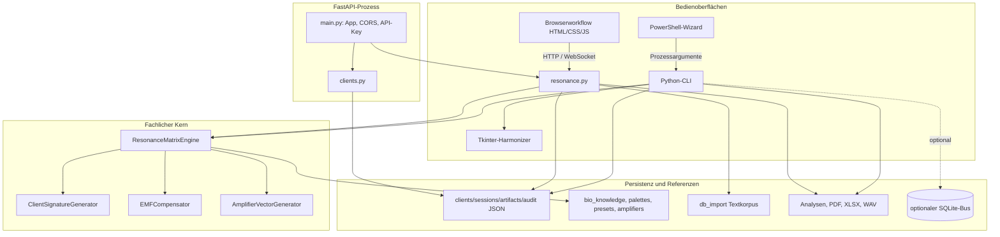
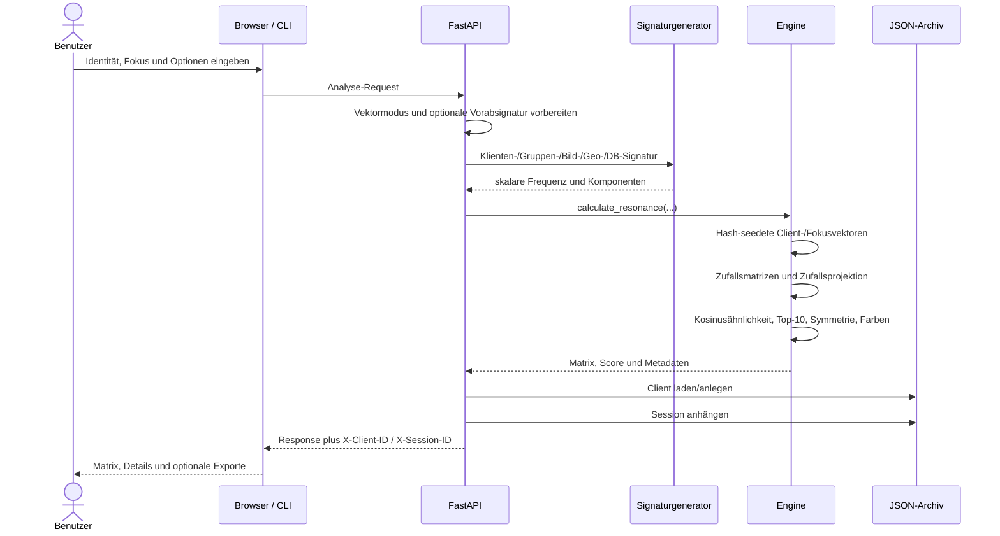
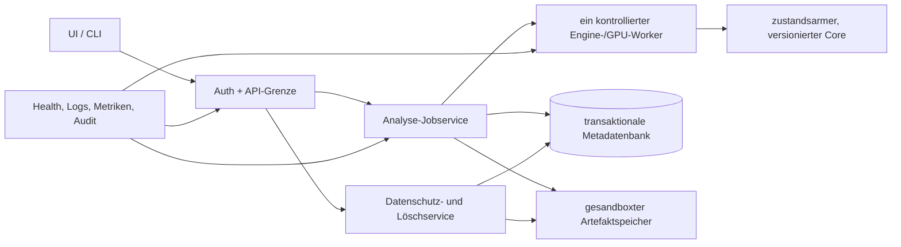

# 02 - Architektur und Komponenten

## 1. Systembild

Radi144 ist keine einzelne Anwendung, sondern eine gemeinsame Codebasis mit mehreren Bedien- und Laufzeitmodellen:

- FastAPI-Server mit statischer Browseroberfläche,
- Vanilla-JavaScript-Workflow,
- interaktiver PowerShell-Wizard,
- Python-CLI mit Report- und Audiofunktionen,
- optionales Tkinter-Harmonisierungsfenster,
- optionaler SQLite-Interchange-Bus,
- Linux/systemd-Deploymentpfad.

Die fachliche Kernengine und die dateibasierte Verwaltungsdomäne werden von mehreren dieser Pfade gemeinsam genutzt. Die Orchestrierung ist jedoch mehrfach implementiert und deshalb nicht vollständig konsistent.

## 2. Repository-Inventar

### 2.1 Zentrale Pfade

| Pfad | Rolle |
|---|---|
| `main.py` | FastAPI-App, CORS, API-Key-Middleware, statische UI-Auslieferung, Uvicorn-Direktstart |
| `app/bootstrap.py` | Runtime-Dependency-Profile |
| `app/api/resonance.py` | Analyse-, Sequenz-, DB-, PDF-, EMF-, WebSocket- und Amplifier-Endpunkte |
| `app/api/clients.py` | Safety-Posture, PII-Safe-View, Löschmanifest, Löschung, Audit |
| `app/schemas/` | Pydantic-Modelle für Klienten und Analysen |
| `app/algorithms/resonance_engine.py` | Hardwareadaption, Matrixsuche, Farben, Symmetrie, Bio-/EMF-/Amplifier-Anbindung |
| `app/algorithms/client_signature.py` | Name-, Geburts-, Bild-, Gruppen-, Geo-, DB- und Planetary-Heuristiken |
| `app/algorithms/emf_compensator.py` | Systemrauschprofil, Kompensationsvektor, Counter-Frequencies, Monitoring |
| `app/algorithms/amplifier.py` | Amplifier-Registry, Matching, Paletten- und Audiozuordnung |
| `app/models/` | Client-, Session-, Artefakt- und Auditmodelle |
| `app/services/` | JSON-Stores, Registry, Sessions, Artefakte, Safety, Löschung und Busadapter |
| `app/interchange_bus/` | Bus-Envelope, Topics und SQLite-Consumer-Store |
| `user_workflow.html/css/js` | Aktiver zehnstufiger Browserworkflow |
| `generate_matrix.ps1` | Interaktiver Windows-Wizard |
| `dev_cli.py` | CLI, Exporte, Archive, Tkinter und Audio |
| `data/` | Amplifier-Konfiguration, Sessiontemplates und ignorierte Runtime-Daten |
| `db_import/` | 59 Text-Referenzdatenbanken |
| `deploy/` | systemd-Unit, Env-Beispiel, Server-Setup |
| `tests/` | 22 Testmodule im aktuellen Arbeitsbaum |
| `docs/` | Zielbild, Audits, historische und aktuelle Beschreibungen |

Das Unterverzeichnis `Radi144/` ist leer und hat aktuell keine erkennbare Funktion.

### 2.2 Größte Verantwortungszentren

| Datei | Umfang | Architekturwirkung |
|---|---:|---|
| `user_workflow.js` | 2.432 Zeilen | State, API, Rendering, Export, Audio, Templates und Navigation in einem globalen Skript |
| `dev_cli.py` | 1.844 Zeilen | CLI, Persistenz, PDF/XLSX, Tkinter und Audio vermischt |
| `app/api/resonance.py` | 1.280 Zeilen | Mehrere fachlich unabhängige API-Domänen in einem Router |
| `app/algorithms/resonance_engine.py` | 1.213 Zeilen | Hardware, Zufallssuche, Farben, Bio, EMF und Quantum-Mock |
| `generate_matrix.ps1` | 1.039 Zeilen | Interaktion, Historie, Templates, DB-Workflow und Prozessstart |
| `app/algorithms/emf_compensator.py` | 800 Zeilen | Messung, Bewertung, Threading, Counter-Frequencies und Callbackzustand |
| `app/algorithms/amplifier.py` | 731 Zeilen | Registry, Matching, Bilder, Persistenz und Modulation |

Die Paketstruktur ist nachvollziehbar, die zentralen Dateien sind dennoch „God Modules“. Änderungen an einer Nutzerfunktion berühren häufig API, UI, CLI, Persistenz und Dokumentation an mehreren Stellen.

## 3. Einstiegspunkte

| Einstieg | Verhalten | Besonderheit |
|---|---|---|
| `python main.py` | startet Uvicorn mit `reload=True` | Entwicklungsstart, Default `127.0.0.1:8090` |
| `run.bat` | wählt `.venv` oder globales Python, prüft API-Profil, startet `main.py` | hängt vom aktuellen Arbeitsverzeichnis ab |
| `/user_workflow.html` | integrierter Browserworkflow | Same-Origin im aktuellen Arbeitsbaum |
| `generate_matrix.ps1` | interaktive Windows-Eingabe und Start von `dev_cli.py` | benutzt `Invoke-Expression` |
| `dev_cli.py` | direkter CLI-Lauf mit Reports und optionaler Harmonisierung | viele Pfade basieren auf `os.getcwd()` |
| `uvicorn main:app` via systemd | Linux-Serverbetrieb | konfiguriert mehrere Worker und eigene Env-Datei |

## 4. Komponentenmodell



## 5. Hauptanalysefluss



## 6. Zustandsmodelle

### 6.1 Browserzustand

`user_workflow.js` nutzt globale Variablen für:

- aktuellen Schritt,
- aktives Ergebnis und Ergebnisfolge,
- API-/DB-Abbruchzustand,
- Harmonizerstatus und Timer,
- AudioContext, Oszillatoren und MediaRecorder,
- Bilddaten,
- Template- und Historyzustand.

Persistiert werden in `localStorage` unter anderem Name, Geburtsdaten, Ort, E-Mail, Symptom, Notizen, Gruppenmitglieder, Geo-Daten, Pfade, Fokus und Konfiguration (`user_workflow.js:1370-1403`). Ergebnisse selbst bleiben primär im RAM und gehen bei Reload verloren, sofern sie nicht exportiert wurden.

### 6.2 API-/Enginezustand

`app/api/resonance.py` erzeugt beim Import ein globales Engineobjekt. Darin liegen mutable Zustände:

- Device und Kandidatenzahl,
- globaler aktiver Amplifier,
- EMF-Compensator,
- HRV-Simulationsstatus,
- Remote-Sensordaten,
- Kompensations- und Monitoringzustand.

Folgen:

- Requests können sich bei Parallelität gegenseitig beeinflussen.
- Jeder Uvicorn-Worker besitzt eine eigene, divergierende Engine.
- WebSocketdaten eines Workers stehen einem anderen Worker nicht zur Verfügung.
- GPU-Speicher und Enginezustände werden pro Worker vervielfacht.

### 6.3 Persistenzzustand

Die Verwaltungsdomäne besteht aus getrennten Dateien:

```text
clients.json -> sessions.json -> artifacts.json -> physische Dateien
                          \-> audit_log.json
```

Jeder Service lädt die komplette Datei, verändert sie im Speicher und ersetzt sie vollständig. Es gibt keine gemeinsame Transaktion oder Locking-Grenze.

## 7. Threading und Async

### 7.1 API

Die meisten Routen sind `async def`, führen aber synchron aus:

- Torch-/NumPy-Berechnung,
- DB-Dateilesen und tausende Engineaufrufe,
- ReportLab-PDF-Erzeugung,
- JSON-Persistenz,
- EMF-Profiling.

Damit blockiert die Berechnung den Eventloop des jeweiligen Workers. Browserseitiger Requestabbruch beendet nicht automatisch die serverseitige Berechnung.

### 7.2 Engine und EMF

- CPU-Torch-Threads werden global auf etwa 80 Prozent der logischen Kerne gesetzt (`resonance_engine.py:99-105`).
- Precision verändert den globalen Torch-RNG und restauriert ihn nur auf dem Erfolgsweg (`resonance_engine.py:282-303`, `:481-484`).
- EMF-Continuous-Monitoring läuft in einem Daemon-Thread (`emf_compensator.py:707-734`).
- Derselbe EMF-Zustand kann zugleich durch Thread, HTTP und WebSocket mutiert werden.

### 7.3 Frontend und Desktop

- Browser: Timer, Web Audio API, MediaRecorder.
- Tkinter: GUI-Mainloop und `root.after`; NumPy-Audioerzeugung läuft auf dem GUI-Thread.
- Audio wird teilweise vollständig im RAM akkumuliert.

## 8. Architekturprobleme

### P1

1. Globaler Enginezustand ohne Requestisolation.
2. Mehrprozessbetrieb mit lockfreier JSON-Persistenz.
3. Synchroner Schwerlastcode in Async-Routen.
4. Vier unabhängige Orchestrierungen: API, Browser, PowerShell und CLI.
5. Keine transaktionale Grenze für Client, Session, Artefakt und Audit.

### P2

1. Große Monolithmodule mit hoher Änderungskopplung.
2. UI-, API- und CLI-Defaults sowie Funktionsumfang driften.
3. Serviceinstanzen und Pfade werden ad hoc konstruiert statt zentral konfiguriert.
4. Konfiguration ist über Env, harte Pfade, CWD und JSON verteilt.
5. Kein explizites Job-, Cancellation- oder Zustandsmodell für lange Analysen.

### P3

1. Leeres Unterprojekt `Radi144/`.
2. Historische `_old`-, Restore-, Diagnose- und Scratchdateien liegen im Arbeitsbaum.
3. Gemischte lokale/UTC-Zeitstempel ohne konsistenten Offset.

## 9. Architekturziel für eine spätere Planung

Eine sinnvolle Zielarchitektur müsste mindestens folgende Grenzen explizit machen:



Dies ist bewusst ein Zielbild, noch keine Festlegung auf konkrete Implementierungsdetails.
