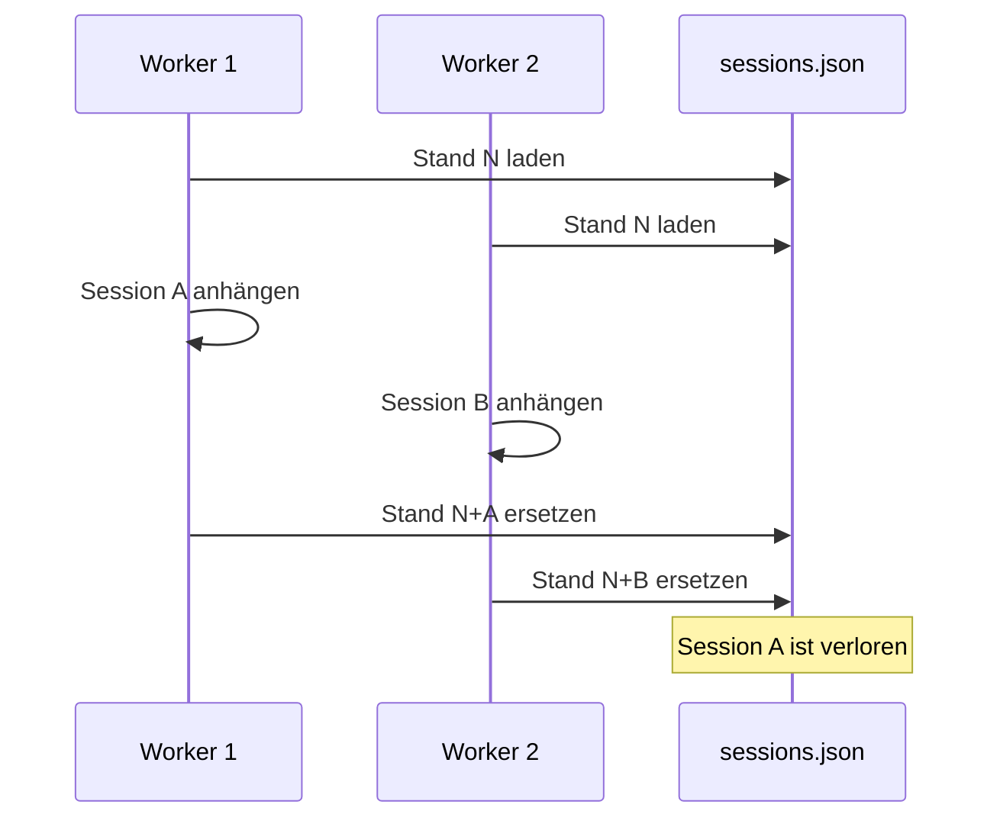
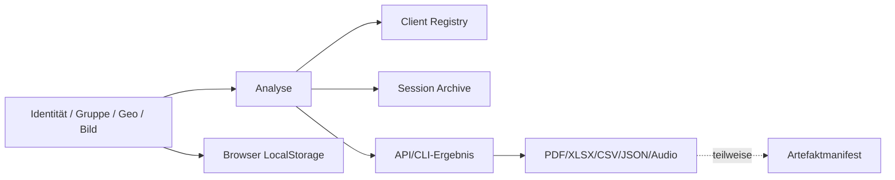

# 04 - Daten, Persistenz und Lebenszyklus

## 1. Datenlandkarte

Radi144 speichert Daten an mehreren voneinander unabhängigen Orten. Es gibt keine zentrale Data-Governance-Schicht und keine einzelne führende Datenquelle.

### 1.1 Laufzeitverwaltungsdaten

| Datenklasse | Speicherort | Inhalt | Sensibilität |
|---|---|---|---|
| Client Registry | `data/runtime/clients.json` | Name, Geburtsdatum, Geburtsort, Planet, Metadaten, Zeitstempel | personenbezogen |
| Session Archive | `data/runtime/sessions.json` | Clientreferenz samt Klarname, Fokus/Fokusfolge, Konfiguration, Scorezusammenfassung, Artefakt-IDs | potenziell Gesundheitsdaten |
| Artefaktmanifest | `data/runtime/artifacts.json` | Session-ID, Typ, absoluter Pfad, Label, Zeitpunkt | Pfad-/Metadaten, indirekt PII |
| Audit | `data/runtime/audit_log.json` | Löschmanifest-, Lösch- und Zugriffsereignisse | personenbezogene Pseudonyme, Betriebsdaten |
| PowerShell-Projektion | `data/runtime/powershell_templates.json` | aus Sessions/Clients abgeleitete Legacy-Templates | personenbezogen |

Zum Analysezeitpunkt enthielten die ignorierten Runtime-Stores ungefähr:

- 205 Client-Einträge,
- 3.942 Session-Einträge,
- 4 registrierte Artefakte.

Diese Zahlen sind eine Momentaufnahme des lokalen Arbeitsbaums. Die Dokumentation reproduziert bewusst keine Klarnamen oder Gesundheitsinhalte.

### 1.2 Legacy- und Browserzustand

| Speicher | Daten | Begrenzung |
|---|---|---|
| `last_session.json` | ein Klientensatz | überschrieben, keine TTL |
| `data/session_templates.json` | Namen, Geburtsdaten, Fokusfolgen, Konfiguration | mengenbegrenzt auf 21, nicht zeitbegrenzt |
| `focus_history.txt` | Fokusformulierungen | mengenbegrenzt |
| `data/.focus_temp.txt` | zuletzt übergebener Fokus | überschrieben, nicht sicher gelöscht |
| `localStorage: resonance_session` | Identität, E-Mail, Symptom, Notizen, Gruppe, Geo, Pfade, Fokus, Optionen | unbegrenzt bis manueller Reset/Browserlöschung |
| `localStorage: resonance_focus_history` | Fokusverlauf | mengenbegrenzt, separater Speicher |
| `localStorage: resonance_templates` | vollständige benannte Konfigurationen | mengenbegrenzt, separater Speicher |

Der Workflow-Reset entfernt nur `resonance_session` (`user_workflow.js:1335-1365`), nicht zwingend Fokusverlauf und Templates.

### 1.3 Analyse- und Exportartefakte

CLI-Ausgaben unter `Analysen/`:

- `analysis_log.txt`,
- Einzel-PDF,
- XLSX,
- kombiniertes PDF,
- optional `session_audio_lossless.wav`.

Browserausgaben im Downloadverzeichnis:

- Analyse-JSON,
- Matrix-CSV,
- PDF,
- „Excel“-CSV,
- WebM-Audio,
- Zwischenablageinhalt.

Nicht alle Ausgaben werden im Artefaktmanifest registriert. Der Browser liest die `X-Session-ID` nicht und sendet beim PDF-Export weder `session_id` noch `output_path` (`user_workflow.js:1529-1547`). Das PDF wird deshalb heruntergeladen, aber nicht mit der Session verknüpft.

## 2. Datenmodelle

### 2.1 Client

`ClientRegistryEntry` (`app/models/client_registry.py:9-18`):

- `client_id`
- `first_name`
- `last_names`
- `birth_date`
- `birth_place`
- `planet`
- freies `metadata`-Dictionary
- `created_at`, `updated_at`

Die API-Safe-View entfernt die vier direkten Identitätsfelder, lässt aber `metadata` unverändert (`app/services/safety_service.py:49-64`). Wenn dort später PII abgelegt wird, ist die Safe-View keine vollständige Sicherheitsgrenze.

### 2.2 Client-ID

Die ID wird als gekürzter SHA-1 über einen normalisierten stabilen Identitätsschlüssel erzeugt. Eigenschaften:

- deterministisch,
- installationsübergreifend korrelierbar,
- ohne Salt/HMAC,
- nur 64 Bit der Hashausgabe,
- abhängig von Schreibweise und Unicode-Normalform.

Das ist eine schwache Pseudonymisierung, keine Anonymisierung.

### 2.3 Session

`SessionArchiveEntry` (`app/models/session_archive.py:13-22`) speichert:

- Session-ID,
- Erstellzeit,
- Client-ID und redundanten Klarname,
- Fokus und Fokusfolge,
- freies Konfigurationsdictionary,
- freie Ergebniszusammenfassung,
- Artefakt-IDs,
- Harmonizerstatus.

Nicht gespeichert werden typischerweise:

- vollständige Matrix und Farbmatrix,
- Algorithmus-/Engineversion,
- Zufallsseed,
- Projektionsmatrix oder deren Hash,
- Kandidatenzahl,
- Referenzdatenversionen und -hashes,
- vollständige EMF-Messwerte,
- strukturierter Hardware-/Dependency-Stand,
- vollständiger Gruppen-, Geo- oder Bildkontext,
- Unsicherheits- oder Kalibrationsdaten.

Eine Session ist deshalb kein vollständiger Reproduzierbarkeitsnachweis.

### 2.4 Sessionbegriff driftet

- CLI: ein Lauf mit Fokusfolge wird als eine Session archiviert.
- API `/analyze-sequence`: ruft pro Fokus die Einzelanalyse auf und erzeugt mehrere Sessions (`app/api/resonance.py:469-489`).
- Browser: ruft `/analyze-matrix` pro Fokus separat auf (`user_workflow.js:1030-1060`).

Damit ist „Session“ je Einstiegspunkt unterschiedlich definiert.

### 2.5 Artefakt

Das Manifest enthält hauptsächlich Session-ID, Typ, Pfad und Label. Es fehlen:

- SHA-256,
- Dateigröße,
- MIME-Type,
- Erzeuger/Version,
- Retentionklasse,
- Verifikationsstatus,
- portable relative Pfadangabe.

Absolute Windows-Pfade sind nach Umzug auf Linux oder ein anderes Benutzerprofil nicht portabel.

## 3. JSON-Persistenz

### 3.1 Positives Verhalten

`JsonStore.save` (`app/services/json_store.py:27-36`):

1. erzeugt die Elternstruktur,
2. schreibt UTF-8 in eine temporäre Datei im Zielordner,
3. nutzt `ensure_ascii=False`,
4. ersetzt das Ziel atomar mit `os.replace`.

Das reduziert das Risiko einer halb geschriebenen Zieldatei bei einem einzelnen Write.

### 3.2 Fehlende Garantien

Nicht vorhanden:

- Thread-/Prozesslock,
- Compare-and-Swap oder Revision,
- Journal/WAL,
- Transaktion über mehrere Stores,
- `fsync`-Garantie,
- Recoverykopie,
- Quarantäne defekter Dateien,
- Migrationen,
- Fremdschlüssel,
- Unique Constraints auf Storeebene,
- Pagination oder Indizes.

### 3.3 Lost-Update-Szenario

Vier Uvicorn-Worker in der lokal vorgefundenen Konfiguration machen dieses Szenario realistisch.

### 3.4 Versionierung ohne Migration

Stores tragen `version="1.0"`, aber der Code:

- prüft die Version nicht auf eine unterstützte Menge,
- besitzt keine Migrationsschritte,
- besitzt keine Downgrade-Strategie,
- kann unbekannte zukünftige Felder beim Validieren und erneuten Speichern verlieren.

Die Versionszeichenfolge ist daher derzeit informativ, nicht operativ.

## 4. Datenlebenszyklus

### 4.1 Analyse

Kritische Eigenschaften:

- Client und Session werden nacheinander, nicht gemeinsam gespeichert.
- Ein Fehler beim Session-Save kann einen verwaisten Client hinterlassen.
- Ein Export kann existieren, ohne registriert zu sein.
- Ein Manifest kann auf eine fehlende Datei zeigen.
- Der Browser erzeugt weitere Kopien außerhalb der Serverkontrolle.

### 4.2 Sequenzanalyse

Der Browser persistiert jede erfolgreiche Teilanalyse serverseitig. Scheitert Fokus N:

- bleiben N-1 Sessions bestehen,
- die UI zeigt die Sequenz als fehlgeschlagen,
- es gibt keinen Batch-Identifier,
- kein Resume und keinen Rollback,
- keine atomare „alles oder nichts“-Semantik.

### 4.3 Export

API-PDF:

- liefert immer den Blob,
- schreibt optional zusätzlich auf einen vom Client gelieferten Pfad,
- registriert nur, wenn `session_id` und `output_path` gemeinsam vorhanden sind.

CLI:

- sammelt erwartete Pfade in `exported_paths`,
- kann Pfade auch dann vormerken, wenn ein optionaler Export wegen fehlender Bibliothek nicht entstand,
- erzeugt Audio erst nach der Archivspiegelung; Audio bleibt dadurch unregistriert (`dev_cli.py:1332-1388`, `:1608-1628`).

## 5. Löschprozess

### 5.1 Implementierte Kaskade

`ErasureService.execute` (`app/services/erasure_service.py:134-243`):

1. Gate-Token prüfen,
2. Client aus `clients.json` entfernen,
3. Sessions aus `sessions.json` entfernen,
4. Artefakte aus `artifacts.json` entfernen,
5. registrierte Dateien best effort löschen,
6. passende `Analysen`-Verzeichnisse best effort löschen,
7. Audit schreiben.

### 5.2 Positive Aspekte

- nicht-destruktives Manifest vor Execute,
- Zielentitäten werden vorab gesammelt,
- wiederholter Aufruf ist für vollständig entfernte Clients nicht erneut destruktiv,
- Audit ist grundsätzlich vorgesehen.

### 5.3 Kritische Lücken

1. **Nicht transaktional:** Nach Schritt 2 können weitere Schritte scheitern.
2. **Schlechter Retry:** `_collect` sucht Sessions nur, wenn der Client noch existiert (`erasure_service.py:74-81`).
3. **Dateifehler werden verschluckt:** Ergebnis bleibt `outcome="ok"`.
4. **Zähler ist ungenau:** `removed_files` steigt auch bei bereits nicht vorhandener Datei.
5. **Pfadgrenze fehlt:** Registrierte Artefaktpfade werden ohne Rootcontainment gelöscht.
6. **Audit ist best effort:** Ein fehlgeschlagener Auditwrite verhindert das Ergebnis nicht.
7. **Gate ist kein Autorisierungsmodell:** bekannter Defaultwert, Queryparameter, keine Rollen-/Ownershipprüfung.

### 5.4 Nicht erreichte Datenkopien

- Browser-LocalStorage,
- Fokusverlauf und Templates,
- Browserdownloads,
- Zwischenablage,
- `last_session.json`,
- `data/session_templates.json`,
- `focus_history.txt`,
- `.focus_temp.txt`,
- unmanifestierte Reports und Logs,
- RestorePoints/ZIPs/ShadowCopies,
- optionale Busdatenbank,
- systemd-/Prozesslogs,
- Git-Historie,
- fremde Geräte und externe Sicherungen.

Die Bezeichnung als vollständige Art.-17-Kaskade ist daher technisch zu weitgehend.

## 6. Import und Referenzdaten

### 6.1 Referenzkorpus

`db_import/` enthält 59 Textdateien. Das bestehende Audit bestätigt neun exakte Duplikatgruppen und ungeklärte Herkunft/Lizenz (`docs/DATA_REFERENCE_AUDIT_2026-06-06.md:88-160`).

Dateinamen wirken in der Rankingphase selbst als Fokus. Duplikate mit unterschiedlichen Namen können deshalb funktional unterschiedliche Rankings erzeugen, obwohl der Inhalt identisch ist.

### 6.2 Encoding

Lesereihenfolge: UTF-8, Latin-1, CP1252 (`app/api/resonance.py:400-411`; `client_signature.py:277-288`). Latin-1 kann jedes Byte dekodieren, sodass CP1252 praktisch nicht mehr erreicht wird. Weitere Lücken:

- kein `utf-8-sig` für BOM,
- keine Unicode-NFC/NFKC-Normalisierung,
- sichtbare BOM-Zeichen können Nutztext werden,
- Identitätshashes reagieren auf Unicode-Darstellung.

### 6.3 Inputvalidierung

Unzureichend modelliert sind:

- Gruppenmitglieder als `List[Dict[str, Any]]`,
- Geo-Grenzen,
- Dateigröße und Zeilenlänge von DB-Dateien,
- Dateityp/Magic Bytes von Bildern,
- Pfadcontainment und Symlinks,
- disjunkte Vektormodi,
- Importformatversion und Provenienz.

## 7. SQLite-Bus

Der optionale Bus ist datentechnisch robuster als die JSON-Stores:

- WAL,
- `synchronous=NORMAL`,
- Primary Keys,
- JSON-Validierungsconstraints,
- parametrisierte SQL-Queries.

Lücken:

- keine echten Schema-Migrationen, nur `CREATE TABLE IF NOT EXISTS`,
- keine inhaltlichen Fremdschlüssel,
- keine Retention/Purge-Funktion,
- keine koordinierte Backupstrategie für DB plus WAL,
- Register/ACK und Audit in getrennten Transaktionen,
- doppelte Informationen in Tabellenspalten und Envelope-JSON ohne Konsistenzconstraint,
- Tippfehler im Pfad kann eine neue leere DB anlegen,
- ACL wird gespeichert, aber nicht durchgesetzt.

## 8. Backup und Restore

Die vorhandenen Restorewerkzeuge sind laut Projektaudit historisch und aus der Baseline ausgeschlossen (`docs/RESTORE_PACKAGING_AUDIT_2026-06-06.md:39-112`). Ein belastbarer aktueller Prozess ist im Repository nicht nachweisbar.

Fehlend:

- verantwortlicher Betreiber,
- RPO und RTO,
- Zeitplan und Rotation,
- Verschlüsselung,
- Offsite-Kopie,
- konsistenter Snapshot aller JSONs und Artefakte,
- Browserdatenstrategie,
- Checksummenmanifest,
- regelmäßiger Restore-Test,
- Löschung aus Backups,
- Versions-/Migrationskompatibilität.

## 9. Datenqualitätsprobleme

Im lokalen Runtime-Bestand wurden strukturell konsistente IDs/Referenzen gefunden, aber semantische Qualitätsprobleme:

- Test-, Bild-, Geo- und potenziell reale Personendaten teilen dieselben Stores.
- Ein großer Anteil der Clients sind temporär benannte Bildidentitäten.
- wiederholte Test-Sessions erhöhen die Storegröße.
- dieselbe Person kann durch Schreibweisen, Datumsformate oder Unicode mehrfach entstehen.
- API und CLI speichern Konfiguration mit unterschiedlichen Feldnamen.
- `planet` wird vom Browser gesendet, ist aber nicht Teil von `ClientBase`; es kann still verworfen werden.

## 10. Data-Governance-Lücken

Vor Produktivbetrieb müssen mindestens beantwortet werden:

1. Wer ist Verantwortlicher und fachlicher Eigentümer der Daten?
2. Was ist ein „Client“: Person, Gruppe, Ort, Bild oder generisches Subjekt?
3. Welche Felder sind für die Berechnung tatsächlich erforderlich?
4. Welche Daten gelten als Gesundheitsdaten?
5. Welche Aufbewahrungsfrist gilt pro Datenklasse?
6. Welche Kopie ist führend?
7. Wie werden Browser- und Downloadkopien behandelt?
8. Wie werden Test- und Produktivdaten getrennt?
9. Wie wird eine Löschung in Backups und Logs umgesetzt?
10. Welche Herkunft, Lizenz und Evidenz besitzt jeder Referenzdatensatz?

## 11. Datenbezogene Empfehlung

Die spätere Planung sollte die Verwaltungsdomäne als zusammenhängendes Datenprodukt behandeln, nicht als vier einzelne JSON-Dateien. Ein tragfähiges Ziel benötigt:

- transaktionale Metadatenbank,
- versionierte Migrationen,
- explizites Session-/Run-Modell,
- Artefaktchecksummen und relative Pfade,
- Retentionklassen,
- vollständiges, wiederanlaufsicheres Löschjournal,
- verschlüsselte Backups mit Restore-Nachweis,
- Test-/Produktivtrennung,
- Referenzdatenmanifest mit Herkunft, Lizenz und Evidenzgrad.
