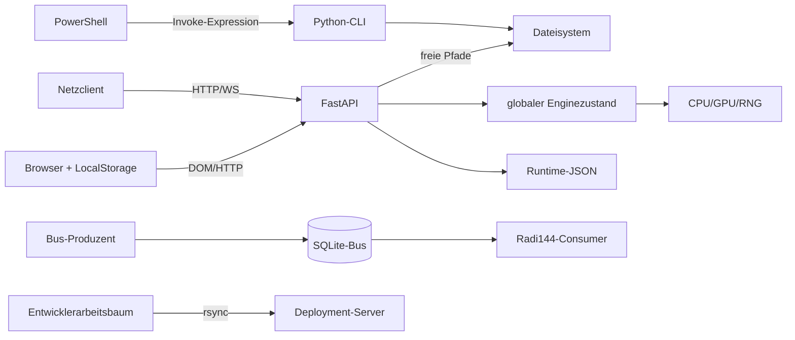

# 06 - Sicherheit, Datenschutz und Regulatorik

## 1. Gesamturteil

Der aktuelle Stand darf nicht öffentlich erreichbar betrieben werden. Die kritischste Kombination ist nicht ein einzelner Fehler, sondern das Zusammenwirken aus:

- öffentlichem Binding,
- deaktivierter Authentisierung,
- frei wählbaren Dateipfaden,
- destruktiver Löschfunktion,
- fehlenden Workloadgrenzen,
- personenbezogenen Runtime-Daten,
- ungeschützten WebSockets.

Die lokal vorgefundene ignorierte `deploy/server.env` setzt:

```text
APP_HOST=0.0.0.0
APP_PORT=8000
APP_WORKERS=4
CORS_ORIGINS=*
API_KEY=
```

Ob genau dieses Profil auf einem erreichbaren Server aktiv ist, ist nicht nachgewiesen. Falls ja, sind die P0-Szenarien unmittelbar relevant. Ein externer Reverse Proxy, eine Firewall oder zusätzliche Authentisierung außerhalb des Repositorys ist ebenfalls nicht nachgewiesen.

## 2. Threat Model

### 2.1 Schutzwerte

- Namen, Geburtsdaten und Geburtsorte,
- E-Mail, Telefon, Adresse, Symptome und Notizen,
- Fokus- und potenzielle Gesundheitsinhalte,
- Bilder, Geo-, HRV-, Audio- und Sensordaten,
- Analyseergebnisse, Reports und Exporte,
- API-/D-Wave-/Lösch-Secrets,
- Serverdateisystem,
- Runtime-JSONs und Busdatenbank,
- CPU-, RAM-, GPU- und Festplattenressourcen.

### 2.2 Angreifermodelle

- unauthentifizierter Internet- oder LAN-Client,
- bösartige Website im Browser eines Benutzers,
- anderer berechtigter Nutzer ohne Objektberechtigung,
- manipuliertes Template, DB-Text, Bild, JSON oder Bus-Envelope,
- lokaler Benutzer mit Zugriff auf Projekt, Browserprofil oder Backups,
- kompromittierter Prozess mit Schreibzugriff auf Bus- oder Runtime-Daten.

### 2.3 Trust Boundaries



## 3. P0-Sicherheitsbefunde

### P0-SEC-01: Fail-open Netzwerkbetrieb

`main.py:87-98` deaktiviert das Gate bei leerem oder Placeholder-Key. Zusammen mit `0.0.0.0` ist die API anonym erreichbar. CORS `*` begrenzt keine Nicht-Browser-Clients.

**Auswirkung:** anonyme Analyse-, Datei-, Client-, Lösch-, EMF- und Amplifierzugriffe.

### P0-SEC-02: Lokale Dateioffenlegung

`_resolve_existing_path` akzeptiert absolute Pfade und nicht auf das Projekt begrenzte relative Pfade (`app/api/resonance.py:212-228`). `/db/scan` liest bis zu 5.000 Textzeilen und gibt ausgewählte Originalzeilen zurück (`:642-693`).

**Auswirkung:** Ein erreichbarer Client kann lesbare Textdateien des Servicekontos als Datenbank missbrauchen. Die Exfiltration ist durch Ranking/Top-N und Textdecoding eingeschränkt, aber praktisch relevant.

### P0-SEC-03: Beliebiges Schreiben/Überschreiben

Der PDF-Endpunkt übernimmt absolute `output_path`-Werte, erzeugt Elternverzeichnisse und überschreibt das Ziel (`app/api/resonance.py:128-135`, `:864-874`).

**Auswirkung:** Prozessbeschreibbare Dateien können mit PDF-Daten überschrieben werden, einschließlich potenziell wichtiger Runtime-Dateien.

### P0-SEC-04: Destruktive Löschung mit bekanntem Fallback

Ohne Env-Secret ist der Gatewert Quelltextwissen (`app/services/erasure_service.py:30-35`). Der Endpunkt nimmt ihn im Querystring entgegen (`app/api/clients.py:94-108`).

**Auswirkung:** Bei offenem Server können Client-IDs gelistet und Löschkaskaden angestoßen werden. Querytokens können zusätzlich in Logs erscheinen.

### P0-SEC-05: Denial of Service

Mögliche Verstärker:

- beliebige `matrix_size`,
- unbeschränkte Fokuslänge und Fokusfolgen,
- unbeschränkte Gruppenliste,
- bis zu 5.000 vollständige Engineaufrufe pro DB-Scan,
- bis zu 1.500 Engineaufrufe im DB-Ranking,
- beliebig große PDF-Matrix,
- keine Rate Limits, Semaphoren, Timeouts oder Jobqueue,
- synchrone Arbeit im Async-Eventloop,
- unlimitierte WebSocketpayloads.

Der aktuelle Testlauf zeigt reale Speicherempfindlichkeit bis zum nativen Prozessabbruch.

### P0-SEC-06: Projektroot als Dateiserver in Anleitung

`SCHNELLSTART-ANLEITUNG.md:14-32` empfiehlt `python -m http.server 8090` im Projektkontext. Das kann den gesamten Projektbaum einschließlich Runtime-, Env-, Log-, Backup- und Personendateien ausliefern.

## 4. P1-Sicherheitsbefunde

### P1-SEC-01: Keine Rollen, Mandanten oder Objektberechtigungen

Ein globaler API-Key unterscheidet keine Nutzer. `/clients` liefert stabile IDs, die in Analysen und Löschpfaden verwendet werden können. Ownership wird nicht geprüft.

### P1-SEC-02: WebSockets umgehen das HTTP-Gate

Kein Token, keine Originprüfung, keine Sessionbindung, keine Limits (`app/api/resonance.py:1072-1221`). Sensordaten verschiedener Clients teilen globalen Zustand.

### P1-SEC-03: Persistentes DOM-XSS

Untrusted Werte aus Eingabe, API und LocalStorage werden in `innerHTML` eingesetzt (`user_workflow.js:820-862`, `:1207-1238`, `:2323-2340`).

Mögliche Folge:

- LocalStorage-PII auslesen,
- Same-Origin-API aufrufen,
- Templates manipulieren,
- Ergebnisdarstellung verändern.

### P1-SEC-04: PowerShell-Command-Injection

`Invoke-Expression` verarbeitet zusammengesetzte Eingabekommandos (`generate_matrix.ps1:420`, `:529`, `:1034`). Quoting ist keine belastbare Shell-Sicherheitsgrenze.

### P1-SEC-05: Multiworker-Datenverlust

Vier Prozesse schreiben lockfrei in dieselben JSON-Dateien. Das ist zugleich Verfügbarkeits-, Integritäts- und Datenschutzrisiko.

### P1-SEC-06: Deployment kopiert lokale sensible Daten

`deploy/setup_server.sh:38-45` rsynct fast den gesamten Arbeitsbaum. Nicht ausreichend ausgeschlossen sind unter anderem:

- `.venv`,
- `build_env`,
- `data/runtime`,
- `Analysen`,
- kleingeschriebenes `restore_points`,
- `.hermes*`,
- `deploy/server.env`,
- lokale Legacy-/Diagnosedateien.

`.gitignore` ist keine Deployment-Sicherheitsgrenze.

### P1-SEC-07: Bus ohne Produzentenauthentizität

SHA-256 über ein selbst enthaltenes Envelope erkennt unbeabsichtigte oder nicht vollständig angepasste Manipulation, beweist aber keinen vertrauenswürdigen Produzenten. ACL wird nicht ausgewertet.

## 5. P2-Sicherheitsbefunde

1. Fehlende Security Header: CSP, `frame-ancestors`, `X-Content-Type-Options`, `Referrer-Policy`, `Permissions-Policy`, HSTS.
2. CSV-/XLSX-Formula-Injection durch unneutralisierte Zellen.
3. Bilder ohne robuste Magic-Byte-, Pixel- und Dekompressionsbombenprüfung.
4. Interne Fehlerdetails in HTTP/WebSocket-Antworten.
5. Absolute Infrastrukturpfade in `/db/list`.
6. Externe Google-Fonts-Anfrage.
7. Offene Dependencyranges und kein Lock/Hash.
8. Lösch-/API-Secrets ohne dokumentierte Erzeugung, Rotation und Berechtigungen.

## 6. Datenschutzanalyse

### 6.1 Datenkategorien

Radi144 kann verarbeiten:

- Identitäts- und Kontaktdaten,
- Geburtsdaten und Geburtsorte,
- Symptome, Notizen und Fokustexte,
- gesundheitsbezogene Ableitungen,
- Geo-, HRV-, Audio- und Sensordaten,
- Bilder,
- Analyse- und Harmonisierungsdaten.

Je nach tatsächlicher Nutzung können besondere Kategorien personenbezogener Daten, insbesondere Gesundheitsdaten, betroffen sein.

### 6.2 Datenminimierung

`ClientBase` akzeptiert E-Mail, Telefon, Adresse, Hauptsymptom, Notizen und Geolocation (`app/schemas/klienten.py:6-18`). Mehrere Felder sind für den sichtbaren Kernalgorithmus nicht erforderlich.

Empfehlung für die spätere Planung:

- Berechnungseingaben und Praxis-/Kontaktdaten trennen,
- Pflichtfelder fachlich begründen,
- gesundheitsbezogenen Freitext gesondert schützen,
- keine automatische Dauerpersistenz optionaler Daten.

### 6.3 At-rest-Schutz

Nicht nachgewiesen sind:

- Verschlüsselung der Runtime-Dateien,
- verschlüsselte Backups,
- installationsspezifische Schlüsselverwaltung,
- restriktive Dateiberechtigungen unter Windows,
- getrennte Service-/Nutzerkonten im lokalen Betrieb.

### 6.4 Aufbewahrung

Es fehlen dokumentierte Fristen für Clients, Sessions, Artefakte, Logs, LocalStorage, Backups und Busdaten. Mengenlimits einzelner Templatehistorien ersetzen keine Retentionpolicy.

### 6.5 Betroffenenrechte und Löschung

Die vorhandene Kaskade ist ein guter Prototyp für ein Löschmanifest, aber nicht vollständig, nicht transaktional und nicht über alle Kopien hinweg nachweisbar. Ein Ergebnis `outcome="ok"` kann verbleibende Dateien und Backups nicht ausschließen.

### 6.6 Fehlende Governance-Nachweise

Im Repository wurden keine vollständigen Nachweise gefunden für:

- Verantwortlichen-/Kontaktangaben,
- Rechtsgrundlage nach Art. 6 DSGVO,
- Umgang mit Art. 9 DSGVO,
- Einwilligungs- und Widerrufsverwaltung,
- Verzeichnis von Verarbeitungstätigkeiten,
- DSFA/DPIA,
- TOM-Dokumentation,
- Empfänger-/Auftragsverarbeiterübersicht,
- Datenschutzvorfall- und Meldeprozess,
- vollständigen Auskunfts-/Exportprozess.

## 7. Medizinische und regulatorische Grenze

> Keine Rechtsberatung. Die tatsächliche Einstufung muss qualifiziert geprüft werden.

### 7.1 Relevante Produkttexte

Im aktiven oder produktnahen Bestand stehen unter anderem:

- „Naturheilpraxis“,
- „Heilsame Resonanzmatrix“,
- „personalisierte Frequenz-Harmonisierung“,
- „Immunsystem stärken“,
- „Schmerzlinderung“,
- „DNA-Reparatur“,
- Krankheits-/Symptomlisten in `db_import`,
- Scoreinterpretationen als Blockade oder energetische Ausrichtung.

### 7.2 Disclaimer reicht nicht allein

Der zentrale Disclaimer ist sinnvoll, enthält aber selbst einen Tippfehler („Heversprechen“) und wird in der aktiven UI nicht konsistent sichtbar. Ein Disclaimer neutralisiert konkrete Wirkungs-, Heilungs-, Diagnose- oder Genauigkeitsclaims nicht automatisch.

### 7.3 Medizinprodukt-/Werberisiko

Wenn die Zweckbestimmung Diagnose, Vorhersage, Überwachung, Behandlung oder Linderung von Krankheit umfasst, kann Medizinprodukterecht einschlägig sein. Der Codebestand enthält keine vollständigen Nachweise für:

- QMS,
- Risikomanagementakte,
- klinische Bewertung,
- Software-Lifecycle nach reguliertem Standard,
- Usability Engineering,
- Post-Market-Prozesse,
- Konformitätsbewertung.

Unbelegte Genauigkeitswerte von 98,7 bis 99,2 Prozent und Wirksamkeitsangaben erzeugen zusätzlich wettbewerbs- und heilmittelwerberechtliche Risiken.

### 7.4 Ehrliche Positionierungsoptionen

1. **Wellness/Meditation/Kunst:** Claims, Scorebegriffe und UI konsequent nicht medizinisch und nicht messend formulieren.
2. **Mess-/Analyseprodukt:** neue validierbare Methodik, Messgeräte, Kalibration, Ground Truth und Unsicherheit.
3. **Medizinisches Produkt:** zusätzlich formaler regulatorischer Entwicklungs- und Qualitätsprozess.

## 8. Sofortige Sicherheitsgrenze

Bis zur späteren Behebung sollte operativ gelten:

- nur Loopback oder isoliertes Testnetz,
- keine realen Klientendaten auf frei erreichbaren Instanzen,
- maximal ein Worker bei JSON-Persistenz,
- `/db/scan`, serverseitiges `output_path`, Lösch- und WebSocketpfade nicht extern freigeben,
- keine Projektroot-Auslieferung mit `http.server`,
- kein Deployment aus der aktuellen Arbeitskopie,
- kein externer Push/Release vor PII- und Lizenzklärung.

## 9. Sicherheitsfreigabekriterien

Vor einer Netzwerkfreigabe mindestens:

- fail-closed Authentisierung für HTTP und WebSocket,
- Rollen, Mandanten- und Objektberechtigungen,
- TLS/Reverse Proxy/Firewall,
- Pfadallowlists und serverseitige Dateinamen,
- harte Eingabe-/Body-/Rechen-/Zeit-/Rate-Limits,
- transaktionale Persistenz,
- CSP und XSS-sicheres Rendering,
- kein `Invoke-Expression`,
- sichere Löschautorisierung und wiederanlaufsicheres Journal,
- Secretmanagement und Rotation,
- Securityregressionstests,
- Datenschutz- und regulatorische Freigabe.
