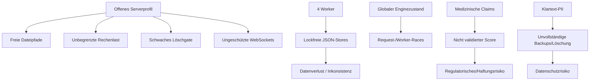

# 09 - Risikoregister und Gap-Analyse

## 1. Bewertungslogik

| Faktor | Skala |
|---|---|
| Eintritt | niedrig / mittel / hoch |
| Auswirkung | begrenzt / erheblich / kritisch |
| Priorität | P0 bis P3 |

P0-Risiken sind teilweise bedingt: Sie werden unmittelbar kritisch, sobald das lokal beobachtete offene Serverprofil netzwerkseitig erreichbar ist.

## 2. P0 - Kritische Risiken

| ID | Risiko | Bedingung | Eintritt | Auswirkung | Beleg |
|---|---|---|---|---|---|
| P0-01 | anonyme Netzwerkexposition | lokales `server.env` aktiv und Port erreichbar | hoch | kritisch | `deploy/server.env`; `main.py:87-107` |
| P0-02 | lokale Textdateien über DB-Scan lesbar | API erreichbar und Servicekonto darf lesen | hoch | kritisch | `app/api/resonance.py:212-228`, `:642-693` |
| P0-03 | beliebige beschreibbare Ziele mit PDF überschreibbar | API erreichbar | hoch | kritisch | `app/api/resonance.py:128-135`, `:864-874` |
| P0-04 | Clientlöschung mit bekanntem Fallbacktoken | API offen, Env-Token fehlt | hoch | kritisch | `erasure_service.py:30-35`; `clients.py:94-108` |
| P0-05 | CPU/RAM/GPU/Eventloop-DoS | offene API/WebSockets | hoch | kritisch | `schemas/resonance.py:8-29`; `resonance.py:554-693` |
| P0-06 | Projektdateien über `http.server` offengelegt | Schnellstartanleitung befolgt und Port erreichbar | mittel | kritisch | `SCHNELLSTART-ANLEITUNG.md:14-32` |
| P0-07 | PII/Secrets beim Deployment mitkopiert | `setup_server.sh` aus lokaler Arbeitskopie | hoch | kritisch | `deploy/setup_server.sh:38-45` |
| P0-08 | medizinisch wirkende Nutzung ohne Evidenz | patientennaher Einsatz/Marketing | hoch | kritisch | UI/Guides/DB; Algorithmusbefunde |
| P0-09 | externe Distribution ohne Lizenzklärung | Veröffentlichung/Remote/Produktpaket | hoch | kritisch | fehlende LICENSE/SBOM; Daten-Audit |

## 3. P1 - Hohe Risiken

| ID | Risiko | Wirkung | Beleg |
|---|---|---|---|
| P1-01 | API-Key-Modus blockiert UI, WebSockets bleiben offen | kein konsistenter sicherer Betriebsmodus | `main.py:94-107`; `user_workflow.js:1042-1046` |
| P1-02 | vier Worker + JSON ohne Lock | Lost Updates, Datenverlust | `json_store.py:19-36`; systemd/env |
| P1-03 | globale Enginezustände | Request-Leakage, Races, Workerdrift | `app/api/resonance.py:27-33`; Enginezustände |
| P1-04 | synchrone Schwerlast in Async-Routen | blockierte Worker, schlechte Verfügbarkeit | `resonance.py:413-693` |
| P1-05 | unvollständige/nicht transaktionale Löschung | Restdaten, nicht wiederholbarer Teilzustand | `erasure_service.py:74-243` |
| P1-06 | persistentes DOM-XSS | PII-/API-Zugriff im Browser | `user_workflow.js:820-862`, `:2323-2340` |
| P1-07 | PowerShell-Command-Injection | lokale Codeausführung im Nutzerkontext | `generate_matrix.ps1:420`, `:529`, `:1034` |
| P1-08 | Klartext-PII/Health-Fokus in mehreren Speichern | Datenschutzverletzung | Models, LocalStorage, Logs, Exporte |
| P1-09 | `client_id` und `client_data` können divergieren | falsche Personenzuordnung | `resonance.py:83-102`, `:279-305` |
| P1-10 | Score ohne Kalibration | Fehlinterpretation/Fehlentscheidung | `resonance_engine.py:1088-1092`; Guide |
| P1-11 | Score nach Symmetrie veraltet | technisch falsche Ergebnissemantik | `resonance_engine.py:415-433` |
| P1-12 | Precision nicht vollständig reproduzierbar | nicht auditierbare Resultate | Zeit/HRV/EMF/Hardware/RNG |
| P1-13 | DB-Ranking vergleicht verschiedene Zufallsexperimente | nicht belastbares Ranking | `resonance.py:571-633`; Seedlogik |
| P1-14 | wirkungslose API-Flags | falsche Konfigurations-/Archivaussagen | `schemas/resonance.py:12-17`; `resonance.py:441-452` |
| P1-15 | D-Wave/Quantum-Mock als Funktion dargestellt | irreführende Produktdarstellung | `resonance_engine.py:1113-1155` |
| P1-16 | EMF als Feldmessung dargestellt | irreführende Mess-/Safety-Aussage | `emf_compensator.py:132-456`; UI |
| P1-17 | reale Engine-Volltests brechen nativ ab | kein aktueller Releasebeleg | Verifikation 23.07.2026 |
| P1-18 | keine Retention/unkontrolliertes Wachstum | Performance-, Datenschutz-, Diskrisiko | Session-/Artefaktservices |
| P1-19 | keine belastbaren Backups/Restores | dauerhafter Datenverlust | Restore-Audit und fehlender Prozess |
| P1-20 | kein reproduzierbares Release/Lock/CI | nicht wiederholbare Auslieferung | Repository-Inventar |

## 4. P2 - Mittlere Risiken

| ID | Risiko | Beleg/Anmerkung |
|---|---|---|
| P2-01 | schwache API-Constraints | freie Strings, Größen und kombinierbare Modi |
| P2-02 | ungeschützte WebSocketpayloads | keine Limits/Origin/Auth |
| P2-03 | Client-ID nur schwach pseudonymisiert | SHA-1, 64 Bit, kein Salt/HMAC |
| P2-04 | Safe-View lässt freies `metadata` stehen | potenzielles PII-Leak |
| P2-05 | Geburtszeit wirkungslos | `datetime.time.split`-Mismatch |
| P2-06 | Organuhr-Mitternachtslücke | `range(23,25)` |
| P2-07 | Geo verliert Hemisphäre | `abs(lat/lon)` |
| P2-08 | Bildtempname beeinflusst Ergebnis | Base64-Temporärdatei |
| P2-09 | Gruppenreihenfolge beeinflusst Hash | `member_0`, `member_1` |
| P2-10 | Amplifier-Key-Mismatch | `name` versus `name_frequency` |
| P2-11 | EMF wird in einem Lauf mehrfach neu profiliert | inkonsistente Messbezüge |
| P2-12 | Bus hat keine Authentizität/ACL-Durchsetzung | SHA-Check statt Signatur |
| P2-13 | CSV-/XLSX-Formula-Injection | ungefilterte Nutzerzellen |
| P2-14 | API-PDF unbegrenzte Matrix | Speicher/CPU/Layout |
| P2-15 | Absolute Pfade werden offengelegt | `/db/list` und Manifeste |
| P2-16 | Browser-PDF nicht archiviert | Header/Session-ID wird ignoriert |
| P2-17 | Audio vollständig im RAM | lange Sitzungen können GB belegen |
| P2-18 | Python/Browser-Harmonizer driften | andere Defaults/Layer/Formate |
| P2-19 | Schema-Versionen ohne Migration | stille Datenverluste möglich |
| P2-20 | Encoding/Unicode nicht normalisiert | BOM, Latin-1 vor CP1252, IDs |
| P2-21 | Referenzduplikate und ungeklärte Provenienz | Daten-Audit |
| P2-22 | Dependencyranges offen, Pillow fehlt | `requirements.txt` |
| P2-23 | Python 3.10 Claim versus StrEnum | Bus benötigt 3.11 |
| P2-24 | keine Security Header / externe Fonts | UI-Härtung und Datenschutz |
| P2-25 | Accessibility nicht verifiziert | semantische und E2E-Lücken |

## 5. P3 - Wartbarkeitsrisiken

| ID | Risiko |
|---|---|
| P3-01 | zentrale Monolithmodule bis 2.432 Zeilen |
| P3-02 | viele breite Exceptionhandler und stille Fallbacks |
| P3-03 | No-op-, Mock- und unreferenzierte Funktionen |
| P3-04 | PDF-, Farb-, Audio- und Dummylogik dupliziert |
| P3-05 | gemischte UTC-/Lokalzeit ohne konsistente Zeitzone |
| P3-06 | historische Diagnose-/Restore-/Old-Dateien im Arbeitsbaum |
| P3-07 | leeres Unterverzeichnis `Radi144/` |
| P3-08 | widersprüchliche Versions-, Port- und Testangaben |
| P3-09 | keine Formatierungs-/Typing-Policy |
| P3-10 | Rootpfade teilweise CWD-abhängig |

## 6. Produktionslücken nach Fähigkeit

| Fähigkeit | Ist-Lücke |
|---|---|
| Identität | keine Nutzeridentität, Rollen, Mandanten oder Ownership |
| Netzwerksicherheit | kein vollständiges TLS-/Proxy-/Firewallmodell |
| Eingabegrenze | keine zentralen Body-/Datei-/Rechenlimits |
| Dateisicherheit | keine Read-/Write-/Delete-Allowlist |
| Rechenbetrieb | keine Jobqueue, Semaphore, Cancel, Timeout, Backpressure |
| Persistenz | keine Transaktionen, Locks, Migrationen, Constraints |
| Datenschutz | keine Retention, Verschlüsselung, vollständige Löschung, DSFA |
| Fachvertrag | kein validierter Score, keine Unsicherheit, Mock-/Claim-Drift |
| Reproduzierbarkeit | kein vollständiges Algorithmus-/Datenmanifest |
| Observability | keine technische Health-, Metrik-, Tracing- und Alertkette |
| Recovery | kein aktuelles RPO/RTO-/Backup-/Restoreverfahren |
| Release | kein sauberes Artefakt, CI, Lock, Signatur, Rollback |
| Supply Chain | keine Lizenz, SBOM, Provenienz, Scans |
| UI-Qualität | keine Browser-E2E-, XSS-, Accessibility- oder Auth-Abnahme |
| Support | keine Owner, SLA/SLO, Incident- und Eskalationsrunbooks |

## 7. Kritische Abhängigkeiten zwischen Risiken

## 8. Freigabeentscheidung

Ein produktiver Release sollte blockiert bleiben, solange mindestens einer der folgenden Zustände besteht:

- externes Binding ohne fail-closed Authentisierung,
- freie Dateipfade,
- mehrere Worker auf JSON-Stores,
- unbeschränkte Analyse-/Scanlast,
- ungeschützte WebSockets,
- keine vollständige Datenschutz-/Retentionentscheidung,
- medizinische Claims ohne Evidenz/Regulierungsentscheidung,
- keine grüne Vollsuite und Last-/Recovery-Abnahme,
- ungeklärte Lizenz/Referenzdatenherkunft.
