# 11 - Mermaid-Strukturen

Dieses Dokument bündelt die wichtigsten Systembilder. Die Diagramme beschreiben den aktuellen Code, sofern sie als **Ist** gekennzeichnet sind. **Ziel**-Diagramme sind Empfehlungen, keine bereits vorhandene Implementierung.

## 1. Systemkontext - Ist

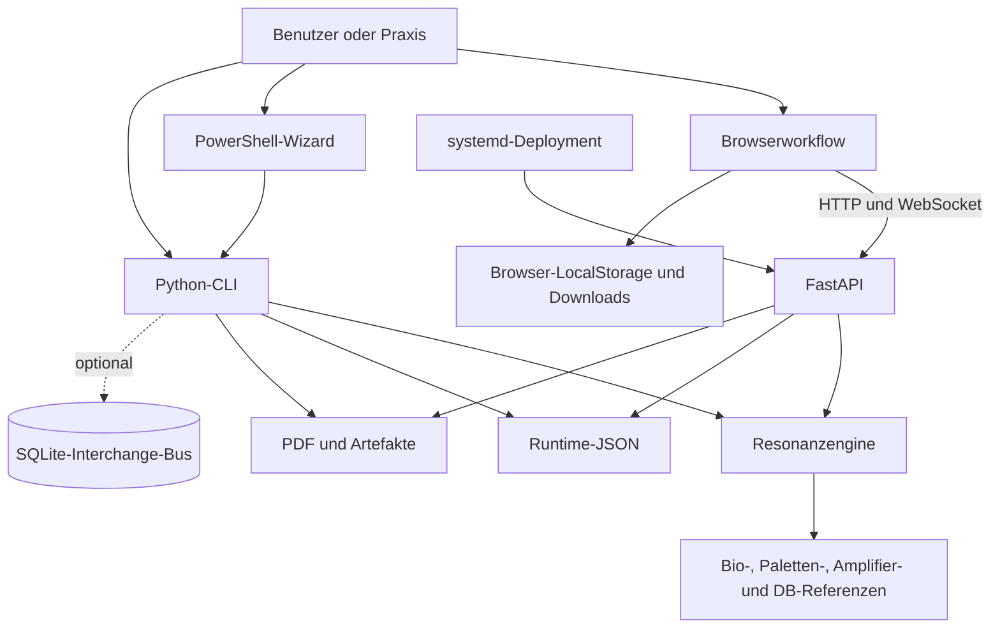

## 2. Komponenten - Ist

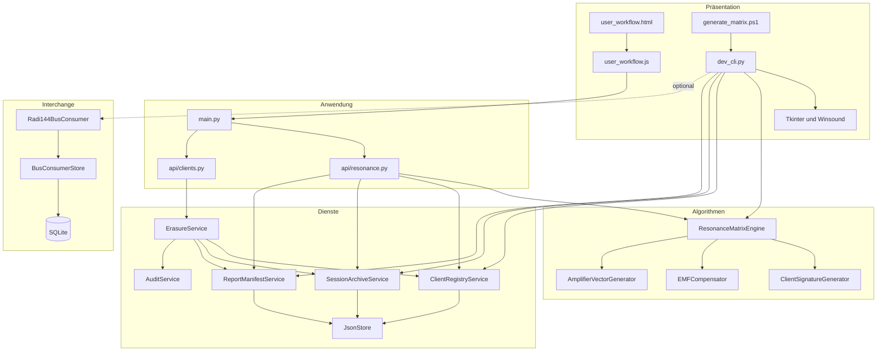

## 3. Einzelanalyse - Ist

```mermaid
sequenceDiagram
    actor U as Benutzer
    participant UI as UI oder CLI
    participant API as Analyse-API
    participant S as Signaturgenerator
    participant E as Engine
    participant J as JSON-Services

    U->>UI: Klient, Fokus, Modus und Optionen
    UI->>API: POST analyze-matrix
    API->>API: Eingabemodus auswählen
    API->>S: Signatur oder Vorabsignatur
    S-->>API: Frequenz und Komponenten
    API->>E: calculate_resonance
    E->>E: MD5-seedete Vektoren
    E->>E: Zufallsmatrizen erzeugen
    E->>E: Zufallsprojektion und Cosinusähnlichkeit
    E->>E: Top-10 auswählen
    E->>E: optional Symmetrie und Farbe
    E-->>API: Resultat
    API->>J: Client laden oder anlegen
    API->>J: Session anhängen
    J-->>API: IDs
    API-->>UI: JSON und X-Client-/X-Session-ID
    UI-->>U: Matrix, Score, Details und Export
```

## 4. Mehrfachfokus im Browser - Ist

```mermaid
sequenceDiagram
    actor U as Benutzer
    participant B as Browser
    participant A as API
    participant D as Sessionarchiv

    U->>B: Fokus 1; Fokus 2; Fokus 3
    loop je Fokus
        B->>A: einzelne analyze-matrix-Anfrage
        A->>D: eigene Session speichern
        A-->>B: einzelnes Resultat
    end
    Note over B,D: Kein gemeinsamer Batch, kein Rollback, kein Resume
```

## 5. Algorithmischer Datenfluss - Ist

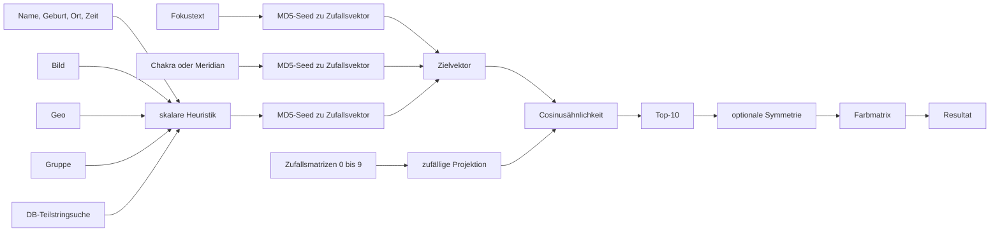

## 6. EMF-Profil - Ist

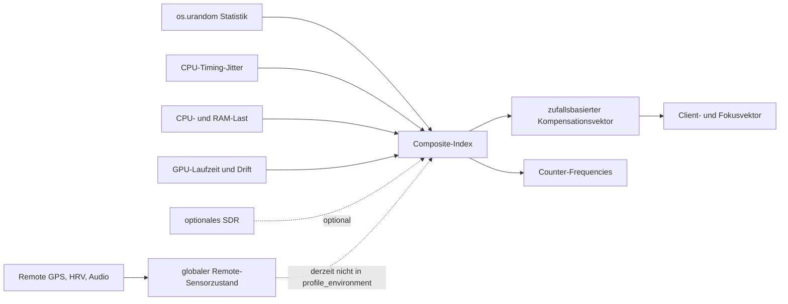

## 7. Datenlebenszyklus - Ist

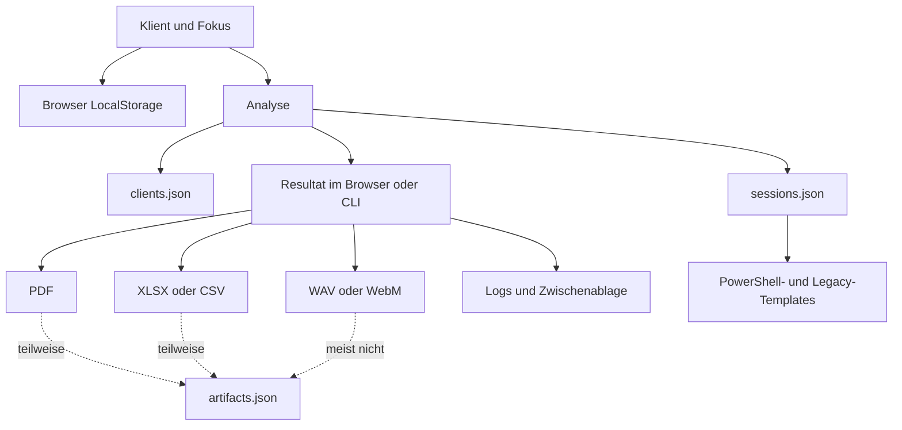

## 8. Löschung und verbleibende Kopien - Ist

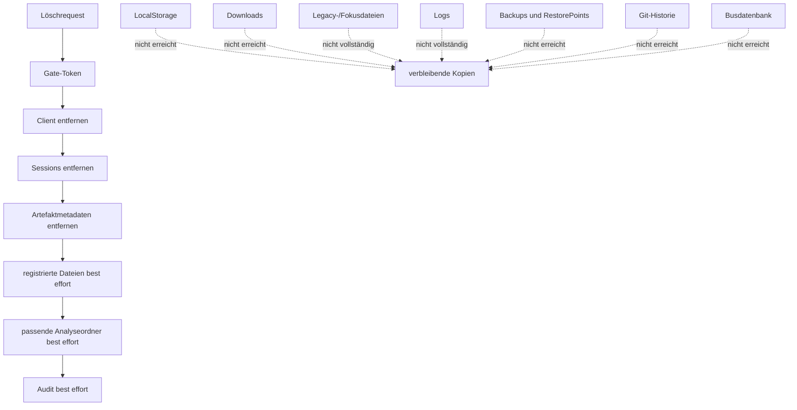

## 9. Lost Update - Ist-Risiko

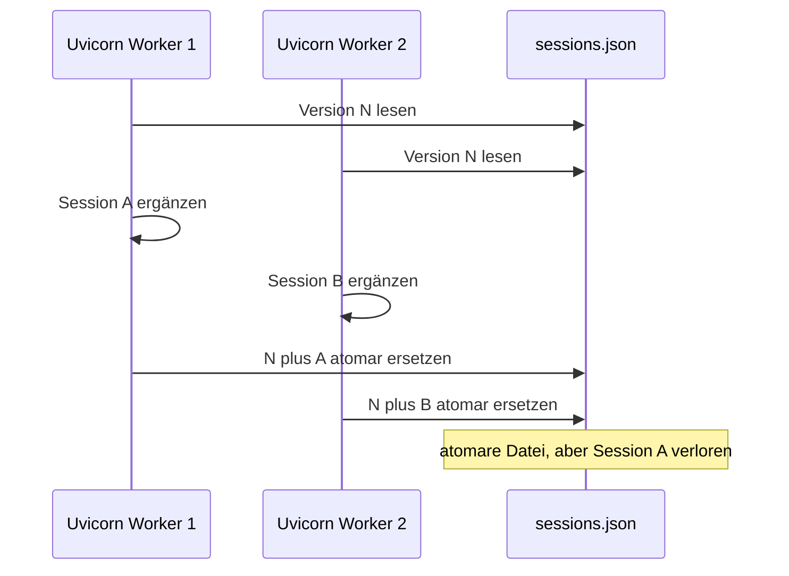

## 10. Trust Boundaries - Ist

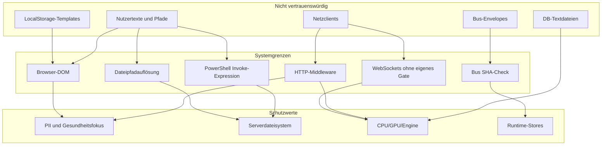

## 11. Deployment - Ist

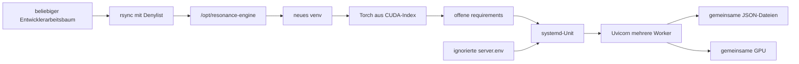

## 12. Risikokopplung - Ist

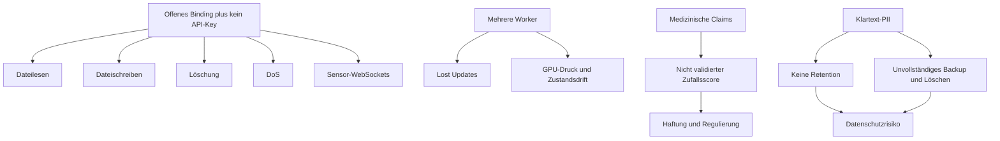

## 13. Zielarchitektur - Empfehlung

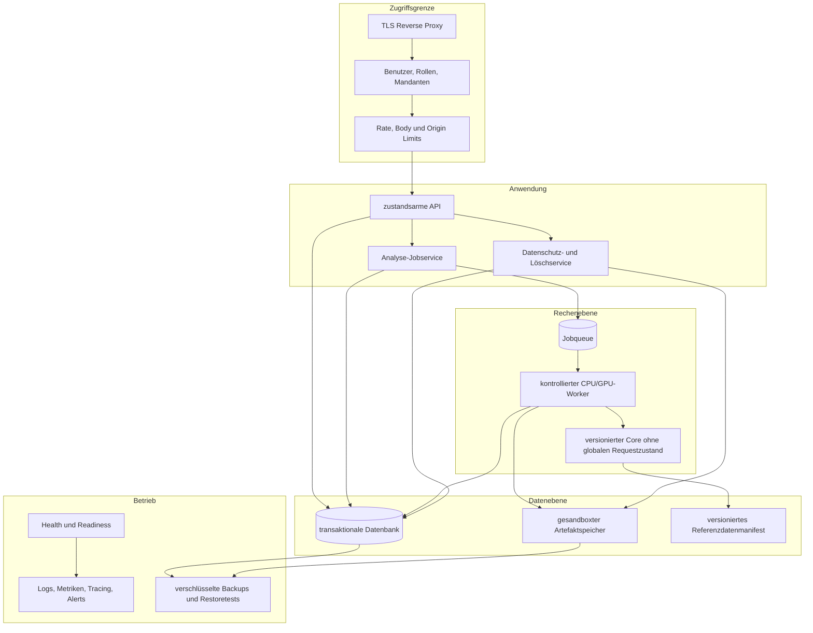

## 14. Ziel-Releasefluss - Empfehlung

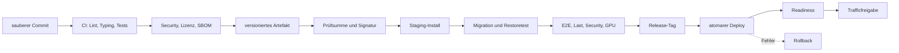
